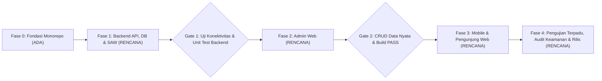

# Rencana Proyek (`Project Plan`)

**Status:** `[RENCANA]` (rencana eksekusi proyek) | `[ADA]` (fondasi monorepo, kerangka aplikasi, dan skema awal backend)

Dokumen ini menjadi panduan eksekusi resmi pengembangan **Sistem Informasi E-Commerce E-Book dan SPK (Metode SAW)** dengan merujuk pada sumber kebenaran utama [`docs-proyek-ebook-ecommerce.md`](../docs-proyek-ebook-ecommerce.md) serta aturan terkunci di [`AGENTS.md`](../../AGENTS.md).

---

## 1. Identitas Proyek & Pembagian Peran Tim (3 Orang)

### 1.1 Identitas Proyek

| Atribut | Keterangan | Status |
|---|---|---|
| **Nama Proyek** | Sistem Informasi E-Commerce E-Book dan SPK Berbasis Mobile (Metode SAW) | `[RENCANA]` |
| **Nama Aplikasi** | E-Book Store *(nama final masih menunggu keputusan #8)* | `[RENCANA]` |
| **Konteks Akademik** | Proyek Sains Data — Sistem Informasi / SPK (Universitas Putra Bangsa, kelas 2DSRA) | `[RENCANA]` |
| **Model Bisnis** | Single-Seller B2C (lihat [ADR-0001](../adr/0001-single-seller-b2c.md)) | `[ADA]` (keputusan) / `[RENCANA]` (implementasi) |
| **Aktor Sistem** | Pelanggan (*Customer*) dan Admin | `[RENCANA]` |
| **Struktur Monorepo** | `backend/`, `web/admin-web/`, `web/pengunjung-web/`, `mobile/ebook_store/`, `docs/` | `[ADA]` |

### 1.2 Pembagian Peran Tim (3 Orang)

Pembagian tanggung jawab dirancang agar ketergantungan antar-lapisan mengikuti urutan **Backend -> Admin Web -> Mobile & Pengunjung Web** ([ADR-0003](../adr/0003-admin-web-sebelum-mobile.md)):

| Peran Tim | Fokus Utama | Direktori Kepemilikan | Tanggung Jawab Kunci |
|---|---|---|---|
| **Anggota 1 — Backend, Database & SPK SAW Lead** | API, Basis Data, Autentikasi, Payment Gateway, Algoritma SAW | `backend/` | Merancang & memigrasi skema Prisma 7 ke PostgreSQL Supabase; verifikasi token Supabase Auth & RBAC; integrasi Supabase Storage bucket privat (signed URL); integrasi payment gateway & webhook idempoten; implementasi fungsi murni SAW & unit/integration test. |
| **Anggota 2 — Web Frontend Lead (Admin & Pengunjung)** | Antarmuka Administrasi & Portal Web Pelanggan | `web/admin-web/`, `web/pengunjung-web/` | Migrasi `admin-web` ke TypeScript + gaya Neo-Brutalism (3 zona intensitas); membangun dashboard, manajemen katalog/kategori/pelanggan, pemantauan order/payment, dan kontrol SAW; membangun portal pelanggan `pengunjung-web`. |
| **Anggota 3 — Mobile Flutter, QA & Dokumentasi Lead** | Aplikasi Android Pelanggan, Pengujian & Sinkronisasi Dokumen | `mobile/ebook_store/`, `docs/` | Mengimplementasikan `ebook_store` dengan Flutter + Riverpod + Dio; autentikasi, katalog, rekomendasi SAW, checkout, riwayat pembelian, dan *in-app PDF reader*; menyusun skenario uji terpadu serta menjaga sinkronisasi status `[ADA]`/`[RENCANA]` di `docs/`. |

---

## 2. Ruang Lingkup & Batasan Sistem (Single-Seller B2C, 2 Aktor)

Rincian lengkap ruang lingkup tersedia pada [`system-scope.md`](../01-project-overview/system-scope.md).

### 2.1 Dalam Ruang Lingkup (*In-Scope*)
- **Backend REST API (`backend/`):** Node.js + Express + TypeScript + Zod + Prisma 7 (ESM). Menangani autentikasi (verifikasi token Supabase Auth), otorisasi role (`CUSTOMER`, `ADMIN`), manajemen katalog/kategori, pesanan & pembayaran nyata (payment gateway), pencatatan transaksi, penerbitan hak akses (`EbookAccess`) dan *signed URL* PDF privat, serta perhitungan SPK SAW.
- **Admin Web (`web/admin-web/`):** React + TypeScript + Vite dengan desain Neo-Brutalism untuk pengelolaan katalog e-book, unggah file PDF ke bucket privat melalui backend, kategori, data pelanggan, pemantauan pesanan/pembayaran/transaksi, laporan penjualan, dan manajemen bobot SAW.
- **Klien Pelanggan — Mobile (`mobile/ebook_store/`) & Web (`web/pengunjung-web/`):**
  - Mobile Android berbasis Flutter + Riverpod + Dio untuk penjelajahan katalog, rekomendasi SAW, pembelian, riwayat, dan *in-app PDF reader*.
  - Portal web pelanggan (`web/pengunjung-web/`) dipertahankan sesuai keputusan #1 di [`keputusan-terbuka.md`](./keputusan-terbuka.md).
- **Database & Object Storage:** PostgreSQL Supabase dan Supabase Storage bucket **privat** untuk file PDF e-book.

### 2.2 Di Luar Ruang Lingkup (*Out-of-Scope*)
- Fitur marketplace multi-penjual / multi-vendor, komisi penjual, atau manajemen toko pihak ketiga ([ADR-0001](../adr/0001-single-seller-b2c.md)).
- Penjualan buku fisik, manajemen stok gudang, atau integrasi kurir pengiriman fisik.
- Perhitungan atau modifikasi skor SAW di sisi klien (`mobile` maupun `web`) ([ADR-0002](../adr/0002-backend-only-saw.md)).
- Dukungan resmi platform iOS/Desktop untuk aplikasi mobile pada fase awal (target utama adalah Android).
- Unduhan file PDF mentah secara bebas ke penyimpanan perangkat di luar *in-app reader* (sesuai keputusan #4 di [`keputusan-terbuka.md`](./keputusan-terbuka.md)).

---

## 3. Tahapan Pengembangan (`Backend -> Admin Web -> Mobile`)

### Fase 0 — Fondasi Monorepo & Kerangka Awal (`[ADA]`)
Kondisi aktual yang telah diverifikasi pada repository (lihat [`test-results.md`](../09-testing/test-results.md)):
- **Backend:** Express 5, TypeScript ESM, validasi env Zod, middleware error/rate-limit/auth dasar, helper Supabase Storage, endpoint `/api/v1/health`, `prisma/schema.prisma` (model `User`, `Category`, `Ebook`, `Order`, `OrderItem`, `Payment`, `Transaction`, `EbookAccess`), serta 5 unit test Vitest lulus.
- **Web & Mobile:** Kerangka awal Vite + React di `web/admin-web/` dan `web/pengunjung-web/`, serta kerangka Flutter di `mobile/ebook_store/` sudah tersedia.

### Fase 1 — Backend API, Migrasi DB, Transaksi & SPK SAW (`[RENCANA]`)
1. **Migrasi & Seed Database:** Membuat migrasi awal Prisma (`prisma/migrations/`), menerapkan ke PostgreSQL Supabase, dan menyediakan skrip seed berlabel `"DATA SIMULASI"` untuk kategori, e-book uji, dan akun uji.
2. **Autentikasi & Otorisasi:** Middleware verifikasi JWT Supabase Auth di backend, sinkronisasi data pengguna ke tabel `users`, dan penjagaan endpoint berdasarkan `UserRole` (`CUSTOMER` / `ADMIN`).
3. **Katalog, Kategori & Storage Privat:** Endpoint publik katalog/detail/kategori dan endpoint admin untuk CRUD kategori, e-book, serta unggah PDF ke Supabase Storage bucket privat.
4. **Pesanan, Pembayaran & Akses E-Book:** Alur pembuatan order (`PENDING`), integrasi payment gateway (Midtrans/Xendit), endpoint webhook terverifikasi signature yang secara atomik memperbarui `Payment` (`VERIFIED`), `Order` (`PAID`), membuat `Transaction`, dan menerbitkan `EbookAccess`, serta endpoint *signed URL* sementara.
5. **Modul SPK SAW:** Implementasi fungsi murni SAW di backend (validasi bobot `Σ w_j = 1`, normalisasi Benefit/Cost, perhitungan preferensi `V_i`, tie-breaker alfabetis judul, snapshot hasil) beserta unit test yang cocok dengan perhitungan manual.
6. **Dashboard & Laporan Admin:** Endpoint agregasi ringkasan penjualan, status pesanan, dan laporan periode.
- **Gate Keluar Fase 1:** Seluruh endpoint lulus `typecheck`, unit & integration test (Vitest + Supertest), dan uji konektivitas ke Supabase berhasil sebelum Fase 2 dimulai.

### Fase 2 — Admin Web (`web/admin-web/`) (`[RENCANA]`)
1. **Migrasi ke TypeScript & Desain Neo-Brutalism:** Mengonversi template `.jsx` ke `.tsx` + `tsconfig.json` dan menerapkan sistem desain neo-brutalism (3 zona intensitas).
2. **Autentikasi Admin:** Halaman login Supabase Auth dengan pengecekan role `ADMIN` oleh backend.
3. **Manajemen Katalog & Kategori:** Form CRUD kategori & e-book, unggah sampul & PDF privat, serta pengarsipan (`isActive`).
4. **Operasional Transaksi & Pelanggan:** Daftar pelanggan, pemantauan pesanan, status pembayaran, riwayat transaksi, serta kontrol pencabutan akses (`isRevoked`).
5. **Dashboard, Laporan & Kontrol SAW:** Visualisasi ringkasan penjualan, laporan periodik, dan konfigurasi/audit bobot SAW.
- **Gate Keluar Fase 2:** Admin Web dapat menginput katalog nyata ke database dan seluruh alur admin teruji terhadap backend aktif (`npm run lint` dan `npm run build` PASS).

### Fase 3 — Klien Pelanggan: Mobile (`ebook_store`) & Pengunjung Web (`pengunjung-web`) (`[RENCANA]`)
1. **Mobile Flutter (`mobile/ebook_store/`):**
   - Menambahkan dan mengonfigurasi dependensi `flutter_riverpod`, `dio`, penyimpanan token aman, serta pembaca PDF *in-app*.
   - Mengimplementasikan alur registrasi/login, beranda & katalog, pencarian & filter kategori, halaman rekomendasi SPK SAW, keranjang & checkout payment gateway, riwayat pesanan/pembelian, dan *in-app PDF reader* via *signed URL*.
2. **Pengunjung Web (`web/pengunjung-web/`):**
   - Menyediakan antarmuka web pelanggan untuk katalog, detail e-book, rekomendasi SAW, alur pembelian, dan akses baca daring sesuai keputusan #1.
- **Gate Keluar Fase 3:** Seluruh skenario pelanggan di mobile dan web berjalan end-to-end dengan data nyata dari backend; `flutter analyze` dan `flutter test` PASS.

### Fase 4 — Pengujian Terpadu, Audit Keamanan & Deployment (`[RENCANA]`)
1. Eksekusi seluruh kasus uji pada [`test-cases.md`](../09-testing/test-cases.md) (fungsional, otorisasi 401/403, signed URL expiry, idempotensi webhook, dan verifikasi SAW).
2. Audit keamanan: verifikasi tidak ada `.env` atau secret di Git, `VITE_*`, maupun kode Dart; verifikasi bucket storage tetap privat.
3. Finalisasi dokumentasi laporan proyek dan kesiapan deployment.

---

## 4. Jadwal & Milestone Akademik (`[RENCANA]`)

Jadwal disusun dalam rentang **12 minggu efektif** (dapat disesuaikan dengan kalender akademik semester berjalan):

| Milestone | Target Waktu | Fase Terkait | Keluaran Terukur (*Deliverables*) | Kriteria Penerimaan |
|---|---|---|---|---|
| **M1 — Penyelarasan Keputusan & Migrasi DB** | Minggu 1–2 | Fase 1 | Penyelesaian keputusan terbuka (#5–#11), migrasi Prisma awal, seed `DATA SIMULASI`. | `prisma validate` & `prisma migrate` berhasil di Supabase; seluruh keputusan terkunci di `docs/`. |
| **M2 — Backend Inti (Auth, Katalog, Storage)** | Minggu 3–4 | Fase 1 | Endpoint auth/RBAC, kategori, e-book, dan upload/signed URL bucket privat. | Uji integrasi Supertest PASS; endpoint admin menolak role `CUSTOMER` (`403`). |
| **M3 — Backend Transaksi & SPK SAW** | Minggu 5–6 | Fase 1 | Checkout, webhook payment gateway, penerbitan `EbookAccess`, fungsi murni SAW + laporan admin. | Unit test SAW identik dengan perhitungan manual; webhook idempoten & atomik. |
| **M4 — Admin Web Fungsional** | Minggu 7–8 | Fase 2 | `web/admin-web` berbasis TypeScript + Neo-Brutalism terhubung penuh ke API backend. | Admin dapat membuat katalog/PDF nyata; `npm run lint` & `npm run build` PASS. |
| **M5 — Mobile `ebook_store` & `pengunjung-web`** | Minggu 9–10 | Fase 3 | Fitur lengkap pelanggan di Flutter (Riverpod + Dio + in-app PDF) & portal web pelanggan. | Alur registrasi -> beli -> bayar -> baca PDF berjalan dengan backend nyata. |
| **M6 — Pengujian Terpadu, Audit & Demo** | Minggu 11–12 | Fase 4 | Laporan hasil uji (`test-results.md`), audit keamanan, dan paket demo/presentasi. | Seluruh cek otomatis PASS; nol kebocoran kredensial; semua `[RENCANA]` terverifikasi. |

---

## 5. Risiko & Mitigasi

| ID | Risiko | Kategori | Dampak | Probabilitas | Rencana Mitigasi |
|---|---|---|---|---|---|
| **R-01** | **Kebocoran file PDF e-book** akibat bucket publik atau signed URL kedaluwarsa terlalu lama | Keamanan | Tinggi | Sedang | Pastikan bucket Supabase Storage disetel **privat**; terbitkan *signed URL* berdurasi pendek hanya setelah verifikasi `EbookAccess` aktif (`!isRevoked`) di backend; gunakan *in-app reader*. |
| **R-02** | **Inkonsistensi hasil SAW** antara perhitungan manual, backend, dan tampilan klien | Teknis / Akademik | Tinggi | Sedang | Kunci perhitungan SAW hanya di backend ([ADR-0002](../adr/0002-backend-only-saw.md)); selesaikan keputusan #9 (4 vs 5 kriteria); wajibkan unit test backend yang membandingkan output fungsi terhadap dataset manual. |
| **R-03** | **Kegagalan sinkronisasi webhook payment gateway** di lingkungan lokal/pengujian | Integrasi | Tinggi | Tinggi | Gunakan mode *sandbox* resmi payment gateway dengan verifikasi signature; sediakan dokumentasi tunneling lokal untuk uji webhook serta mekanisme *idempotency key* pada tabel `payments`/`transactions`. |
| **R-04** | **Ketidaksesuaian stack template** (`admin-web` masih `.jsx`, `ebook_store` belum ada Riverpod/Dio) | Teknis | Sedang | Tinggi | Jadwalkan migrasi TypeScript pada awal Fase 2 dan penambahan paket Flutter pada awal Fase 3 sebelum fitur bisnis dibangun. |
| **R-05** | **Hambatan lingkungan Windows** (mis. symlink Flutter gagal atau command `EPERM` Node.js) | Lingkungan | Rendah | Sedang | Pastikan Windows Developer Mode aktif sebelum menjalankan `flutter analyze`/`build`; dokumentasikan langkah pemulihan di [`troubleshooting.md`](../10-maintenance/troubleshooting.md). |
| **R-06** | **Keterlambatan penentuan keputusan terbuka (#5–#11)** menghambat desain skema lanjutan | Manajemen | Sedang | Sedang | Tetapkan batas waktu penguncian seluruh keputusan terbuka pada **M1 (Minggu 2)** sebelum migrasi database final dijalankan. |

---

## 6. Kriteria Selesai (*Definition of Done*)

Sebuah fitur atau fase baru dinyatakan selesai apabila memenuhi seluruh syarat berikut (selaras [`AGENTS.md`](../../AGENTS.md)):
1. Kode terimplementasi nyata di repository (bukan endpoint palsu, data mock tanpa label `"DATA SIMULASI"`, atau tombol tanpa aksi).
2. Otorisasi dan validasi input berjalan di sisi backend.
3. Pengujian otomatis relevan telah dijalankan dan lulus (`typecheck`, `lint`, `test`, `build`, `flutter analyze`, `flutter test`).
4. Status fitur pada dokumen terkait diperbarui dari `[RENCANA]` menjadi `[ADA]` beserta bukti file dan hasil perintah verifikasi.
