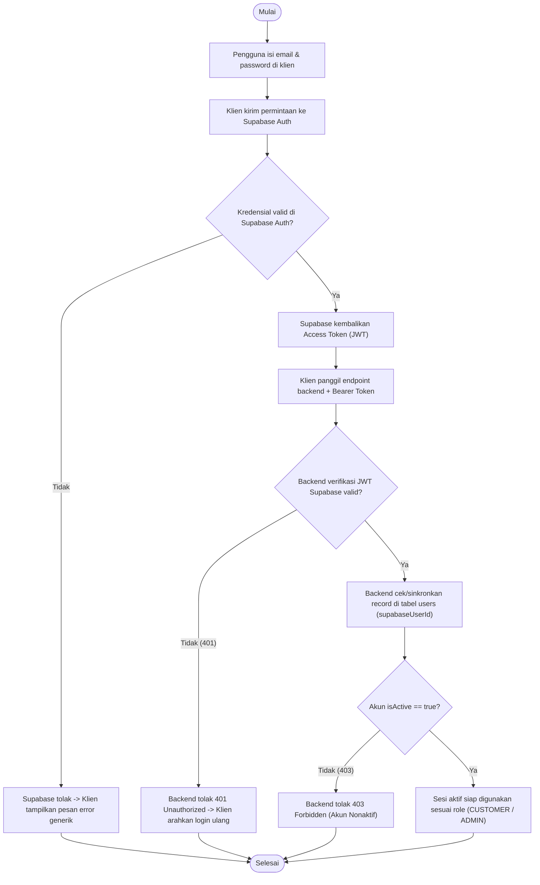
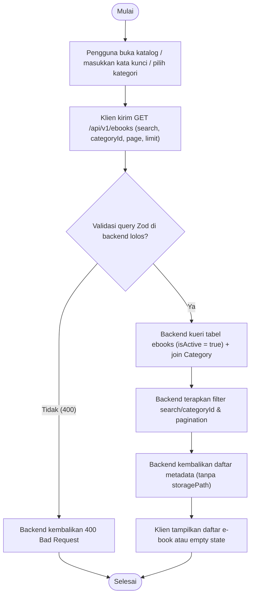
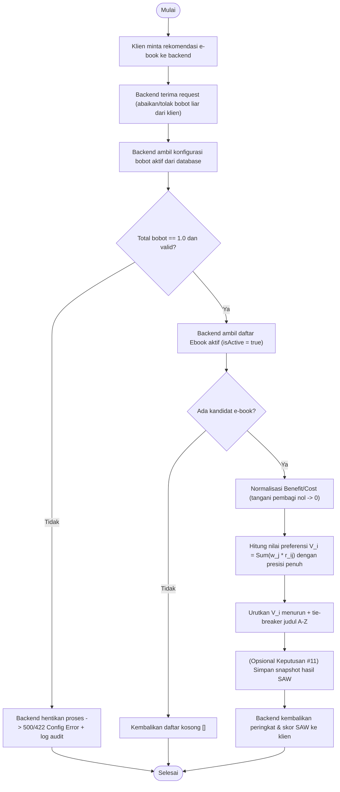
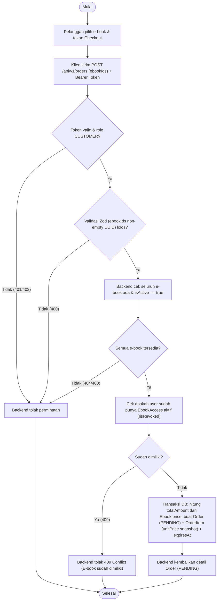
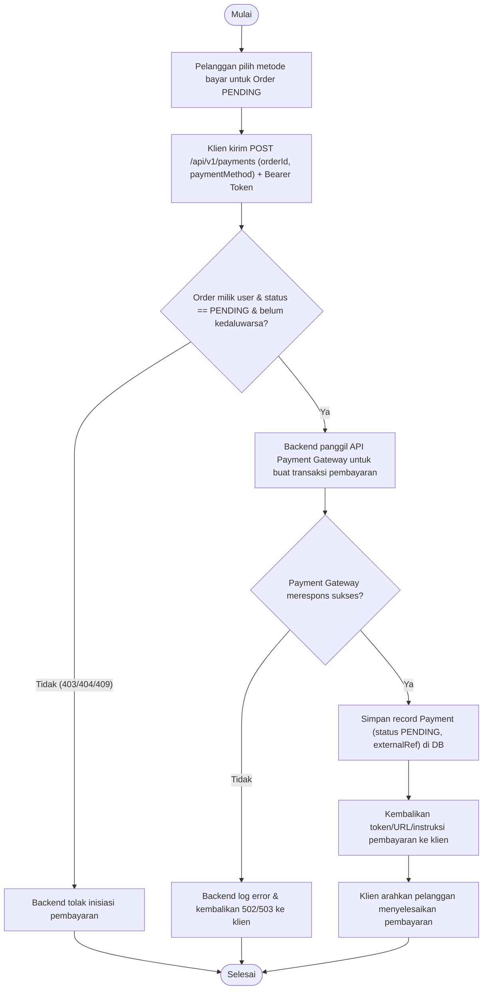
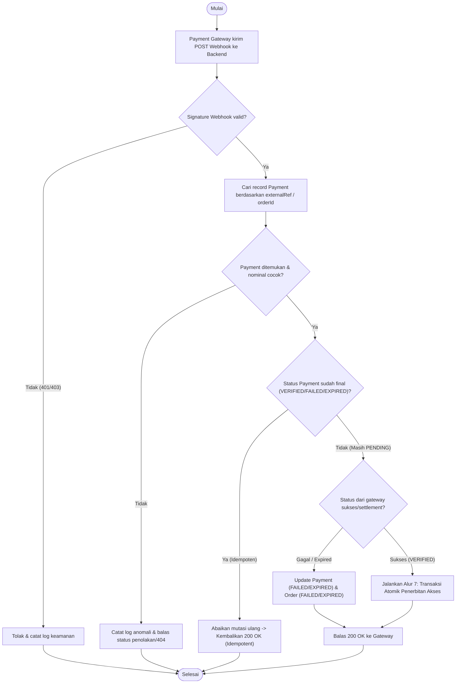
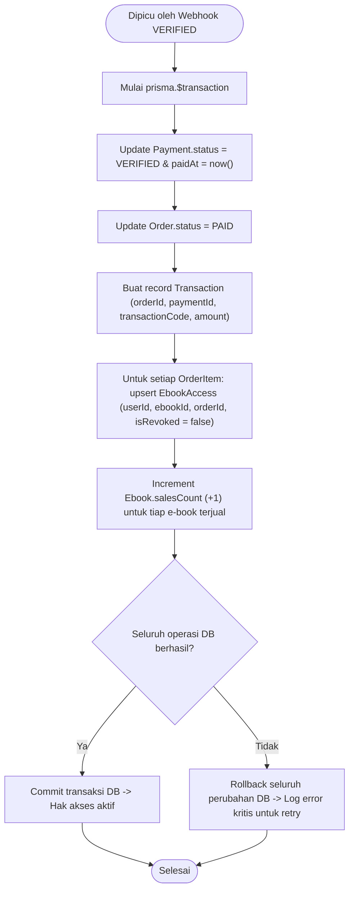
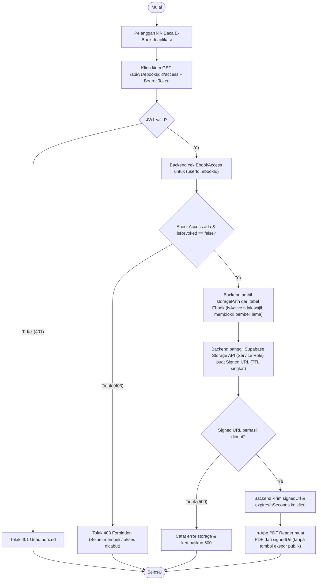
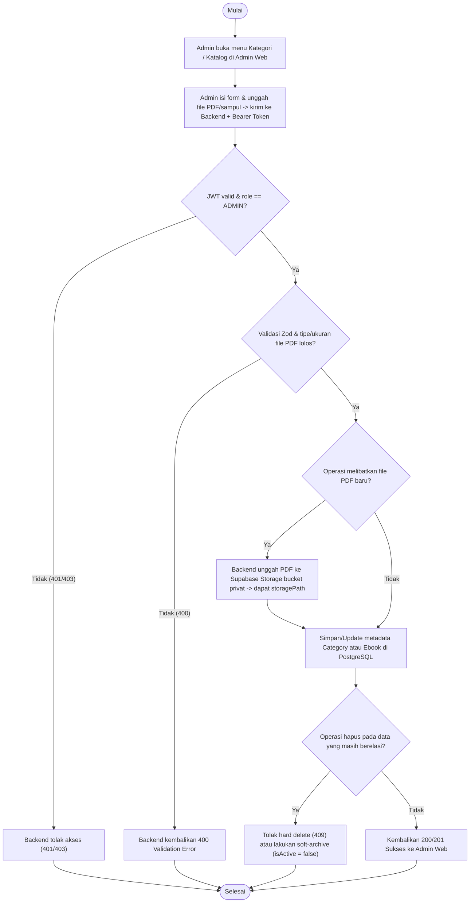
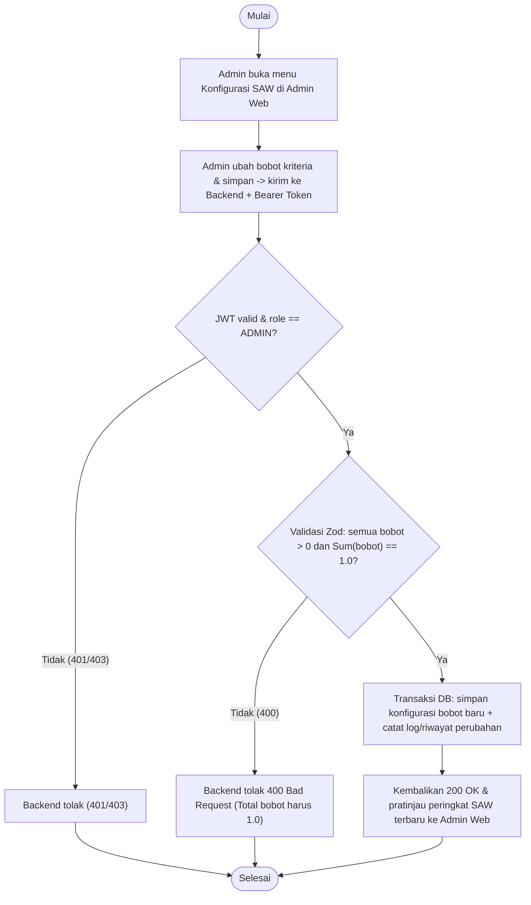

# Activity Diagram

**Status:** `[RENCANA]` — Seluruh alur proses bisnis di bawah ini merupakan rancangan implementasi. Komponen yang sudah `[ADA]` baru sebatas middleware kerangka (`validate`, `auth.middleware`, `error.middleware`) dan `/api/v1/health` di `backend/`.

Dokumen ini menyajikan **10 diagram aktivitas** dalam Mermaid beserta penjelasan titik validasi, autentikasi, otorisasi, transaksi database, dan penanganan kegagalan.

> **Keterangan Singkatan:** **JWT** = *JSON Web Token*; **RBAC** = *Role-Based Access Control*; **SAW** = *Simple Additive Weighting*; **URL** = *Uniform Resource Locator*; **PDF** = *Portable Document Format*; **TTL** = *Time-to-Live*.

---

## 1. Registrasi dan Login (Supabase Auth + Sinkronisasi Backend) `[RENCANA]`

**Deskripsi:** Alur pendaftaran/masuk melalui Supabase Auth pada klien (`mobile/ebook_store`, `pengunjung-web`, atau `admin-web`), dilanjutkan verifikasi token JWT oleh backend Express dan sinkronisasi record `User`.

- **Titik Validasi & Auth:** Klien tidak langsung mengakses tabel `users`. JWT diverifikasi di middleware backend sebelum controller dijalankan.
- **Penanganan Kegagalan:** Error autentikasi tidak membocorkan keberadaan email (`401` generik); akun nonaktif (`isActive = false`) ditolak dengan `403`.

---

## 2. Jelajah Katalog, Pencarian, dan Filter Kategori `[RENCANA]`

**Deskripsi:** Alur penjelajahan katalog publik e-book aktif dengan validasi parameter kueri oleh Zod.

- **Titik Validasi & Keamanan:** Parameter paginasi/filter divalidasi dengan Zod. Kolom `storagePath` tidak pernah disertakan pada respons katalog publik.

---

## 3. Rekomendasi E-Book Berbasis SAW (Backend-Only) `[RENCANA]`

**Deskripsi:** Perhitungan rekomendasi e-book menggunakan metode SAW yang dijalankan sepenuhnya di backend ([ADR-0002](../adr/0002-backend-only-saw.md)).

- **Titik Validasi:** Klien dilarang mengirim bobot arbitrer. Pembagi nol (`max = 0` atau `x_ij = 0`) ditangani aman tanpa `NaN`/`Infinity`.

---

## 4. Checkout Pesanan `[RENCANA]`

**Deskripsi:** Pembuatan `Order` dan `OrderItem` dari daftar ID e-book dengan penguncian harga dari database (*snapshot*).

- **Transaksi DB & Integritas:** `totalAmount` dan `unitPrice` selalu diambil dari database, bukan dari payload klien.

---

## 5. Pembayaran Melalui Payment Gateway `[RENCANA]`

**Deskripsi:** Inisiasi pembayaran atas `Order` yang masih berstatus `PENDING` melalui integrasi payment gateway nyata (Keputusan #3 `[ADA]`).

---

## 6. Webhook Pembayaran yang Idempoten `[RENCANA]`

**Deskripsi:** Penerimaan notifikasi status pembayaran dari Payment Gateway secara aman dan idempoten.

- **Keamanan & Idempotensi:** Verifikasi *signature* wajib dilakukan sebelum membaca/mengubah data. Pengiriman ulang webhook untuk `Payment` yang sudah `VERIFIED` tidak menggandakan `Transaction` maupun `EbookAccess`.

---

## 7. Penerbitan Akses E-Book (Transaksi Atomik Database) `[RENCANA]`

**Deskripsi:** Proses atomik (`prisma.$transaction`) yang dipicu saat pembayaran terverifikasi `VERIFIED`.

- **Integritas Data:** Jika salah satu langkah gagal (mis. pembuatan `EbookAccess`), seluruh transaksi di-rollback sehingga tidak pernah terjadi kondisi pembayaran lunas tanpa hak akses.

---

## 8. Permintaan Signed URL dan Pembacaan PDF Dalam Aplikasi `[RENCANA]`

**Deskripsi:** Alur akses konten PDF dari Supabase Storage bucket **privat** melalui *signed URL* sementara untuk dibaca di *in-app PDF reader* (Keputusan #4 `[ADA]`).

---

## 9. Admin Mengelola Kategori dan E-Book `[RENCANA]`

**Deskripsi:** Alur pengelolaan master data katalog dan unggah file PDF ke bucket privat oleh Admin melalui `web/admin-web`.

---

## 10. Admin Mengubah Konfigurasi Bobot SAW `[RENCANA]`

**Deskripsi:** Alur pembaruan bobot kriteria SAW oleh Admin dengan validasi ketat sebelum digunakan pada perhitungan rekomendasi.

