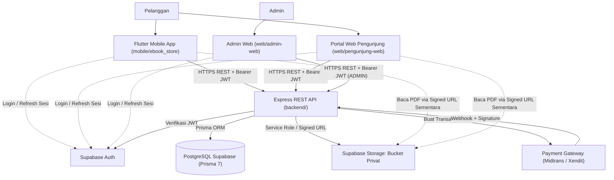

# Arsitektur Sistem (`Architecture`)

**Status:** `[ADA]` (fondasi monorepo, kerangka `backend/`, `schema.prisma`, 4 keputusan terkonfirmasi, dan 3 ADR) | `[RENCANA]` (implementasi fitur bisnis, integrasi penuh Supabase Auth/Storage privat, Payment Gateway, `SPK SAW`, serta UI bisnis web dan mobile)

---

## 1. Tujuan Arsitektur

Dokumen ini menetapkan arsitektur tingkat tinggi **Sistem Informasi E-Commerce E-Book dan SPK Metode SAW** sebagai acuan tunggal bagi tim pengembang `backend`, `web/admin-web`, `web/pengunjung-web`, dan `mobile/ebook_store` agar seluruh komponen memiliki batas tanggung jawab yang tegas, aman, dan konsisten dengan [`docs-proyek-ebook-ecommerce.md`](../docs-proyek-ebook-ecommerce.md).

---

## 2. Prinsip Arsitektur & Batasan Teknis

1. **Single-Seller B2C ([ADR-0001](../adr/0001-single-seller-b2c.md)):** Sistem hanya melayani satu penjual resmi (**Admin**) dan **Pelanggan**; tidak ada fitur *marketplace* multi-vendor.
2. **Backend sebagai *Single Source of Truth*:** Seluruh validasi input (**Zod**), autentikasi token, otorisasi `RBAC`, perhitungan harga transaksi, dan penerbitan hak akses wajib dijalankan di `backend/`.
3. **SPK SAW Hanya di Backend ([ADR-0002](../adr/0002-backend-only-saw.md)):** Klien dilarang menghitung skor akhir SAW atau mengirim bobot mentah yang dipercaya langsung oleh server.
4. **Proteksi Aset PDF Privat (Keputusan #4 `[ADA]`):** File PDF e-book disimpan pada **Supabase Storage `bucket privat`** dan hanya dapat dibaca di dalam aplikasi (*in-app PDF reader*) via `signed URL` sementara dari `backend`.
5. **Otorisasi di Backend:** Penyembunyian menu pada `web/admin-web`, `web/pengunjung-web`, atau `mobile/ebook_store` hanya bersifat kosmetik; setiap endpoint wajib memeriksa token dan `role`.
6. **Urutan Pengembangan Terkunci ([ADR-0003](../adr/0003-admin-web-sebelum-mobile.md)):** `Backend -> Admin Web -> Mobile`, dengan uji konektivitas terlebih dahulu sebelum membangun UI penuh.

---

## 3. Diagram Arsitektur Sistem (`[ADA]` Kerangka / `[RENCANA]` Integrasi Bisnis)

---

## 4. Penjelasan Setiap Komponen

| Komponen | Stack Terkunci (`AGENTS.md`) | Status Aktual | Tanggung Jawab Utama |
|---|---|---|---|
| **`mobile/ebook_store`** | Flutter + Dart + Riverpod + Dio (Android) | `[ADA]` template; paket & fitur `[RENCANA]` | Autentikasi pelanggan via Supabase Auth, katalog, rekomendasi SAW, checkout, riwayat pembelian, dan *in-app PDF reader*. |
| **`web/pengunjung-web`** | React + Vite | `[ADA]` template & keputusan #1; fitur `[RENCANA]` | Portal web pelanggan untuk menjelajah katalog, melihat rekomendasi SAW, membeli e-book, dan membaca PDF di dalam aplikasi. |
| **`web/admin-web`** | React + TypeScript + Vite (Neo-Brutalism) | `[ADA]` template; migrasi TS & fitur `[RENCANA]` | Antarmuka operasional Admin untuk CRUD kategori/e-book, unggah PDF via backend, pantau pelanggan/pesanan/pembayaran/transaksi, laporan, dan bobot SAW. |
| **`backend/`** | Node.js + Express + TypeScript + Zod + Prisma 7 (ESM) | `[ADA]` fondasi (`/health`, env, validate, `schema.prisma`); bisnis `[RENCANA]` | Pusat otorisasi JWT & `RBAC`, validasi Zod, orkestrasi transaksi DB atomik, verifikasi webhook payment gateway, kalkulasi SAW, dan penerbitan `signed URL`. |
| **Supabase Auth** | Layanan Autentikasi Terkelola | `[ADA]` keputusan #2; integrasi `[RENCANA]` | Mengelola registrasi, login, dan penerbitan `JWT`; diverifikasi oleh `backend/` sebelum akses resource. |
| **PostgreSQL Supabase** | PostgreSQL + Prisma 7 (`prisma.config.ts`) | `[ADA]` `schema.prisma` (8 model); migrasi `[RENCANA]` | Penyimpanan persisten data relasional (`users`, `categories`, `ebooks`, `orders`, `order_items`, `payments`, `transactions`, `ebook_accesses`). |
| **Supabase Storage (`bucket privat`)** | Object Storage Privat | `[ADA]` helper dasar & keputusan #4; integrasi `[RENCANA]` | Menyimpan file PDF e-book secara privat tanpa akses publik bebas. |
| **Payment Gateway** | Midtrans / Xendit | `[ADA]` keputusan #3; integrasi `[RENCANA]` | Memproses pembayaran daring nyata dan mengirim notifikasi status ke *webhook* `backend/`. |

---

## 5. Aliran Utama Sistem (`[RENCANA]`)

1. **Aliran Autentikasi dan Otorisasi:** Klien melakukan login ke **Supabase Auth** dan memperoleh `JWT`. Setiap permintaan ke `backend/` menyertakan `Authorization: Bearer <JWT>`. Middleware `backend/` memverifikasi `JWT`, menyinkronkan `User` (`supabaseUserId`), memeriksa `isActive`, serta menegakkan `UserRole` (`CUSTOMER` atau `ADMIN`).
2. **Aliran Katalog dan Manajemen E-Book:** Permintaan katalog publik (`GET /ebooks`, `GET /categories`) hanya mengembalikan `Ebook` aktif (`isActive = true`) tanpa kolom `storagePath`. Pengelolaan CRUD oleh **Admin** wajib melewati otorisasi `ADMIN`, validasi Zod, dan unggah file PDF ke `bucket privat` melalui `backend/`.
3. **Aliran Checkout, Pembayaran, Webhook, Transaksi Atomik, & Idempotensi:** Saat *checkout*, `backend/` mengambil harga langsung dari `Ebook.price` (*snapshot* pada `OrderItem`) dan membuat `Order` (`PENDING`). Inisiasi pembayaran diteruskan ke **Payment Gateway**. Ketika *webhook* masuk, `backend/` memverifikasi *signature*, memeriksa *idempotensi* (mengabaikan mutasi ulang jika `Payment` sudah final), lalu menjalankan `prisma.$transaction` untuk memperbarui `Payment -> VERIFIED`, `Order -> PAID`, mencatat `Transaction`, dan mengaktifkan `EbookAccess`.
4. **Aliran Akses PDF Melalui `Signed URL`:** Klien (*in-app PDF reader*) meminta akses ke `backend/`. `backend/` memvalidasi `JWT`, memastikan terdapat `EbookAccess` aktif (`isRevoked = false`) untuk `(userId, ebookId)`, lalu menggunakan *service role* di server untuk meminta `signed URL` berumur pendek dari **Supabase Storage `bucket privat`**.
5. **Aliran Rekomendasi `SPK SAW`:** Klien meminta daftar rekomendasi ke `backend/`. `backend/` memuat bobot kriteria aktif (validasi `Σ bobot = 1.0`) dan kandidat `Ebook` aktif, menjalankan normalisasi *Benefit*/*Cost* (aman pembagi nol), menghitung nilai preferensi $V_i = \sum w_j \cdot r_{ij}$, menerapkan *tie-breaker* judul A–Z, dan mengembalikan peringkat ke klien.

---

## 6. Batas Tanggung Jawab Tiap Lapisan

| Lapisan | Boleh Dilakukan | Dilarang Keras |
|---|---|---|
| **Frontend (`mobile`, `pengunjung-web`, `admin-web`)** | Menampilkan UI, validasi UX ringan, memanggil REST API `backend/`, login ke Supabase Auth, dan me-render PDF dari `signed URL` di *in-app reader*. | Menyimpan *service role key* / secret di `VITE_*` atau Dart; mengakses PostgreSQL langsung; menghitung skor SAW; atau menyediakan unduhan bebas PDF. |
| **Backend (`backend/`)** | Memverifikasi `JWT` & `RBAC`, memvalidasi seluruh input via Zod, menghitung harga & SAW, memproses *webhook* gateway, dan menerbitkan `signed URL`. | Mengembalikan `storagePath` privat ke publik, memercayai harga/bobot dari klien, atau membocorkan *stack trace* error. |
| **Database & Storage (PostgreSQL & Supabase Storage)** | Menyimpan data relasional terstruktur dan objek PDF pada `bucket privat`. | Membuka akses baca/tulis langsung dari klien melewati kontrol `backend/` atau membuka bucket PDF menjadi publik. |
| **Layanan Eksternal (Supabase Auth & Payment Gateway)** | Menerbitkan `JWT` sesi dan memproses transaksi pembayaran serta mengirim *webhook* bertanda tangan. | Menentukan otorisasi bisnis internal tanpa verifikasi ulang di `backend/`. |

---

## 7. Keputusan Arsitektur (`[ADA]` vs `[RENCANA]`)

- **Sudah `[ADA]` (Terkunci):**
  - Model *Single-Seller B2C* ([ADR-0001](../adr/0001-single-seller-b2c.md)).
  - Perhitungan SAW hanya di `backend/` ([ADR-0002](../adr/0002-backend-only-saw.md)).
  - Urutan pengembangan `Backend -> Admin Web -> Mobile` ([ADR-0003](../adr/0003-admin-web-sebelum-mobile.md)).
  - Keputusan #1–#4 di [`keputusan-terbuka.md`](../00-project/keputusan-terbuka.md) (`pengunjung-web` dipertahankan, Supabase Auth, Payment Gateway nyata, *in-app PDF reader* via `signed URL` dari `bucket privat`).
- **Masih `[RENCANA]` (Menunggu Konfirmasi di [`keputusan-terbuka.md`](../00-project/keputusan-terbuka.md)):**
  - Keputusan #5 (hak ubah bobot SAW oleh pelanggan), #6–#7 (ulasan/rating & e-book tanpa rating), #8 (nama/logo final), #9 (konflik 4 vs 5 kriteria SAW), #10 (platform hosting `backend/`), dan #11 (penyimpanan snapshot riwayat rekomendasi SAW).

---

## 8. Risiko Arsitektur & Mitigasi

| Risiko | Dampak | Mitigasi |
|---|---|---|
| **Kebocoran file PDF** jika bucket disetel publik atau `signed URL` berumur terlalu lama | Tinggi | Kunci konfigurasi `bucket privat`, validasi `EbookAccess` (`!isRevoked`) di `backend/`, dan terbitkan `signed URL` dengan TTL singkat. |
| **Duplikasi transaksi / gagal aktif akses** akibat *webhook* berulang atau error tengah proses | Tinggi | Verifikasi *signature webhook*, cek status final sebelum mutasi (idempoten), dan bungkus mutasi dalam `prisma.$transaction`. |
| **Inkonsistensi skor SAW** antara klien dan perhitungan manual | Tinggi | Jalankan SAW hanya di `backend/` sebagai fungsi murni dan wajibkan unit test Vitest terhadap perhitungan manual. |
| **Pemilihan hosting serverless (#10)** mengganggu *connection pool* Prisma & timeout *webhook* | Sedang | Kunci keputusan #10 pada M1/M5; bila serverless dipilih, gunakan *connection pooler* Supabase yang sesuai. |
