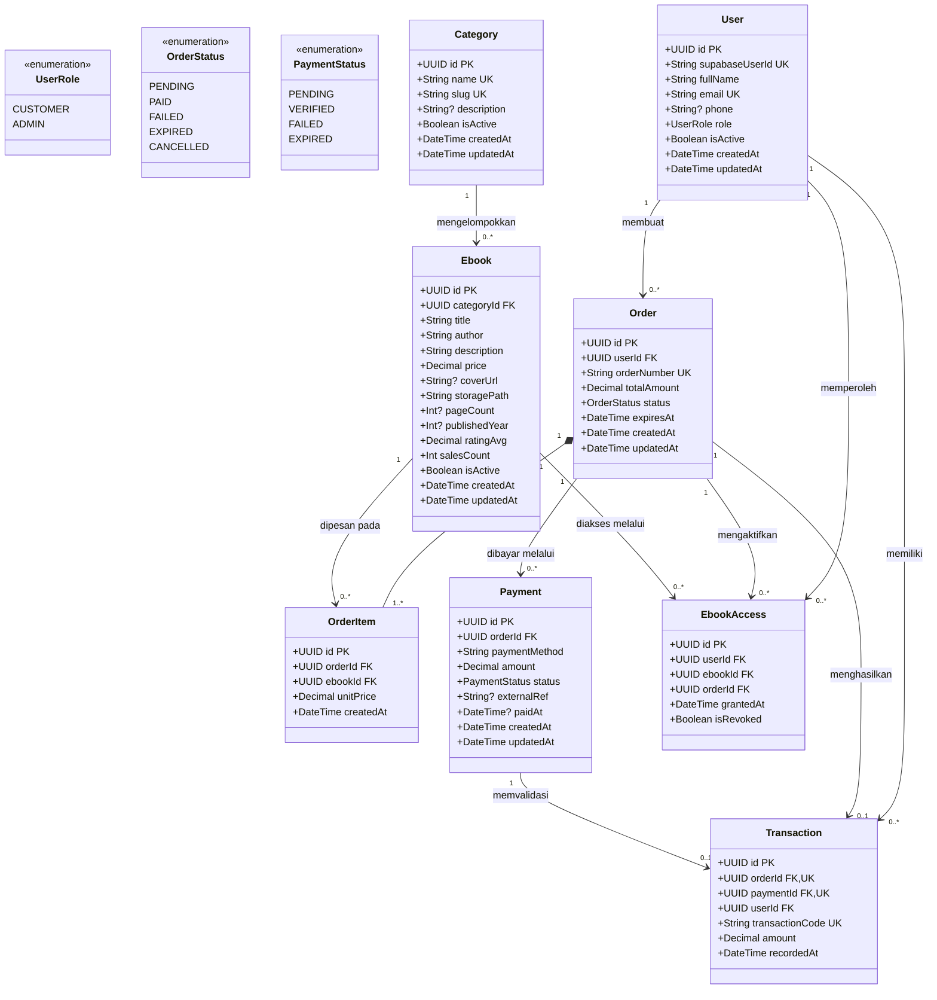
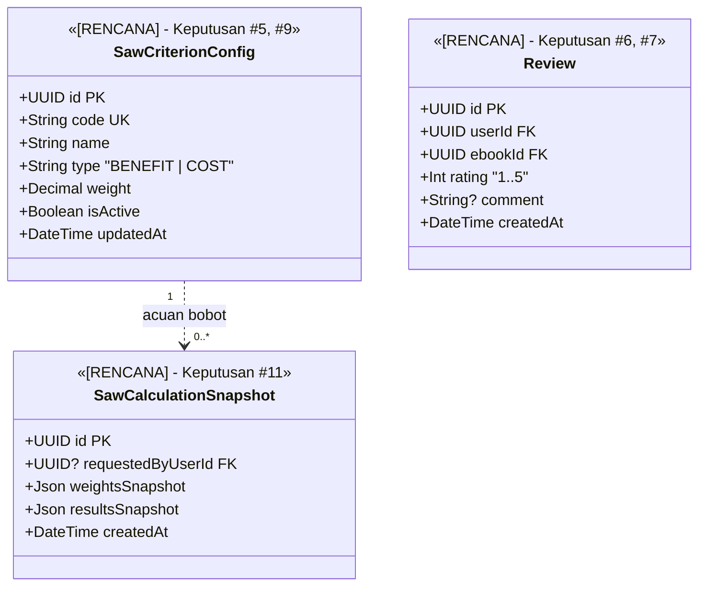

# Class Diagram & Model Data

**Status:** `[ADA]` (definisi 8 model inti & 3 enum pada [`backend/prisma/schema.prisma`](../../backend/prisma/schema.prisma), tervalidasi `prisma validate`) | `[RENCANA]` (migrasi SQL ke database, model konfigurasi/snapshot SAW, dan model `Review`).

Dokumen ini memodelkan struktur kelas entitas domain beserta relasi, kardinalitas, tipe data, enum status, dan aturan integritas data.

> **Keterangan Singkatan:** **PK** = *Primary Key*; **FK** = *Foreign Key*; **UK** = *Unique Key*; **UUID** = *Universally Unique Identifier*; **SAW** = *Simple Additive Weighting*; **ERD** = *Entity Relationship Diagram*.

---

## 1. Diagram Kelas Entitas Inti (`[ADA]` di `schema.prisma` / Migrasi `[RENCANA]`)

**Deskripsi:** Merepresentasikan 8 model domain dan 3 enum yang telah didefinisikan pada `backend/prisma/schema.prisma`.

---

## 2. Entitas Lanjutan yang Masih `[RENCANA]` (Belum Ada di `schema.prisma`)

Entitas berikut **belum** didefinisikan di `backend/prisma/schema.prisma` dan **tidak boleh** diklaim sebagai implementasi aktif sebelum keputusan terbuka terkait ditetapkan:

---

## 3. Ringkasan Relasi, Kardinalitas, & Aturan Integritas Data

| Relasi / Entitas | Kardinalitas & Constraint | Aturan Integritas (`schema.prisma` `[ADA]`) |
|---|---|---|
| **User (`users`)** | `supabaseUserId` (`UNIQUE`), `email` (`UNIQUE`) | Autentikasi dikelola Supabase Auth (Keputusan #2 `[ADA]`); tidak menyimpan `password_hash` di database aplikasi. |
| **Category -> Ebook** | `1` ke `0..*` (`onDelete: Restrict`) | Kategori yang masih memiliki e-book tidak dapat dihapus permanen. |
| **Order -> OrderItem** | `1` ke `1..*` (`onDelete: Cascade`), `@@unique([orderId, ebookId])` | Satu e-book hanya muncul sekali per pesanan; `unitPrice` (`Decimal(12,2)`) menyimpan *snapshot* harga saat checkout. |
| **Ebook -> OrderItem** | `1` ke `0..*` (`onDelete: Restrict`) | Ebook yang pernah dipesan tidak boleh di-hard-delete; gunakan arsip (`isActive = false`). |
| **Order -> Payment** | `1` ke `0..*` (`onDelete: Cascade`) | Satu pesanan dapat memiliki beberapa percobaan pembayaran jika percobaan awal gagal/kedaluwarsa. |
| **Order / Payment -> Transaction** | `1` ke `0..1` (`orderId @unique`, `paymentId @unique`, `onDelete: Restrict`) | Menjamin satu pesanan lunas hanya menghasilkan tepat satu `Transaction` resmi (anti-duplikasi webhook). |
| **User & Ebook -> EbookAccess** | `@@unique([userId, ebookId])` (`onDelete: Restrict`) | Satu pelanggan hanya memiliki satu catatan izin aktif per judul; pencabutan akses memakai `isRevoked = true`. |
| **Presisi Moneter & SAW** | `price`, `totalAmount`, `unitPrice`, `amount` -> `Decimal(12,2)`; `ratingAvg` -> `Decimal(3,2)` | Menghindari galat pembulatan *floating-point* pada transaksi keuangan. |

> **Catatan Sinkronisasi Dokumen:** Dokumen lama pada `docs/04-database/` (`data-dictionary.md`, `erd.md`) masih menyebut tabel `customers`, `admins`, dan `order_details`. Desain pada dokumen ini mengikuti [`backend/prisma/schema.prisma`](../../backend/prisma/schema.prisma) (`users` dan `order_items`) sebagai acuan terkini.
