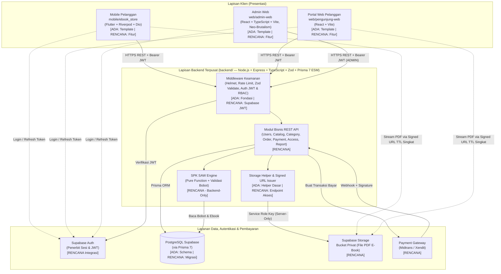

# Component Diagram

**Status:** `[ADA]` (struktur folder monorepo, template klien, fondasi server Express + Prisma client) | `[RENCANA]` (modul bisnis API, integrasi penuh Supabase Auth/Storage privat, Payment Gateway, UI lengkap Admin & Pelanggan).

Dokumen ini memodelkan arsitektur komponen tingkat tinggi sistem **E-Book Store** dan menegaskan batas tanggung jawab keamanan tiap komponen.

> **Keterangan Singkatan:** **REST** = *Representational State Transfer*; **API** = *Application Programming Interface*; **JWT** = *JSON Web Token*; **RBAC** = *Role-Based Access Control*; **SAW** = *Simple Additive Weighting*; **ESM** = *ECMAScript Modules*; **PDF** = *Portable Document Format*; **HTTPS** = *Hypertext Transfer Protocol Secure*.

---

## 1. Diagram Komponen Sistem (`[ADA]` Kerangka / `[RENCANA]` Fitur Bisnis)

**Deskripsi:** Hubungan antara tiga aplikasi klien (`mobile/ebook_store`, `web/pengunjung-web`, `web/admin-web`), layanan terpusat `backend/`, serta layanan eksternal (**Supabase Auth**, **PostgreSQL Supabase**, **Supabase Storage privat**, dan **Payment Gateway**).

**Legenda:**
- Garis solid (`-->`): Alur kontrol utama melalui Backend Express.
- Garis putus-putus (`-.->`): Alur login langsung ke Supabase Auth oleh klien atau pembacaan stream PDF menggunakan *signed URL* sementara yang diterbitkan backend.

---

## 2. Batas Tanggung Jawab Masing-Masing Komponen

| Komponen | Status Aktual | Tanggung Jawab Utama | Batasan Mutlak (Dilarang) |
|---|---|---|---|
| **`mobile/ebook_store`** (Flutter + Riverpod + Dio, Android) | `[ADA]` template; paket Riverpod/Dio `[RENCANA]` | Autentikasi pelanggan via Supabase Auth, penjelajahan katalog, tampilan rekomendasi SAW, checkout, pembayaran, riwayat, dan *in-app PDF reader*. | Dilarang menghitung skor SAW, dilarang menyimpan *service role key* / secret, dilarang mengakses database langsung. |
| **`web/pengunjung-web`** (React + Vite) | `[ADA]` template; fitur `[RENCANA]` | Portal web pelanggan untuk katalog, rekomendasi SAW, pembelian, dan *in-app reader* (Keputusan #1 `[ADA]`). | Dilarang menaruh secret di `VITE_*`, dilarang menghitung SAW atau mengakses bucket privat langsung. |
| **`web/admin-web`** (React + TypeScript + Vite, Neo-Brutalism) | `[ADA]` template; migrasi TS & fitur `[RENCANA]` | Antarmuka manajemen katalog, upload PDF via backend, kategori, pelanggan, pemantauan order/payment/transaksi, laporan, dan bobot SAW. | Penyembunyian menu UI hanya kosmetik; dilarang mengandalkan validasi klien tanpa verifikasi `ADMIN` di backend. |
| **`backend/`** (Express + TS + Zod + Prisma 7 ESM) | `[ADA]` fondasi (`/health`, env, validate, Prisma schema); fitur bisnis `[RENCANA]` | **Single source of truth** untuk otorisasi JWT & RBAC, validasi Zod, transaksi DB atomik, verifikasi webhook payment gateway, kalkulasi SAW, dan penerbitan *signed URL*. | Tidak mengekspos `storagePath` mentah atau `stack trace` error internal ke klien publik. |
| **Supabase Auth** | `[RENCANA]` integrasi | Mengelola registrasi, login, dan penerbitan JWT pengguna. | Tidak menentukan otorisasi bisnis internal tanpa pengecekan `User.role` & `User.isActive` di backend. |
| **PostgreSQL Supabase** | `[ADA]` definisi `schema.prisma`; migrasi `[RENCANA]` | Penyimpanan persisten data relasional (`users`, `categories`, `ebooks`, `orders`, `order_items`, `payments`, `transactions`, `ebook_accesses`). | Tidak boleh diakses langsung oleh klien (mobile/web) melewati backend API. |
| **Supabase Storage (Privat)** | `[ADA]` helper dasar; integrasi penuh `[RENCANA]` | Menyimpan file PDF e-book secara **privat** (non-publik). | Dilarang menyetel bucket PDF sebagai publik; akses baca hanya via *signed URL* sementara. |
| **Payment Gateway** | `[RENCANA]` | Memproses pembayaran nyata dan mengirim notifikasi status via webhook bertanda tangan (*signature*). | Status dari klien tidak dipercaya; perubahan `Order -> PAID` hanya sah dari verifikasi backend/webhook. |
