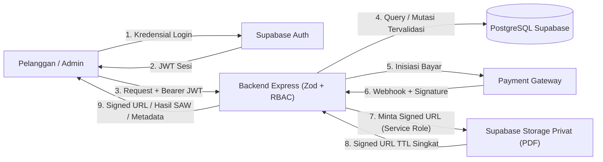

# Data Flow Documentation

**Status:** `[RENCANA]` — Seluruh aliran data bisnis di bawah ini merupakan rancangan target. Data contoh yang dicantumkan berlabel `"DATA SIMULASI"`. Tidak ada kredensial, token nyata, URL database, atau isi `.env` yang disertakan.

Dokumen ini mendokumentasikan aliran data untuk **6 proses utama**, lengkap dengan klasifikasi data sensitif, sumber, tujuan, validasi, dan kontrol akses.

> **Keterangan Singkatan:** **JWT** = *JSON Web Token*; **RBAC** = *Role-Based Access Control*; **SAW** = *Simple Additive Weighting*; **PDF** = *Portable Document Format*; **URL** = *Uniform Resource Locator*; **TTL** = *Time-to-Live*.

---

## 1. Diagram Aliran Data Lintas Sistem (`[RENCANA]`)

**Deskripsi:** Gambaran menyeluruh perpindahan data antar-aktor, aplikasi klien, Backend Express, layanan Supabase, dan Payment Gateway.

---

## 2. Rincian Aliran Data per Proses (`[RENCANA]`)

### 2.1 Autentikasi dan Token
- **Alur:** Klien -> Supabase Auth (login/register) -> Klien menerima JWT -> Klien mengirim `Authorization: Bearer <JWT>` ke Backend Express -> Backend memverifikasi JWT ke Supabase Auth dan menyinkronkan `users` di PostgreSQL.
- **Sumber Data:** Input email/password di klien; klaim `sub` & `email` dari Supabase Auth.
- **Tujuan Data:** Header `Authorization` ke backend; tabel `users` (`supabaseUserId`, `role`, `isActive`).
- **Data Sensitif:** Password (tidak pernah dikirim/disimpan di backend aplikasi), Access Token & Refresh Token (disimpan aman di *secure storage* pada mobile), `SUPABASE_SERVICE_ROLE_KEY` (hanya di backend `.env`).
- **Validasi & Kontrol Akses:** Middleware auth memverifikasi JWT (`401` jika tidak valid) dan memeriksa `isActive` + `role` (`403` jika tidak berwenang).

### 2.2 Data Katalog E-Book
- **Alur:**
  - *Tulis (Admin):* Admin Web -> `POST/PATCH /api/v1/admin/ebooks` -> Backend validasi Zod -> Upload PDF ke Supabase Storage privat -> Simpan metadata & `storagePath` ke PostgreSQL.
  - *Baca (Publik/Pelanggan):* Klien -> `GET /api/v1/ebooks` -> Backend kueri PostgreSQL (`isActive = true`) -> Kembalikan metadata publik.
- **Data Sensitif / Internal:** `storagePath` (path objek PDF di bucket privat) **wajib disaring** agar tidak pernah bocor pada respons katalog publik.
- **Validasi & Kontrol Akses:** Operasi tulis wajib `ADMIN`; operasi baca publik divalidasi parameter paginasi/search via Zod.
- **Contoh Payload Katalog (`"DATA SIMULASI"`):**
  `{ "id": "00000000-0000-0000-0000-000000000001", "title": "DATA SIMULASI - Pengantar Sains Data", "price": "75000.00", "ratingAvg": "4.50", "salesCount": 12 }`

### 2.3 Pembuatan Pesanan (*Order*)
- **Alur:** Klien -> `POST /api/v1/orders` (`{ ebookIds }`) -> Backend validasi Zod -> Backend mengambil `Ebook.price` dari PostgreSQL -> Backend mengecek `EbookAccess` -> Simpan `Order` (`PENDING`) + `OrderItem` (`unitPrice` snapshot).
- **Sumber & Tujuan:** Daftar `ebookIds` dari klien; `unitPrice` dan `totalAmount` bersumber dari PostgreSQL dan disimpan ke `orders` & `order_items`.
- **Data Sensitif:** Identitas pemesan (`userId`), rincian harga dan `totalAmount`.
- **Validasi & Kontrol Akses:** Wajib role `CUSTOMER`; nominal harga dari klien **tidak pernah dipercaya**; duplikasi kepemilikan ditolak (`409 Conflict`).

### 2.4 Pembayaran dan Webhook Payment Gateway
- **Alur:**
  - *Inisiasi:* Klien -> `POST /api/v1/payments` -> Backend validasi kepemilikan `Order` -> Backend panggil Payment Gateway -> Simpan `Payment` (`PENDING`, `externalRef`) -> Kembalikan instruksi bayar.
  - *Webhook:* Payment Gateway -> `POST /api/v1/payments/webhook` -> Backend verifikasi *signature* -> Cek idempotensi -> Transaksi DB atomik (`Payment -> VERIFIED`, `Order -> PAID`, buat `Transaction`, aktifkan `EbookAccess`).
- **Data Sensitif:** *Webhook secret key* gateway (hanya di backend), `externalRef`, `transactionCode`, nominal pembayaran.
- **Validasi & Kontrol Akses:** Hanya webhook dengan *signature* sah yang diproses; pengiriman ulang webhook tidak memicu mutasi ganda (*idempoten*).

### 2.5 Akses Konten PDF (*Signed URL* Privat)
- **Alur:** Klien (*In-App PDF Reader*) -> `GET /api/v1/ebooks/:id/access` -> Backend verifikasi JWT -> Cek `EbookAccess` (`userId`, `ebookId`, `isRevoked = false`) -> Backend meminta *signed URL* sementara ke Supabase Storage privat -> Kembalikan `{ signedUrl, expiresInSeconds }` -> Klien membaca PDF di dalam aplikasi.
- **Kebijakan Keamanan Mutlak (Keputusan #4 `[ADA]`):**
  - File PDF **tidak tersedia untuk unduhan publik bebas** dan bucket Storage wajib berstatus **privat**.
  - *Signed URL* hanya diterbitkan oleh backend menggunakan *service role* setelah verifikasi kepemilikan aktif, dengan masa berlaku (*TTL*) singkat.

### 2.6 Konfigurasi dan Hasil Rekomendasi SAW
- **Alur:**
  - *Konfigurasi (Admin):* Admin Web -> Backend (`PUT` bobot SAW) -> Validasi Zod (`bobot > 0`, `Σ bobot = 1.0`) -> Simpan ke PostgreSQL.
  - *Rekomendasi (Pelanggan):* Klien -> `GET /api/v1/ebooks/recommendations` -> Backend baca bobot aktif & matriks `Ebook` aktif -> Hitung normalisasi Benefit/Cost & skor $V_i$ -> (Opsional Keputusan #11: simpan snapshot) -> Kembalikan `{ ebookId, title, sawScore, rank }`.
- **Validasi & Kontrol Akses:** Bobot dari klien publik ditolak/diabaikan ([ADR-0002](../adr/0002-backend-only-saw.md)); hanya `ADMIN` yang dapat mengubah konfigurasi bobot.

---

## 3. Matriks Ringkasan Klasifikasi Data Sensitif

| Aset Data | Klasifikasi | Lokasi Penyimpanan | Boleh Dikirim ke Klien? |
|---|---|---|---|
| `SUPABASE_SERVICE_ROLE_KEY`, `DATABASE_URL`, Secret Gateway | **Rahasia Kritikal** | Backend `.env` (diabaikan Git) | **Tidak Pernah** |
| File PDF E-Book Asli | **Konten Terproteksi** | Supabase Storage Bucket Privat | **Tidak** (hanya via *Signed URL* TTL singkat untuk pemilik `EbookAccess`) |
| `Ebook.storagePath` | **Internal Backend** | PostgreSQL (`ebooks`) | **Tidak** |
| JWT Access Token Pengguna | **Rahasia Sesi** | Memori / *Secure Storage* Klien | Hanya milik pengguna bersangkutan |
| `Order`, `Payment`, `Transaction` | **Pribadi / Finansial** | PostgreSQL | Hanya milik `userId` terkait atau `ADMIN` |
