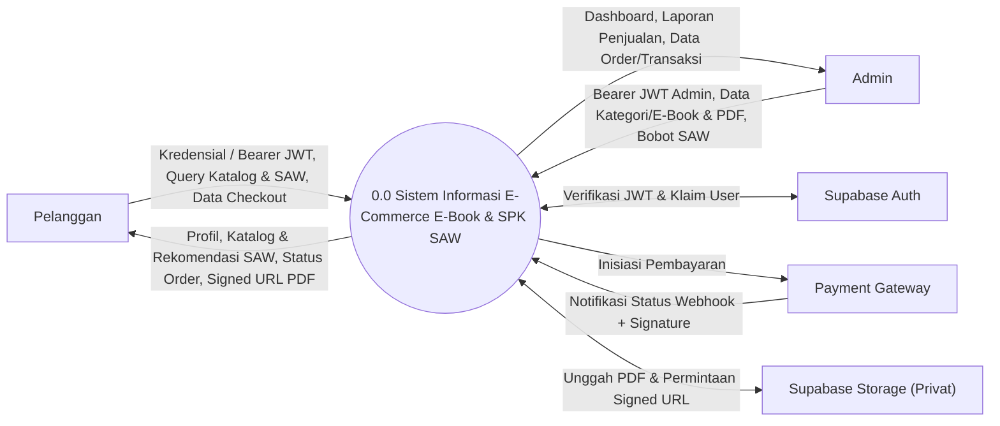
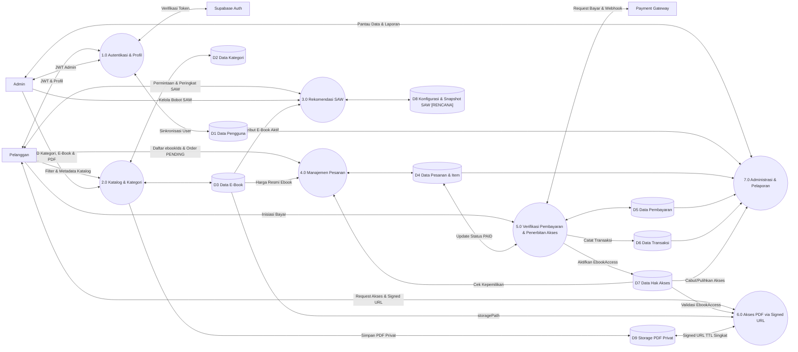

# Data Flow Diagram (`DFD`)

**Status:** `[RENCANA]` — Seluruh diagram aliran data di bawah ini bersifat rancangan sistem karena fitur bisnis, integrasi *payment gateway*, `SPK SAW`, dan akses *signed URL* belum diimplementasikan di `backend/`.

---

## 1. Tujuan DFD & Notasi

Dokumen ini memodelkan **arus data** (*data flow*) pada **Sistem Informasi E-Commerce E-Book dan SPK Metode SAW** (bukan urutan tampilan antarmuka) untuk memastikan setiap proses memiliki masukan, keluaran, penyimpanan (*data store*), dan kontrol keamanan yang jelas.

- **Notasi Mermaid `flowchart`:**
  - Kotak persegi `[Nama]`: **Entitas Eksternal** (*External Entity*)
  - Lingkaran ganda `((No Nama))`: **Proses** (*Process*)
  - Silinder `[(Nama)]`: **Data Store**

---

## 2. Daftar Entitas Eksternal, Proses, & Data Store

- **Entitas Eksternal:** `Pelanggan`, `Admin`, `Supabase Auth`, `Payment Gateway`, `Supabase Storage` (layanan objek privat).
- **Proses Utama (Level 1):** `1.0` Manajemen Autentikasi & Profil, `2.0` Manajemen Katalog & Kategori, `3.0` Perhitungan Rekomendasi SAW, `4.0` Manajemen Pesanan, `5.0` Verifikasi Pembayaran & Penerbitan Akses, `6.0` Akses PDF via Signed URL, `7.0` Administrasi & Pelaporan.
- **Data Store:** `D1 Data Pengguna (users)`, `D2 Data Kategori (categories)`, `D3 Data E-Book (ebooks)`, `D4 Data Pesanan & Item (orders, order_items)`, `D5 Data Pembayaran (payments)`, `D6 Data Transaksi (transactions)`, `D7 Data Hak Akses (ebook_accesses)`, `D8 Konfigurasi & Snapshot SAW [RENCANA]`, `D9 Storage PDF Privat`.

---

## 3. DFD Level 0: Diagram Konteks (`[RENCANA]`)

---

## 4. DFD Level 1: Proses Utama (`[RENCANA]`)

---

## 5. Penjelasan Arus Data & Tabel Validasi per Proses (`[RENCANA]`)

| Proses | Masukan | Keluaran | Data Store | Kontrol Keamanan | Status |
|---|---|---|---|---|---|
| **1.0 Autentikasi & Profil** | *Bearer JWT* dari klien, update `fullName`/`phone`. | Profil `User` & peran (`CUSTOMER` / `ADMIN`). | `D1 (users)` | Verifikasi `JWT` ke Supabase Auth; cek `isActive`; tolak mutasi `role` oleh klien. | `[RENCANA]` |
| **2.0 Katalog & Kategori** | Query `search`/`categoryId`/`page`, payload CRUD & file PDF Admin. | Metadata katalog aktif (tanpa `storagePath`). | `D2`, `D3`, `D9` | Publik hanya baca `isActive = true`; tulis wajib role `ADMIN` + validasi Zod & tipe PDF. | `[RENCANA]` |
| **3.0 Rekomendasi SAW** | Query filter opsional (Pelanggan); bobot kriteria (Admin). | Daftar `e-book` berperingkat + `sawScore`. | `D3`, `D8` `[RENCANA]` | Hitung **hanya di `backend`**; tolak bobot klien publik; validasi `Σ bobot = 1.0`. | `[RENCANA]` |
| **4.0 Manajemen Pesanan** | `ebookIds` dari Pelanggan terautentikasi. | `Order` (`PENDING`) + `OrderItem` (`unitPrice` snapshot). | `D3`, `D4`, `D7` | Wajib role `CUSTOMER`; harga diambil dari `D3`; tolak jika `EbookAccess` sudah ada (`409`). | `[RENCANA]` |
| **5.0 Verifikasi Pembayaran & Penerbitan Akses** | Inisiasi bayar Pelanggan; *webhook* Payment Gateway. | Instruksi bayar; `Transaction` & `EbookAccess` aktif. | `D4`, `D5`, `D6`, `D7` | Verifikasi *signature webhook*, cek nominal, *idempotensi*, dan `prisma.$transaction`. | `[RENCANA]` |
| **6.0 Akses PDF via Signed URL** | `ebookId` + *Bearer JWT* Pelanggan. | `signedUrl` sementara + `expiresInSeconds`. | `D3`, `D7`, `D9` | Wajib ada `EbookAccess` aktif (`isRevoked = false`); file PDF tidak untuk unduhan publik bebas. | `[RENCANA]` |
| **7.0 Administrasi & Pelaporan** | Filter laporan tanggal/status, perintah `isRevoked` oleh Admin. | Ringkasan penjualan, daftar transaksi, status akses. | `D1`, `D4`, `D5`, `D6`, `D7` | Wajib role `ADMIN` di `backend`; validasi rentang tanggal via Zod. | `[RENCANA]` |

- **Contoh Data Aliran Katalog (`"DATA SIMULASI"`):** `{ "title": "DATA SIMULASI - Basis Data Terapan", "price": "65000.00", "sawScore": 0.875, "rank": 1 }`.

---

## 6. Klasifikasi Data Sensitif & Aturan Perlindungan

| Kategori Data | Contoh | Aturan Perlindungan |
|---|---|---|
| **Rahasia Server & Gateway** | `SUPABASE_SERVICE_ROLE_KEY`, `DATABASE_URL`, *webhook secret* | Disimpan hanya di `.env` `backend/` (diabaikan Git); dilarang masuk ke `VITE_*` atau kode Flutter. |
| **File PDF & `storagePath`** | File PDF `e-book`, kolom `ebooks.storage_path` | File disimpan di `D9` (`bucket privat`); `storagePath` disaring dari respons publik; baca hanya via `signed URL` TTL singkat untuk pemilik `EbookAccess`. |
| **Data Finansial & Token** | `JWT`, `Order`, `Payment`, `Transaction` | Transmisi via HTTPS; isolasi kepemilikan data berdasarkan `userId` dari `JWT` terverifikasi (anti-IDOR). |
