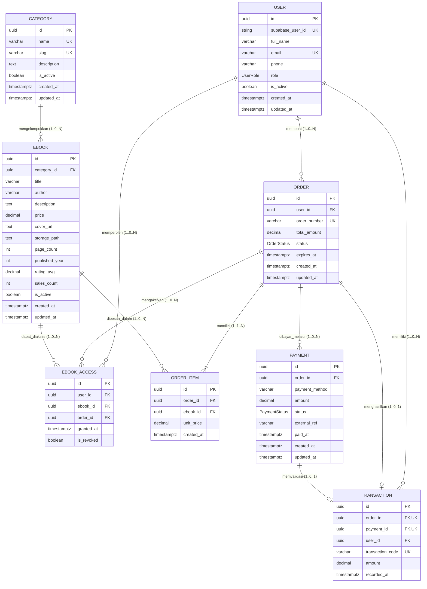

# Entity Relationship Diagram (`ERD`)

**Status:** `[ADA]` (definisi 8 model inti & 3 enum pada [`backend/prisma/schema.prisma`](../../backend/prisma/schema.prisma), tervalidasi `prisma validate`) | `[RENCANA]` (migrasi SQL ke PostgreSQL Supabase serta entitas lanjutan `Review`, konfigurasi bobot SAW, dan snapshot SAW).

---

## 1. Tujuan ERD

Dokumen ini memodelkan struktur basis data relasional pada PostgreSQL Supabase untuk memastikan integritas transaksi e-commerce `e-book`, kontrol hak akses PDF, serta kesiapan data atribut bagi perhitungan `SPK SAW` di `backend/`.

---

## 2. Konvensi Relasi & Cardinality

- **Primary Key (`PK`):** Seluruh entitas inti menggunakan tipe `UUID` (`@default(uuid())`) untuk menghindari enumerasi ID berurutan pada API publik.
- **Notasi `erDiagram` Mermaid:**
  - `||--o{` : satu ke nol atau banyak (`1` ke `0..N`)
  - `||--|{` : satu ke satu atau lebih (`1` ke `1..N`)
  - `||--o|` : satu ke nol atau satu (`1` ke `0..1`)

---

## 3. Diagram ERD (`[ADA]` di `schema.prisma` / Migrasi `[RENCANA]`)

---

## 4. Penjelasan Entitas Inti (`schema.prisma` `[ADA]`, Migrasi `[RENCANA]`)

| Entitas (Tabel) | PK & FK / Constraint Utama | Atribut Inti | Status Implementasi |
|---|---|---|---|
| **`User` (`users`)** | `id` (PK), `supabaseUserId` (UK), `email` (UK) | `fullName`, `phone`, `role` (`UserRole`: `CUSTOMER \| ADMIN`), `isActive` | Model `[ADA]` di `schema.prisma`; migrasi & sinkronisasi runtime `[RENCANA]`. |
| **`Category` (`categories`)** | `id` (PK), `name` (UK), `slug` (UK) | `description`, `isActive` | Model `[ADA]` di `schema.prisma`; migrasi & endpoint `[RENCANA]`. |
| **`Ebook` (`ebooks`)** | `id` (PK), `categoryId` (FK -> `categories.id`, `Restrict`) | `title`, `author`, `description`, `price` (`Decimal(12,2)`), `coverUrl`, `storagePath`, `pageCount`, `publishedYear`, `ratingAvg` (`Decimal(3,2)`), `salesCount`, `isActive` | Model `[ADA]` di `schema.prisma`; migrasi & endpoint `[RENCANA]`. |
| **`Order` (`orders`)** | `id` (PK), `userId` (FK -> `users.id`, `Restrict`), `orderNumber` (UK) | `totalAmount` (`Decimal(12,2)`), `status` (`OrderStatus`: `PENDING \| PAID \| FAILED \| EXPIRED \| CANCELLED`), `expiresAt` | Model `[ADA]` di `schema.prisma`; migrasi & endpoint `[RENCANA]`. |
| **`OrderItem` (`order_items`)** | `id` (PK), `orderId` (FK, `Cascade`), `ebookId` (FK, `Restrict`), `@@unique([orderId, ebookId])` | `unitPrice` (`Decimal(12,2)`) — *snapshot* harga saat checkout | Model `[ADA]` di `schema.prisma`; migrasi & endpoint `[RENCANA]`. |
| **`Payment` (`payments`)** | `id` (PK), `orderId` (FK -> `orders.id`, `Cascade`) | `paymentMethod`, `amount` (`Decimal(12,2)`), `status` (`PaymentStatus`: `PENDING \| VERIFIED \| FAILED \| EXPIRED`), `externalRef`, `paidAt` | Model `[ADA]` di `schema.prisma`; migrasi & webhook `[RENCANA]`. |
| **`Transaction` (`transactions`)** | `id` (PK), `orderId` (FK, UK), `paymentId` (FK, UK), `userId` (FK), `transactionCode` (UK) | `amount` (`Decimal(12,2)`), `recordedAt` | Model `[ADA]` di `schema.prisma`; migrasi & pencatatan atomik `[RENCANA]`. |
| **`EbookAccess` (`ebook_accesses`)** | `id` (PK), `userId` (FK), `ebookId` (FK), `orderId` (FK), `@@unique([userId, ebookId])` | `grantedAt`, `isRevoked` | Model `[ADA]` di `schema.prisma`; migrasi & validasi akses `[RENCANA]`. |

### Penegasan Relasi Bisnis Penting
1. Satu **Pelanggan** (`User`) dapat membuat banyak **Pesanan** (`Order`).
2. Satu **Pesanan** (`Order`) memiliki satu atau lebih **Item Pesanan** (`OrderItem`), dan setiap `OrderItem` merujuk tepat satu **E-Book** (`Ebook`).
3. Satu **Pesanan** (`Order`) dapat memiliki catatan **Pembayaran** (`Payment`) sesuai rancangan (mendukung percobaan ulang bila pembayaran sebelumnya gagal/kedaluwarsa), namun hanya satu `Payment` terverifikasi (`VERIFIED`) yang menghasilkan tepat satu **Transaksi** (`Transaction`, `1-to-1`).
4. Pembayaran yang terverifikasi secara atomik mencatat `Transaction` dan menerbitkan **Hak Akses** (`EbookAccess`) untuk pengguna yang memenuhi ketentuan pembayaran (`Order -> PAID`).
5. Satu **Kategori** (`Category`) mengelompokkan banyak **E-Book** (`Ebook`); satu **E-Book** dapat muncul pada banyak `OrderItem` dan banyak `EbookAccess`.

---

## 5. Aturan Integritas Data Penting

1. **Snapshot Harga (`OrderItem.unitPrice`):** Perubahan harga pada `Ebook.price` oleh Admin tidak memengaruhi nilai pesanan yang sudah dibuat.
2. **Non-Hard-Delete:** Relasi `onDelete: Restrict` pada `Category -> Ebook`, `Ebook -> OrderItem`, dan `EbookAccess` mencegah penghapusan permanen data yang memiliki riwayat transaksi; penonaktifan katalog menggunakan `isActive = false`.
3. **Anti-Duplikasi Akses & Transaksi:** `@@unique([userId, ebookId])` pada `EbookAccess` mencegah duplikasi izin per judul, sedangkan `orderId @unique` & `paymentId @unique` pada `Transaction` menjaga idempotensi *webhook*.
4. **Presisi Moneter:** Seluruh nilai uang menggunakan `Decimal(12,2)` pada PostgreSQL.
5. **Sinkronisasi Dokumen Lama:** Dokumen `docs/04-database/` lama masih menyebut tabel `customers`, `admins`, dan `order_details`; ERD ini mengikuti [`backend/prisma/schema.prisma`](../../backend/prisma/schema.prisma) (`users` dan `order_items`) sebagai acuan terkini.

---

## 6. Entitas Lanjutan yang Masih `[RENCANA]` (Belum Ada di `schema.prisma`)

Entitas berikut **belum tersedia** di `backend/prisma/schema.prisma` dan baru boleh dimodelkan serta dimigrasi setelah keputusan terbuka pada [`keputusan-terbuka.md`](../00-project/keputusan-terbuka.md) dikunci:

| Entitas Usulan | Status | Ketergantungan Keputusan | Catatan Gap |
|---|---|---|---|
| **`Review` (Ulasan & Rating)** | `[RENCANA]` | Keputusan #6 & #7 | Menentukan siapa yang boleh memberi rating (`EbookAccess` aktif), moderasi, dan pembaruan `Ebook.ratingAvg`. |
| **Konfigurasi Bobot SAW** | `[RENCANA]` | Keputusan #5 & #9 | Menentukan penyimpanan bobot aktif kriteria SAW (4 vs 5 kriteria) serta apakah hanya Admin yang mengelola. |
| **Snapshot Perhitungan / Hasil Rekomendasi SAW** | `[RENCANA]` | Keputusan #11 | Menentukan perlu tidaknya tabel `SawCalculationSnapshot` untuk menyimpan riwayat peringkat & bobot historis ([ADR-0002](../adr/0002-backend-only-saw.md)). |
