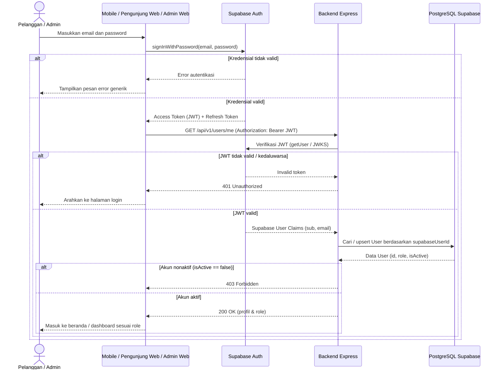
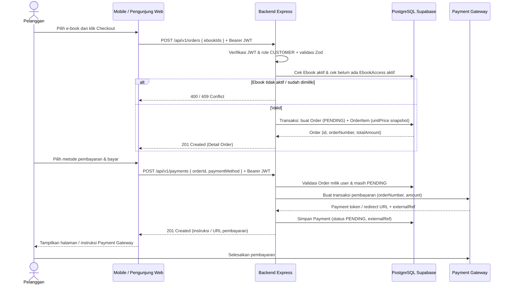
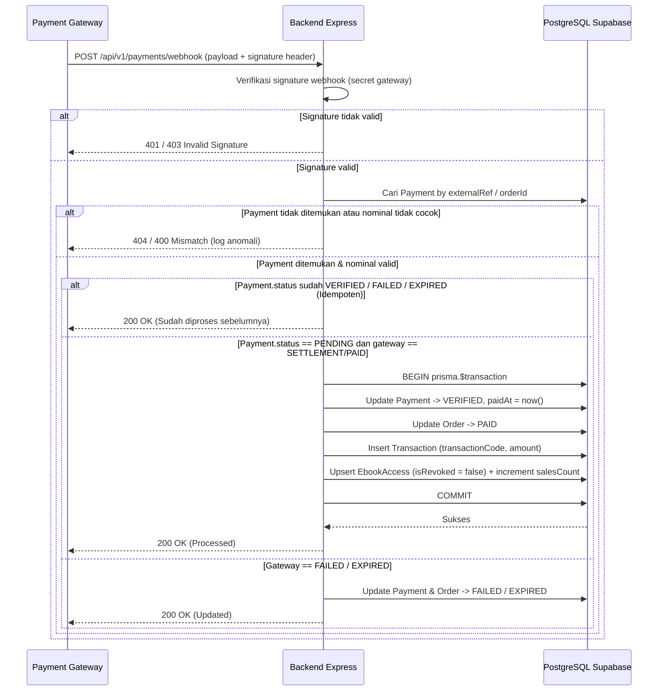
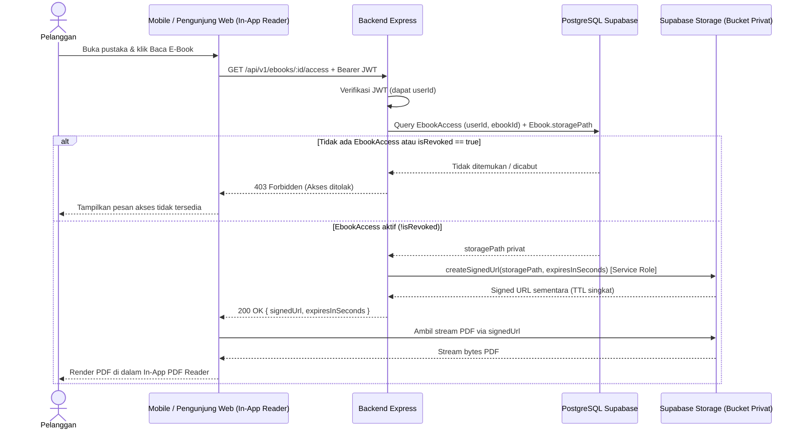

# Sequence Diagram

**Status:** `[RENCANA]` — Seluruh alur interaksi antarkomponen di bawah ini adalah rancangan target implementasi. Klien dilarang keras menghitung skor SAW maupun menerbitkan *signed URL* secara mandiri.

Dokumen ini menyajikan **5 diagram urutan** (*Sequence Diagram*) terperinci menggunakan Mermaid.

> **Keterangan Singkatan:** **JWT** = *JSON Web Token*; **API** = *Application Programming Interface*; **SAW** = *Simple Additive Weighting*; **PDF** = *Portable Document Format*; **URL** = *Uniform Resource Locator*; **TTL** = *Time-to-Live*.

---

## 1. Login Melalui Supabase Auth dan Verifikasi JWT oleh Backend `[RENCANA]`

**Deskripsi:** Menunjukkan pemisahan tanggung jawab antara **Supabase Auth** (penerbit sesi/JWT) dan **Backend Express** (verifikator JWT, pemeriksa status aktif, dan penyinkron profil di PostgreSQL Supabase).



---

## 2. Checkout Hingga Pembayaran Terverifikasi dan Akses E-Book Dibuat `[RENCANA]`

**Deskripsi:** Alur *end-to-end* mulai dari pembuatan `Order` (dengan *snapshot* harga database), inisiasi pembayaran ke **Payment Gateway**, penyelesaian pembayaran oleh Pelanggan, hingga penerimaan status terverifikasi.



---

## 3. Webhook Payment Gateway dengan Verifikasi Signature dan Idempotensi `[RENCANA]`

**Deskripsi:** Menjelaskan bagaimana Backend Express menerima callback asinkron dari Payment Gateway, memverifikasi *signature*, mencegah duplikasi (*idempotensi*), dan mengeksekusi pembaruan status secara atomik.



---

## 4. Permintaan Signed URL PDF oleh Pelanggan yang Memiliki `EbookAccess` `[RENCANA]`

**Deskripsi:** Menjamin file PDF di **Supabase Storage privat** tidak pernah diakses langsung tanpa verifikasi hak akses di backend dan tidak tersedia untuk unduhan publik bebas (Keputusan #4 `[ADA]`).



> **Catatan Penamaan Endpoint (`[RENCANA]`):** Dokumen `api-endpoints.md` mengusulkan `/api/v1/ebooks/:id/access`, sedangkan `requirements.md` mencatat `/api/v1/ebooks/:id/access-url`. Penyelarasan final dicatat pada [`design-assumptions-and-gaps.md`](./design-assumptions-and-gaps.md).

---

## 5. Permintaan Rekomendasi SAW dari Klien Sampai Hasil Dikembalikan Backend `[RENCANA]`

**Deskripsi:** Menegaskan prinsip [ADR-0002](../adr/0002-backend-only-saw.md) bahwa perhitungan SAW hanya berjalan di backend. Klien hanya mengirim parameter filter (opsional) dan menerima daftar peringkat yang sudah dihitung.

```mermaid
sequenceDiagram
    actor P as Pelanggan
    participant C as Mobile / Pengunjung Web
    participant API as Backend Express (SAW Service)
    participant DB as PostgreSQL Supabase

    P->>C: Buka menu Rekomendasi E-Book
    C->>API: GET /api/v1/ebooks/recommendations?categoryId=...
    Note over C,API: Klien tidak mengirim bobot mentah; bobot klien ditolak/diabaikan
    API->>API: Validasi query parameter (Zod)
    API->>DB: Ambil konfigurasi bobot kriteria aktif
    API->>DB: Ambil daftar Ebook aktif (isActive = true)
    DB-->>API: Bobot kriteria + matriks nilai kandidat e-book
    API->>API: Validasi Sum(bobot) == 1.0
    API->>API: Normalisasi Benefit/Cost (aman pembagi nol)
    API->>API: Hitung skor preferensi V_i = Sum(w_j * r_ij)
    API->>API: Urutkan V_i menurun + tie-breaker judul alfabetis A-Z
    opt Simpan Snapshot Audit [RENCANA - Keputusan #11]
        API->>DB: Simpan snapshot hasil perhitungan SAW
    end
    API-->>C: 200 OK [{ ebookId, title, sawScore, rank, ... }]
    C-->>P: Tampilkan daftar rekomendasi e-book berperingkat
```
