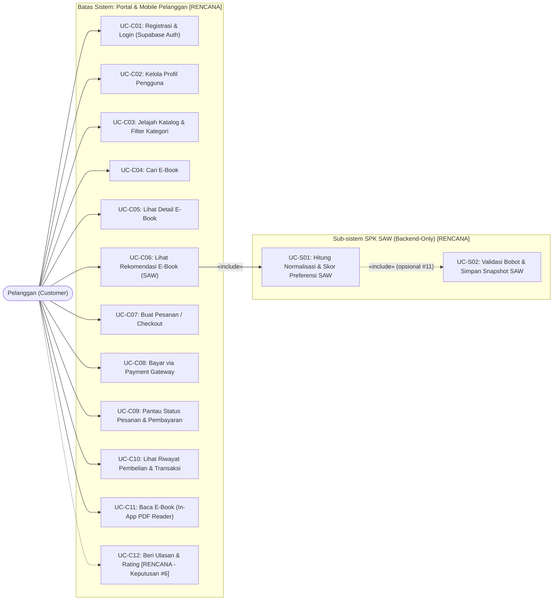
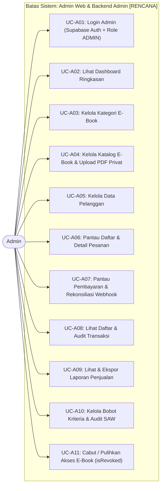

# Use Case Diagram

**Status:** `[RENCANA]` — Seluruh use case fitur bisnis (Pelanggan, Admin, dan SPK SAW) belum diimplementasikan di kode sumber; baru fondasi kerangka aplikasi dan skema Prisma awal yang `[ADA]`.

Dokumen ini memodelkan kebutuhan interaksi aktor terhadap **Sistem Informasi E-Commerce E-Book dan Sistem Pendukung Keputusan (SPK) Metode Simple Additive Weighting (SAW)**.

> **Keterangan Singkatan:** **SPK** = Sistem Pendukung Keputusan; **SAW** = *Simple Additive Weighting*; **RBAC** = *Role-Based Access Control*; **PDF** = *Portable Document Format*; **URL** = *Uniform Resource Locator*.

---

## 1. Diagram Use Case Sistem Keseluruhan (`[RENCANA]`)

### 1.1 Use Case Aktor Pelanggan & Sistem Pendukung SAW (`[RENCANA]`)

**Deskripsi:** Menggambarkan interaksi aktor **Pelanggan** (*Customer*) melalui aplikasi mobile (`mobile/ebook_store`) maupun portal web pelanggan (`web/pengunjung-web`), serta ketergantungan ke layanan **SPK SAW (Backend-Only)**.

**Legenda:**
- Garis solid (`-->`): Interaksi langsung aktor ke use case utama `[RENCANA]`.
- Garis putus-putus (`-.->`): Use case yang masih bergantung pada keputusan terbuka (`#6` untuk ulasan/rating, `#11` untuk penyimpanan snapshot riwayat rekomendasi).

---

### 1.2 Use Case Aktor Admin & Konfigurasi SAW (`[RENCANA]`)

**Deskripsi:** Menggambarkan interaksi aktor **Admin** melalui `web/admin-web` dengan penegakan otorisasi role `ADMIN` di backend Express.

> **Catatan Ruang Lingkup:** Fitur manajemen penulis sebagai entitas terpisah (`BR-A05`) dan fitur pengubahan bobot SAW oleh pelanggan (Keputusan #5) belum masuk sebagai use case terkunci karena masih berstatus `[RENCANA]`.

---

## 2. Deskripsi Use Case & Keterkaitan Kebutuhan

### 2.1 Fitur Pelanggan (`[RENCANA]`)

| Kode UC | Nama Use Case | Aktor | Deskripsi Singkat | ID Kebutuhan (`requirements.md`) | Status |
|---|---|---|---|---|---|
| **UC-C01** | Registrasi & Login | Pelanggan | Pelanggan mendaftar atau masuk via **Supabase Auth**; backend memverifikasi token JWT dan menyinkronkan profil ke tabel `users` (`role = CUSTOMER`). | `FR-C01`, `NFR-01` | `[RENCANA]` |
| **UC-C02** | Kelola Profil Pengguna | Pelanggan | Pelanggan melihat dan memperbarui `fullName` dan `phone` miliknya tanpa hak mengubah `role` atau `isActive`. | `FR-C02` | `[RENCANA]` |
| **UC-C03** | Jelajah Katalog & Filter Kategori | Pelanggan | Menelusuri daftar e-book aktif (`isActive = true`) dengan paginasi dan filter kategori. | `FR-C03` | `[RENCANA]` |
| **UC-C04** | Cari E-Book | Pelanggan | Mencari e-book berdasarkan kata kunci judul atau penulis. | `FR-C04` | `[RENCANA]` |
| **UC-C05** | Lihat Detail E-Book | Pelanggan | Melihat sinopsis, penulis, kategori, harga, halaman, tahun terbit, `ratingAvg`, `salesCount`, dan sampul (tanpa mengekspos `storagePath`). | `FR-C05` | `[RENCANA]` |
| **UC-C06** | Lihat Rekomendasi E-Book (SAW) | Pelanggan | Meminta daftar e-book terurut berdasarkan skor preferensi SAW hasil perhitungan backend. | `FR-C06`, `FR-S01` | `[RENCANA]` |
| **UC-C07** | Buat Pesanan / Checkout | Pelanggan | Memilih satu/lebih e-book aktif untuk membuat `Order` (`PENDING`); backend menghitung `totalAmount` dan mengunci `unitPrice` pada `OrderItem`. | `FR-C07`, `NFR-07` | `[RENCANA]` |
| **UC-C08** | Bayar via Payment Gateway | Pelanggan | Menginisiasi pembayaran untuk `Order` berstatus `PENDING` melalui payment gateway nyata (Keputusan #3 `[ADA]`). | `FR-C08` | `[RENCANA]` |
| **UC-C09** | Pantau Status Pesanan & Pembayaran | Pelanggan | Melihat status `Order` dan `Payment` milik sendiri (`PENDING`, `PAID`, `FAILED`, `EXPIRED`, `CANCELLED`). | `FR-C09` | `[RENCANA]` |
| **UC-C10** | Lihat Riwayat Pembelian & Transaksi | Pelanggan | Melihat daftar `Transaction` resmi dan e-book yang sudah dibeli. | `FR-C10` | `[RENCANA]` |
| **UC-C11** | Baca E-Book (*In-App PDF Reader*) | Pelanggan | Meminta *signed URL* sementara dari backend (jika `EbookAccess` aktif dan `!isRevoked`) lalu membaca PDF di dalam aplikasi (Keputusan #4 `[ADA]`). | `FR-C11`, `NFR-02` | `[RENCANA]` |
| **UC-C12** | Beri Ulasan & Rating | Pelanggan | Memberi rating/ulasan pada e-book yang sudah dibeli *(menunggu Keputusan #6 & #7)*. | `FR-C12` | `[RENCANA]` |

### 2.2 Fitur Admin (`[RENCANA]`)

| Kode UC | Nama Use Case | Aktor | Deskripsi Singkat | ID Kebutuhan (`requirements.md`) | Status |
|---|---|---|---|---|---|
| **UC-A01** | Login Admin | Admin | Masuk melalui Supabase Auth di `web/admin-web`; backend wajib memverifikasi `role = ADMIN` pada setiap endpoint admin. | `FR-A01`, `NFR-01` | `[RENCANA]` |
| **UC-A02** | Lihat Dashboard Ringkasan | Admin | Melihat total pendapatan, jumlah pesanan per status, jumlah e-book & pelanggan aktif, serta e-book terlaris. | `FR-A02` | `[RENCANA]` |
| **UC-A03** | Kelola Kategori E-Book | Admin | Tambah, ubah, dan nonaktifkan/hapus kategori (`Category`) dengan perlindungan relasi (`Restrict`). | `FR-A03` | `[RENCANA]` |
| **UC-A04** | Kelola Katalog E-Book & Upload PDF | Admin | Tambah, ubah, arsipkan (`isActive`), unggah sampul, dan unggah file PDF ke bucket privat Supabase Storage via backend. | `FR-A04`, `NFR-02` | `[RENCANA]` |
| **UC-A05** | Kelola Data Pelanggan | Admin | Melihat daftar pelanggan, riwayat pembelian ringkas, serta mengaktifkan/menonaktifkan akun (`isActive`). | `FR-A05` | `[RENCANA]` |
| **UC-A06** | Pantau Daftar & Detail Pesanan | Admin | Memfilter dan memeriksa pesanan masuk beserta rincian `OrderItem`. | `FR-A06` | `[RENCANA]` |
| **UC-A07** | Pantau Pembayaran & Webhook | Admin | Memeriksa status `Payment`, `externalRef`, dan menindaklanjuti kegagalan pembayaran. | `FR-A07` | `[RENCANA]` |
| **UC-A08** | Lihat Daftar & Audit Transaksi | Admin | Memeriksa catatan buku besar `Transaction` (`transactionCode`, nominal, relasi order/payment). | `FR-A08` | `[RENCANA]` |
| **UC-A09** | Lihat & Ekspor Laporan Penjualan | Admin | Menghasilkan laporan penjualan per periode/kategori dan mengekspornya dari data nyata backend. | `FR-A09` | `[RENCANA]` |
| **UC-A10** | Kelola Bobot Kriteria & Audit SAW | Admin | Mengatur bobot kriteria SAW di backend dengan validasi `Σ w_j = 1.0` dan meninjau peringkat hasil SAW. | `FR-A10`, `FR-S02` | `[RENCANA]` |
| **UC-A11** | Cabut / Pulihkan Akses E-Book | Admin | Mengubah flag `isRevoked` pada `EbookAccess` untuk kasus sengketa/refund. | `FR-A11` | `[RENCANA]` |

### 2.3 Sub-sistem Pendukung Keputusan SAW (`[RENCANA]`)

| Kode UC | Nama Use Case | Pemicu | Deskripsi Singkat | ID Kebutuhan (`requirements.md`) | Status |
|---|---|---|---|---|---|
| **UC-S01** | Hitung Normalisasi & Skor Preferensi SAW | Permintaan `UC-C06` / `UC-A10` | Fungsi murni di backend mengambil matriks data e-book aktif, memvalidasi bobot, menormalisasi kriteria `Benefit`/`Cost` (aman pembagi nol), menghitung $V_i = \sum w_j \cdot r_{ij}$, dan menerapkan *tie-breaker* alfabetis judul. | `FR-S01`, `FR-S02`, `FR-S03`, `FR-S04`, `FR-S06` | `[RENCANA]` |
| **UC-S02** | Simpan Snapshot Hasil SAW | Eksekusi `UC-S01` / `UC-A10` | Menyimpan snapshot konfigurasi bobot dan hasil peringkat untuk keperluan audit *(menunggu Keputusan #11)*. | `FR-S05` | `[RENCANA]` |
