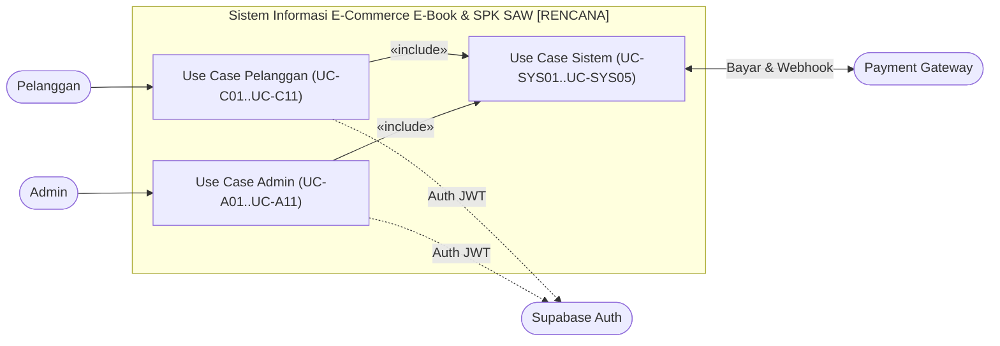

# Use Cases

**Status:** `[RENCANA]` — Seluruh use case fitur bisnis (Pelanggan, Admin, dan Sistem) merupakan rancangan target implementasi. Fondasi yang sudah `[ADA]` baru sebatas kerangka server Express, endpoint `/api/v1/health`, middleware validasi/auth dasar, dan definisi `schema.prisma`.

Dokumen ini melengkapi [`use-case-diagram.md`](./use-case-diagram.md) dengan spesifikasi rinci setiap use case bagi **Pelanggan**, **Admin**, dan **Sistem**.

---

## 1. Daftar Aktor & Batas Sistem

### 1.1 Daftar Aktor
| Aktor / Layanan | Tipe | Peran |
|---|---|---|
| **Pelanggan** (`CUSTOMER`) | Aktor Utama | Menjelajah katalog, melihat rekomendasi `SPK SAW`, membuat pesanan, membayar, melihat riwayat, dan membaca `e-book` melalui *in-app PDF reader*. |
| **Admin** (`ADMIN`) | Aktor Utama | Mengelola kategori, katalog `e-book`, file PDF privat, data pelanggan, memantau pesanan/pembayaran/transaksi, melihat laporan penjualan, dan mengatur bobot `SPK SAW`. |
| **Payment Gateway** | Aktor Eksternal | Memproses pembayaran daring nyata dan mengirim notifikasi status via *webhook* bertanda tangan ke `backend/` (Keputusan #3 `[ADA]`). |
| **Supabase Auth** | Layanan Eksternal | Mengelola registrasi, login, dan penerbitan `JWT` sesi pengguna untuk diverifikasi oleh `backend/` (Keputusan #2 `[ADA]`). |

### 1.2 Batas Sistem (*System Boundary*)
- **Di dalam batas sistem:** Aplikasi klien (`mobile/ebook_store`, `web/pengunjung-web`, `web/admin-web`), layanan `backend/` (Express REST API + `SPK SAW`), serta persistensi internal PostgreSQL Supabase & `bucket privat` Supabase Storage.
- **Di luar batas sistem:** Pengguna manusia (**Pelanggan**, **Admin**) serta layanan eksternal (**Payment Gateway** dan **Supabase Auth**).

---

## 2. Diagram Use Case Ringkas (`[RENCANA]`)

---

## 3. Tabel Pemetaan Use Case ke Kebutuhan (`requirements.md`)

| ID Use Case | Nama Use Case | Aktor | ID Kebutuhan (`requirements.md`) | Status |
|---|---|---|---|---|
| **UC-C01** | Registrasi & Login | Pelanggan, Supabase Auth | `FR-C01`, `NFR-01` | `[RENCANA]` |
| **UC-C02** | Mengelola Profil | Pelanggan | `FR-C02` | `[RENCANA]` |
| **UC-C03** | Melihat Katalog E-Book | Pelanggan | `FR-C03` | `[RENCANA]` |
| **UC-C04** | Mencari & Memfilter E-Book | Pelanggan | `FR-C03`, `FR-C04` | `[RENCANA]` |
| **UC-C05** | Melihat Detail E-Book | Pelanggan | `FR-C05` | `[RENCANA]` |
| **UC-C06** | Mendapatkan Rekomendasi SAW | Pelanggan | `FR-C06`, `FR-S01` | `[RENCANA]` |
| **UC-C07** | Membuat Pesanan (*Checkout*) | Pelanggan | `FR-C07`, `NFR-07` | `[RENCANA]` |
| **UC-C08** | Melakukan Pembayaran | Pelanggan, Payment Gateway | `FR-C08` | `[RENCANA]` |
| **UC-C09** | Melihat Riwayat Pesanan & Transaksi | Pelanggan | `FR-C09`, `FR-C10` | `[RENCANA]` |
| **UC-C10** | Membaca E-Book via Signed URL | Pelanggan | `FR-C11`, `NFR-02` | `[RENCANA]` |
| **UC-A01** | Login Sebagai Admin | Admin, Supabase Auth | `FR-A01`, `NFR-01` | `[RENCANA]` |
| **UC-A02** | Mengelola Kategori | Admin | `FR-A03` | `[RENCANA]` |
| **UC-A03** | Mengelola Katalog E-Book | Admin | `FR-A04` | `[RENCANA]` |
| **UC-A04** | Mengunggah Sampul & PDF via Backend | Admin | `FR-A04`, `NFR-02` | `[RENCANA]` |
| **UC-A05** | Memantau Pelanggan | Admin | `FR-A05` | `[RENCANA]` |
| **UC-A06** | Memantau Pesanan & Pembayaran | Admin | `FR-A06`, `FR-A07` | `[RENCANA]` |
| **UC-A07** | Melihat Transaksi | Admin | `FR-A08` | `[RENCANA]` |
| **UC-A08** | Membuat Laporan Penjualan | Admin | `FR-A02`, `FR-A09` | `[RENCANA]` |
| **UC-A09** | Mengatur Bobot SAW | Admin | `FR-A10`, `FR-S02` | `[RENCANA]` |
| **UC-A10** | Mencabut / Memulihkan Akses E-Book | Admin | `FR-A11` | `[RENCANA]` |
| **UC-SYS01** | Memverifikasi JWT & Role | Sistem (`backend`) | `NFR-01` | `[RENCANA]` |
| **UC-SYS02** | Memvalidasi Pembayaran via Webhook | Sistem, Payment Gateway | `FR-C08`, `NFR-06` | `[RENCANA]` |
| **UC-SYS03** | Membuat Transaksi & `EbookAccess` Atomik | Sistem (`backend`) | `FR-C10`, `NFR-06` | `[RENCANA]` |
| **UC-SYS04** | Menghitung SAW di Backend | Sistem (`backend`) | `FR-S01`–`FR-S04`, `FR-S06` | `[RENCANA]` |
| **UC-SYS05** | Menerbitkan Signed URL Setelah Cek Akses | Sistem (`backend`) | `FR-C11`, `NFR-02` | `[RENCANA]` |

---

## 4. Spesifikasi Use Case Pelanggan (`[RENCANA]`)

### UC-C01: Registrasi dan Login
- **Aktor:** Pelanggan, Supabase Auth.
- **Tujuan:** Mengautentikasi Pelanggan ke sistem dengan sesi `JWT` terverifikasi.
- **Prakondisi:** Pelanggan berada pada layar registrasi/login di `mobile/ebook_store` atau `web/pengunjung-web`.
- **Pemicu:** Pelanggan mengirim email dan password.
- **Alur Utama:** (1) Klien mengirim kredensial ke Supabase Auth. (2) Supabase Auth mengembalikan `JWT`. (3) Klien memanggil `GET /api/v1/users/me` dengan *Bearer token*. (4) `backend/` memverifikasi `JWT` (`UC-SYS01`) dan menyinkronkan record `User` (`role = CUSTOMER`). (5) Sesi aktif dimulai.
- **Alur Alternatif / Gagal:** Kredensial salah -> tampilkan pesan error generik; akun `isActive = false` -> `backend/` menolak `403 Forbidden`.
- **Pascakondisi:** Token sesi tersimpan aman di klien dan profil `User` tersinkron di PostgreSQL.
- **Kebutuhan Terkait & Status:** `FR-C01`, `NFR-01` | `[RENCANA]`.

### UC-C02: Mengelola Profil
- **Aktor:** Pelanggan.
- **Tujuan:** Melihat dan memperbarui data profil dasar (`fullName`, `phone`).
- **Prakondisi:** Pelanggan sudah login (`JWT` valid).
- **Pemicu:** Pelanggan membuka halaman profil dan menyimpan perubahan.
- **Alur Utama:** (1) Klien mengirim `PATCH` profil + *Bearer token*. (2) `backend/` memvalidasi payload via Zod (menolak perubahan `role`/`isActive`). (3) Data `User` diperbarui.
- **Alur Alternatif / Gagal:** Input tidak valid -> `400 Bad Request`; token kedaluwarsa -> `401 Unauthorized`.
- **Pascakondisi:** Data profil terbaru tersimpan di `users`.
- **Kebutuhan Terkait & Status:** `FR-C02` | `[RENCANA]`.

### UC-C03 & UC-C04: Melihat, Mencari, dan Memfilter Katalog E-Book
- **Aktor:** Pelanggan.
- **Tujuan:** Menemukan `e-book` aktif berdasarkan kategori atau kata kunci judul/penulis.
- **Prakondisi:** Tersedia data `Category` dan `Ebook` aktif (`isActive = true`).
- **Pemicu:** Pelanggan membuka katalog, memilih kategori, atau mengetik kata kunci pencarian.
- **Alur Utama:** (1) Klien memanggil `GET /api/v1/ebooks` dengan query `search`, `categoryId`, `page`, `limit`. (2) `backend/` memvalidasi query via Zod dan mengambil metadata `Ebook` aktif (tanpa `storagePath`). (3) Klien menampilkan daftar hasil.
- **Alur Alternatif / Gagal:** Tidak ada hasil -> tampilkan *empty state*; parameter tidak valid -> `400 Bad Request`.
- **Pascakondisi:** Daftar `e-book` terpaginasi tampil di klien.
- **Kebutuhan Terkait & Status:** `FR-C03`, `FR-C04` | `[RENCANA]`.

### UC-C05: Melihat Detail E-Book
- **Aktor:** Pelanggan.
- **Tujuan:** Meninjau deskripsi, penulis, kategori, harga, halaman, tahun terbit, `ratingAvg`, dan `salesCount`.
- **Prakondisi:** `e-book` berstatus `isActive = true`.
- **Pemicu:** Pelanggan memilih salah satu `e-book` dari katalog atau rekomendasi.
- **Alur Utama:** (1) Klien memanggil `GET /api/v1/ebooks/:id`. (2) `backend/` mengembalikan detail lengkap tanpa `storagePath` privat.
- **Alur Alternatif / Gagal:** ID tidak ditemukan atau nonaktif -> `404 Not Found`.
- **Pascakondisi:** Pelanggan melihat informasi lengkap untuk memutuskan pembelian.
- **Kebutuhan Terkait & Status:** `FR-C05` | `[RENCANA]`.

### UC-C06: Mendapatkan Rekomendasi SAW
- **Aktor:** Pelanggan.
- **Tujuan:** Memperoleh peringkat rekomendasi `e-book` yang objektif dari `SPK SAW`.
- **Prakondisi:** Konfigurasi bobot SAW valid (`Σ bobot = 1.0`) tersedia di `backend/`.
- **Pemicu:** Pelanggan membuka fitur Rekomendasi SAW.
- **Alur Utama:** (1) Klien mengirim permintaan rekomendasi ke `backend/`. (2) `backend/` menjalankan `UC-SYS04` (mengabaikan/menolak bobot liar dari klien). (3) Klien menampilkan daftar `e-book` berperingkat beserta skor SAW.
- **Alur Alternatif / Gagal:** Tidak ada kandidat aktif -> kembalikan array kosong `[]`.
- **Pascakondisi:** Pelanggan melihat daftar rekomendasi terurut dari skor tertinggi.
- **Kebutuhan Terkait & Status:** `FR-C06`, `FR-S01` | `[RENCANA]`.

### UC-C07: Membuat Pesanan (*Checkout*)
- **Aktor:** Pelanggan.
- **Tujuan:** Membuat `Order` (`PENDING`) dengan *snapshot* harga dari database.
- **Prakondisi:** Pelanggan login (`CUSTOMER`), `e-book` aktif dan belum dimiliki di `EbookAccess`.
- **Pemicu:** Pelanggan menekan tombol Checkout.
- **Alur Utama:** (1) Klien mengirim `POST /api/v1/orders` berisi `ebookIds`. (2) `backend/` memvalidasi token, cek kepemilikan `EbookAccess`, menghitung `totalAmount` dari `Ebook.price`, dan menyimpan `Order` + `OrderItem` (`unitPrice`).
- **Alur Alternatif / Gagal:** `e-book` sudah dimiliki -> `409 Conflict`; daftar kosong -> `400 Bad Request`.
- **Pascakondisi:** `Order` (`PENDING`) dengan `expiresAt` tercatat di PostgreSQL.
- **Kebutuhan Terkait & Status:** `FR-C07`, `NFR-07` | `[RENCANA]`.

### UC-C08: Melakukan Pembayaran
- **Aktor:** Pelanggan, Payment Gateway.
- **Tujuan:** Membayar pesanan `PENDING` melalui *payment gateway* nyata.
- **Prakondisi:** `Order` milik Pelanggan berstatus `PENDING` dan belum melewati `expiresAt`.
- **Pemicu:** Pelanggan memilih metode bayar dan mengonfirmasi pembayaran.
- **Alur Utama:** (1) Klien mengirim `POST /api/v1/payments`. (2) `backend/` membuat transaksi di Payment Gateway, menyimpan `Payment` (`PENDING`, `externalRef`), dan mengembalikan instruksi/URL bayar. (3) Pelanggan menyelesaikan pembayaran di gateway. (4) Gateway mengirim *webhook* ke `backend/` (`UC-SYS02`, `UC-SYS03`).
- **Alur Alternatif / Gagal:** Pesanan sudah `PAID`/`EXPIRED` -> `409 Conflict`; gateway gagal merespons -> `502/503`.
- **Pascakondisi:** `Payment` tercatat dan menunggu/menerima verifikasi *webhook*.
- **Kebutuhan Terkait & Status:** `FR-C08` | `[RENCANA]`.

### UC-C09: Melihat Riwayat Pesanan & Transaksi
- **Aktor:** Pelanggan.
- **Tujuan:** Memantau status `Order`/`Payment` dan daftar `Transaction` milik sendiri.
- **Prakondisi:** Pelanggan sudah login.
- **Pemicu:** Pelanggan membuka menu Pesanan atau Riwayat Pembelian.
- **Alur Utama:** (1) Klien meminta daftar order/transaksi + *Bearer token*. (2) `backend/` memfilter ketat berdasarkan `userId` dari `JWT`. (3) Daftar riwayat ditampilkan.
- **Alur Alternatif / Gagal:** Token tidak valid -> `401 Unauthorized`.
- **Pascakondisi:** Pelanggan melihat status terkini dan daftar `e-book` yang sudah dibeli.
- **Kebutuhan Terkait & Status:** `FR-C09`, `FR-C10` | `[RENCANA]`.

### UC-C10: Membaca E-Book via Signed URL
- **Aktor:** Pelanggan.
- **Tujuan:** Membaca file PDF `e-book` yang telah dibeli di dalam *in-app PDF reader*.
- **Prakondisi:** Pelanggan memiliki `EbookAccess` aktif (`isRevoked = false`).
- **Pemicu:** Pelanggan menekan tombol Baca pada pustaka pribadi.
- **Alur Utama:** (1) Klien memanggil endpoint akses PDF `backend/`. (2) `backend/` menjalankan `UC-SYS05` dan mengembalikan `signedUrl` sementara. (3) *In-app PDF reader* memuat stream PDF dari `signedUrl`.
- **Alur Alternatif / Gagal:** Belum membeli atau `isRevoked = true` -> `403 Forbidden`; `signedUrl` kedaluwarsa -> klien meminta ulang ke `backend/`.
- **Pascakondisi:** PDF tampil aman di dalam aplikasi tanpa tautan unduhan publik.
- **Kebutuhan Terkait & Status:** `FR-C11`, `NFR-02` | `[RENCANA]`.

---

## 5. Spesifikasi Use Case Admin (`[RENCANA]`)

### UC-A01: Login Sebagai Admin
- **Aktor:** Admin, Supabase Auth.
- **Tujuan:** Mengakses `web/admin-web` dengan otorisasi peran `ADMIN` terverifikasi di `backend/`.
- **Prakondisi:** Akun terdaftar dengan `role = ADMIN` dan `isActive = true`.
- **Pemicu:** Admin masuk melalui halaman login `admin-web`.
- **Alur Utama:** (1) Login ke Supabase Auth. (2) `backend/` memverifikasi `JWT` dan memastikan `role == ADMIN` (`UC-SYS01`).
- **Alur Alternatif / Gagal:** Akun ber-role `CUSTOMER` mencoba akses endpoint admin -> `403 Forbidden`.
- **Pascakondisi:** Admin masuk ke dashboard operasional.
- **Kebutuhan Terkait & Status:** `FR-A01`, `NFR-01` | `[RENCANA]`.

### UC-A02, UC-A03, & UC-A04: Mengelola Kategori, Katalog E-Book, & Unggah Sampul/PDF
- **Aktor:** Admin.
- **Tujuan:** Menambah, mengubah, mengarsipkan kategori/`e-book`, dan mengunggah sampul serta file PDF ke `bucket privat`.
- **Prakondisi:** Admin terautentikasi (`ADMIN`).
- **Pemicu:** Admin mengirim formulir CRUD di `admin-web`.
- **Alur Utama:** (1) `admin-web` mengirim data/file ke endpoint `/api/v1/admin/*`. (2) `backend/` memverifikasi `ADMIN`, validasi Zod & tipe file PDF. (3) File PDF diunggah ke Supabase Storage `bucket privat` dan `storagePath` disimpan ke `ebooks`.
- **Alur Alternatif / Gagal:** Hapus kategori yang masih punya `e-book` atau `e-book` yang sudah pernah dibeli -> tolak `409` / gunakan *soft-archive* (`isActive = false`).
- **Pascakondisi:** Master data katalog & file PDF privat tersimpan aman.
- **Kebutuhan Terkait & Status:** `FR-A03`, `FR-A04`, `NFR-02` | `[RENCANA]`.

### UC-A05, UC-A06, UC-A07, & UC-A08: Memantau Pelanggan, Pesanan, Pembayaran, Transaksi, & Laporan Penjualan
- **Aktor:** Admin.
- **Tujuan:** Memantau operasional toko dan menghasilkan laporan penjualan per periode.
- **Prakondisi:** Admin terautentikasi (`ADMIN`).
- **Pemicu:** Admin membuka menu Pelanggan, Pesanan, Pembayaran, Transaksi, atau Laporan di `admin-web`.
- **Alur Utama:** (1) `admin-web` memanggil endpoint `/api/v1/admin/*` dengan filter tanggal/status. (2) `backend/` mengagregasi dan mengembalikan data nyata dari PostgreSQL.
- **Alur Alternatif / Gagal:** Rentang tanggal terbalik -> `400 Bad Request`; non-admin -> `403 Forbidden`.
- **Pascakondisi:** Admin memperoleh visibilitas operasional dan laporan teraudit.
- **Kebutuhan Terkait & Status:** `FR-A02`, `FR-A05`–`FR-A09` | `[RENCANA]`.

### UC-A09: Mengatur Bobot SAW *(Menunggu Keputusan #5 & #9)*
- **Aktor:** Admin.
- **Tujuan:** Memperbarui bobot kriteria `SPK SAW` di `backend/`.
- **Prakondisi:** Admin terautentikasi (`ADMIN`); himpunan kriteria final sudah dikunci (Keputusan #9).
- **Pemicu:** Admin mengubah nilai bobot pada panel konfigurasi SAW dan menyimpan.
- **Alur Utama:** (1) `backend/` memvalidasi setiap bobot `> 0` dan `Σ bobot == 1.0`. (2) Konfigurasi baru disimpan dan siap dipakai pada kalkulasi SAW berikutnya.
- **Alur Alternatif / Gagal:** Jumlah bobot `!= 1.0` -> `400 Bad Request`.
- **Pascakondisi:** Bobot SAW terbaru tersimpan di database.
- **Kebutuhan Terkait & Status:** `FR-A10`, `FR-S02` | `[RENCANA]`.

### UC-A10: Mencabut / Memulihkan Akses E-Book
- **Aktor:** Admin.
- **Tujuan:** Mengubah status `EbookAccess.isRevoked` milik pelanggan tertentu pada kasus sengketa/refund.
- **Prakondisi:** Admin terautentikasi (`ADMIN`); record `EbookAccess` ada.
- **Pemicu:** Admin menekan tombol Cabut/Pulihkan Akses.
- **Alur Utama:** (1) `backend/` memperbarui `isRevoked` pada `ebook_accesses`.
- **Alur Alternatif / Gagal:** Record tidak ditemukan -> `404 Not Found`.
- **Pascakondisi:** Permintaan `signed URL` berikutnya mengikuti status `isRevoked` terbaru.
- **Kebutuhan Terkait & Status:** `FR-A11` | `[RENCANA]`.

---

## 6. Spesifikasi Use Case Sistem (`[RENCANA]`)

| ID | Nama Use Case Sistem | Pemicu | Alur Utama & Kontrol | Alur Gagal | Pascakondisi | Status |
|---|---|---|---|---|---|---|
| **UC-SYS01** | **Memverifikasi JWT & Role** | Setiap request endpoint terproteksi | Verifikasi `JWT` ke Supabase Auth -> muat `User` (`isActive`) -> cek `UserRole` (`CUSTOMER`/`ADMIN`). | Token invalid -> `401`; role/status tidak cocok -> `403`. | Identitas `req.user` valid tersedia di controller. | `[RENCANA]` |
| **UC-SYS02** | **Memvalidasi Pembayaran via Webhook** | Callback HTTP dari Payment Gateway | Verifikasi *signature* webhook -> cocokkan `Payment` & nominal -> cek apakah status sudah final (idempoten). | *Signature* salah -> `401/403`; duplikat final -> `200 OK` tanpa mutasi ulang. | Status pembayaran sah terkonfirmasi. | `[RENCANA]` |
| **UC-SYS03** | **Membuat Transaksi & `EbookAccess` Atomik** | `UC-SYS02` menerima status `VERIFIED` | Jalankan `prisma.$transaction`: update `Payment -> VERIFIED`, `Order -> PAID`, insert `Transaction`, upsert `EbookAccess`, increment `salesCount`. | Error DB di tengah proses -> *rollback* penuh. | `Transaction` dan `EbookAccess` aktif secara konsisten. | `[RENCANA]` |
| **UC-SYS04** | **Menghitung SAW di Backend** | Permintaan rekomendasi dari klien / pratinjau Admin | Baca bobot aktif (`Σ = 1.0`) & `Ebook` aktif -> normalisasi *Benefit*/*Cost* (pembagi nol -> `0`) -> hitung $V_i = \sum w_j r_{ij}$ -> urutkan + *tie-breaker* judul A–Z. | Bobot tidak valid -> hentikan dengan error konfigurasi. | Daftar peringkat skor SAW siap dikembalikan. | `[RENCANA]` |
| **UC-SYS05** | **Menerbitkan Signed URL Setelah Cek Akses** | Permintaan baca PDF Pelanggan | Cek `EbookAccess` untuk `(userId, ebookId)` dengan `isRevoked = false` -> ambil `storagePath` -> panggil Supabase Storage API (*service role*) buat `signed URL` TTL singkat. | Tidak ada akses / dicabut -> `403 Forbidden`. | `signedUrl` sementara dikembalikan hanya ke pemilik sah. | `[RENCANA]` |
