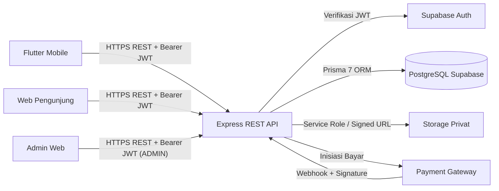

# Gambaran Umum API (`API Overview`)

**Status:** `[ADA]` (hanya `GET /api/v1/health` dan `GET /api/v1/admin/ping` pada `backend/src/app.ts`) | `[RENCANA]` (seluruh endpoint bisnis, transaksi, akses PDF, dan `SPK SAW`)

Dokumen ini menjelaskan arsitektur REST API **E-Book Store** pada `backend/` (*Node.js + Express + TypeScript + Zod + Prisma 7 ESM*), batas tanggung jawab antar komponen, serta daftar status implementasi endpoint.

---

## 1. Tujuan & Base Path API

- **Tujuan API:** Menjadi satu-satunya gerbang terpusat (*single source of truth*) bagi aplikasi klien (`mobile/ebook_store`, `web/pengunjung-web`, `web/admin-web`) untuk mengakses data, transaksi pembayaran, hak akses PDF privat, dan perhitungan rekomendasi `SPK SAW`.
- **Base Path:** `/api/v1` (contoh URL nonrahasia: `https://api.example.com/api/v1`).
- **Prinsip Desain REST:** Berorientasi *resource* (`/ebooks`, `/orders`, `/payments`), *stateless* berbasis *Bearer JWT*, validasi skema ketat di `backend/` menggunakan **Zod**, serta respons JSON terstandar.

---

## 2. Daftar Aktor & Ringkasan Kelompok Endpoint

| Aktor | Peran dalam API | Kelompok Endpoint |
|---|---|---|
| **Publik** | Mengakses kesehatan layanan, katalog aktif, detail `e-book`, dan rekomendasi SAW (sesuai Keputusan #5) | `/health`, `/categories`, `/ebooks`, `/ebooks/{id}`, `/recommendations/saw` |
| **Pelanggan (`CUSTOMER`)** | Sinkronisasi/kelola profil, checkout, bayar, pantau order/pembayaran, minta `signed URL` PDF | `/auth/sync`, `/users/me`, `/orders*`, `/payments*`, `/ebooks/{id}/access-url` |
| **Admin (`ADMIN`)** | Manajemen kategori & `e-book` (+ upload PDF), pantau pelanggan/order/payment/transaksi, laporan, bobot SAW, cabut akses | `/admin/*` |
| **Payment Gateway** | Mengirim notifikasi status pembayaran secara asinkron | `POST /api/v1/payments/webhook` |

---

## 3. Arsitektur & Batas Tanggung Jawab API (`[ADA]` Kerangka / `[RENCANA]` Bisnis)

- **Klien (`Mobile`, `Web Pengunjung`, `Admin Web`):** Dilarang mengakses PostgreSQL atau `Storage Privat` secara langsung, dilarang menghitung skor SAW, dan dilarang menyimpan *service role key* / secret gateway.
- **Backend Express:** Bertanggung jawab penuh atas verifikasi token `Supabase Auth`, otorisasi `RBAC`, validasi Zod, perhitungan harga & `SPK SAW`, verifikasi *signature webhook*, dan penerbitan `signed URL` sementara.

---

## 4. Daftar Endpoint: `[ADA]` vs `[RENCANA]`

| Endpoint | Method | Role Minimum | Status Aktual |
|---|---|---|---|
| `/api/v1/health` | `GET` | Publik | **`[ADA]`** (`backend/src/app.ts`, teruji di Vitest) |
| `/api/v1/admin/ping` | `GET` | `ADMIN` | **`[ADA]`** (`backend/src/app.ts`, memakai `authenticate` + `authorize('ADMIN')`) |
| `/api/v1/auth/sync`, `/api/v1/users/me` | `POST`, `GET`, `PATCH` | `CUSTOMER \| ADMIN` | `[RENCANA]` |
| `/api/v1/categories`, `/api/v1/ebooks`, `/api/v1/ebooks/{id}` | `GET` | Publik | `[RENCANA]` |
| `/api/v1/recommendations/saw` | `GET` | Publik / `CUSTOMER` | `[RENCANA]` |
| `/api/v1/orders*`, `/api/v1/payments*`, `/api/v1/ebooks/{id}/access-url` | `POST`, `GET` | `CUSTOMER` | `[RENCANA]` |
| `/api/v1/payments/webhook` | `POST` | Payment Gateway | `[RENCANA]` |
| `/api/v1/admin/dashboard`, `/admin/categories*`, `/admin/ebooks*`, `/admin/customers*`, `/admin/orders*`, `/admin/payments`, `/admin/transactions`, `/admin/reports/sales`, `/admin/saw/weights`, `/admin/accesses/{id}` | `GET`, `POST`, `PATCH`, `PUT`, `DELETE` | `ADMIN` | `[RENCANA]` |

> **Catatan Sinkronisasi:** Dokumen lama pada `docs/05-api/api-endpoints.md` masih mencantumkan endpoint register/login kredensial lokal serta variasi path `/ebooks/:id/access` dan `/ebooks/recommendations`. Acuan spesifikasi API terbaru adalah [`api-spec.yaml`](./api-spec.yaml).

---

## 5. Tautan Referensi Silang
- Spesifikasi OpenAPI 3.1: [`api-spec.yaml`](./api-spec.yaml)
- Desain & Arsitektur: [`architecture.md`](../01-design/architecture.md), [`erd.md`](../01-design/erd.md), [`sequence-diagram.md`](../01-design/sequence-diagram.md)
- Proses Bisnis: [`customer-workflow.md`](../03-business-process/customer-workflow.md), [`transaction-workflow.md`](../03-business-process/transaction-workflow.md)
- Pengujian: [`test-cases.md`](../09-testing/test-cases.md), [`test-results.md`](../09-testing/test-results.md)
