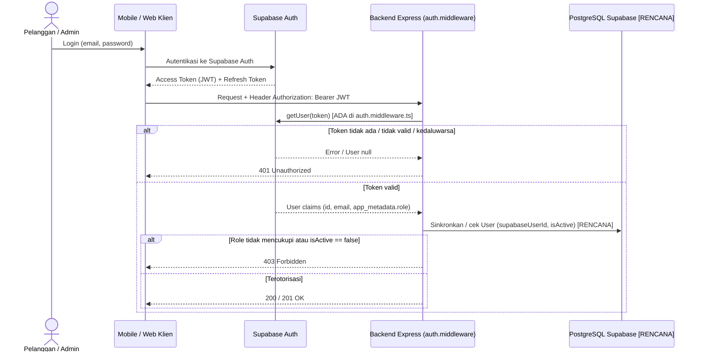

# Authentication and Authorization

**Status:** `[ADA]` (middleware kerangka `authenticate` dan `authorize` pada [`backend/src/middlewares/auth.middleware.ts`](../../backend/src/middlewares/auth.middleware.ts) serta proteksi `GET /api/v1/admin/ping`) | `[RENCANA]` (sinkronisasi otomatis ke tabel `users` PostgreSQL, pengecekan `User.isActive`, dan proteksi seluruh endpoint bisnis)

---

## 1. Batas Tanggung Jawab: Supabase Auth vs Backend

Sesuai Keputusan #2 (`[ADA]`) di [`keputusan-terbuka.md`](../00-project/keputusan-terbuka.md):
- **Supabase Auth** bertanggung jawab penuh atas registrasi akun, verifikasi kredensial login (`email` + `password`), reset password, dan penerbitan **Access Token (JWT)** beserta **Refresh Token**.
- **Backend Express (`backend/`)** tidak menyimpan `password_hash` dan tidak menyediakan endpoint login/register password lokal. Backend memverifikasi **Bearer JWT** pada setiap permintaan terproteksi melalui `supabase.auth.getUser(token)` dan menegakkan **RBAC** (`CUSTOMER` / `ADMIN`).

---

## 2. Alur Token & Verifikasi JWT (`[ADA]` Kerangka / `[RENCANA]` Sinkronisasi DB)

### Status Mekanisme Saat Ini
1. **Pengambilan & Verifikasi Bearer JWT (`[ADA]`):** `authenticate` di `auth.middleware.ts` memeriksa header `Authorization: Bearer <token>`, memanggil `getSupabaseAdmin().auth.getUser(token)`, dan mengisi `req.user = { id, email, role }`.
2. **Penentuan Role (`[ADA]` dasar / `[RENCANA]` DB sync):** Saat ini `auth.middleware.ts` membaca `data.user.app_metadata?.role` (`'ADMIN'` atau default `'CUSTOMER'`). Sinkronisasi dengan kolom `User.role` dan pemeriksaan `User.isActive` di PostgreSQL masih `[RENCANA]`.
3. **Middleware `authorize(...allowedRoles)` (`[ADA]`):** Memastikan `req.user` ada (`401`) dan `allowedRoles.includes(req.user.role)` (`403`).

---

## 3. Perbedaan `401 Unauthorized` vs `403 Forbidden`

| HTTP Status | Makna | Kondisi Pemicu |
|---|---|---|
| **`401 Unauthorized`** | Autentikasi gagal / belum teridentifikasi | Header `Authorization: Bearer ...` tidak ada, format salah, token tidak valid, atau token kedaluwarsa. |
| **`403 Forbidden`** | Terautentikasi, tetapi tidak berhak | Role `CUSTOMER` mengakses `/api/v1/admin/*`, akun nonaktif (`isActive = false`), Pelanggan mengakses `Order`/`Payment` milik orang lain, atau meminta PDF tanpa `EbookAccess` aktif. |

---

## 4. Matriks Endpoint Publik vs Terproteksi

| Kategori Akses | Contoh Endpoint | Autentikasi | Role Minimum | Status |
|---|---|---|---|---|
| **Publik** | `GET /api/v1/health` | Tidak wajib | Publik | `[ADA]` |
| **Publik** | `GET /api/v1/categories`, `GET /api/v1/ebooks`, `GET /api/v1/ebooks/{id}` | Tidak wajib | Publik | `[RENCANA]` |
| **Publik / Customer** | `GET /api/v1/recommendations/saw` | Opsional *(Keputusan #5)* | Publik / `CUSTOMER` | `[RENCANA]` |
| **Customer / Admin** | `POST /api/v1/auth/sync`, `GET/PATCH /api/v1/users/me` | Wajib Bearer JWT | `CUSTOMER \| ADMIN` | `[RENCANA]` |
| **Customer** | `POST/GET /api/v1/orders*`, `POST/GET /api/v1/payments*`, `GET /api/v1/ebooks/{id}/access-url` | Wajib Bearer JWT | `CUSTOMER` | `[RENCANA]` |
| **Admin** | `GET /api/v1/admin/ping` | Wajib Bearer JWT | `ADMIN` | `[ADA]` |
| **Admin** | Seluruh `/api/v1/admin/*` lainnya | Wajib Bearer JWT | `ADMIN` | `[RENCANA]` |
| **Payment Gateway** | `POST /api/v1/payments/webhook` | **Tidak** pakai JWT; wajib *Signature* Gateway | Payment Gateway | `[RENCANA]` |

---

## 5. Aturan Keamanan Token & Larangan Secret

1. **Dilarang menaruh secret di klien:** `SUPABASE_SERVICE_ROLE_KEY`, `DATABASE_URL`, dan *webhook secret* dilarang keras dimasukkan ke variabel `VITE_*` (`web/admin-web`, `web/pengunjung-web`) maupun kode Flutter (`mobile/ebook_store`).
2. **Penyimpanan Token di Klien:** Aplikasi mobile Flutter wajib menyimpan token sesi pada penyimpanan aman (*secure storage* `[RENCANA]`), bukan log konsol atau teks polos yang dibagikan bebas.
3. **Otorisasi Backend-Only:** Menyembunyikan menu admin di UI bukan kontrol keamanan; seluruh penegakan role wajib berjalan di `backend/`.
