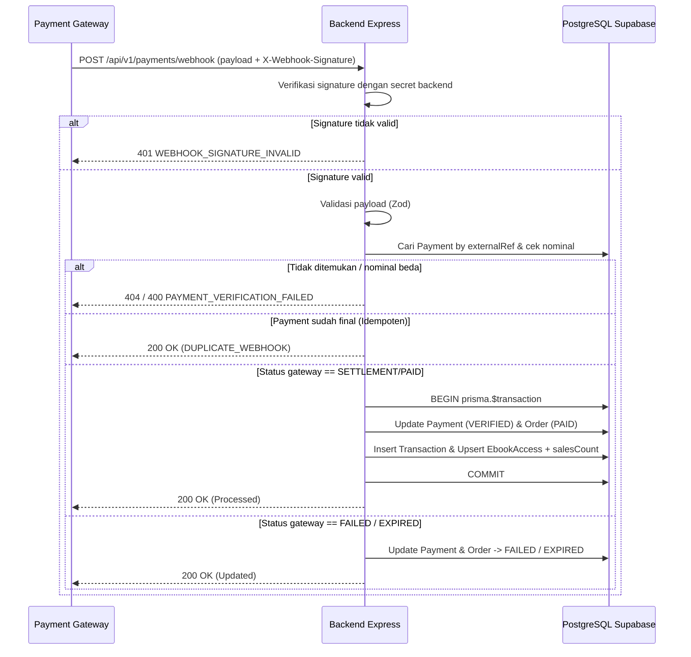

# Kontrak Webhook Payment Gateway (`Webhook Contract`)

**Status:** `[RENCANA]` — Endpoint webhook dan integrasi *payment gateway* nyata (Keputusan #3 `[ADA]`) belum diimplementasikan di `backend/`.

---

## 1. Tujuan, Endpoint, & Sumber Webhook

- **Tujuan:** Menerima notifikasi status pembayaran secara asinkron dari *payment gateway* nyata, memverifikasi keasliannya, dan memperbarui status transaksi serta hak akses `e-book` secara atomik dan idempoten.
- **Endpoint:** `POST /api/v1/payments/webhook`
- **Sumber Webhook:** Server *payment gateway* eksternal (Midtrans / Xendit). Endpoint ini **tidak** menggunakan Bearer JWT Pelanggan.
- **Header yang Diperlukan:**
  - `Content-Type: application/json`
  - Header *signature* resmi penyedia gateway (mis. `X-Webhook-Signature` / header khusus provider; diverifikasi dengan *webhook secret* yang hanya tersimpan di `.env` `backend/`).

---

## 2. Verifikasi Signature, Validasi Payload, & Pemetaan Status

1. **Verifikasi Signature:** Hitung HMAC/SHA-512 atau *signature* sesuai spesifikasi provider menggunakan *raw body* + *webhook secret* di `.env` `backend/`. Jika tidak cocok -> tolak `401` (`WEBHOOK_SIGNATURE_INVALID`) dan catat log keamanan.
2. **Validasi Payload (Zod):** Pastikan field wajib (`externalRef`, `status`, `amount`) valid. Payload cacat -> tolak `400` (`VALIDATION_ERROR`).
3. **Validasi Kecocokan Nominal:** Pastikan `amount` pada webhook sama persis dengan `Payment.amount` di PostgreSQL. Ketidakcocokan -> tolak `400` (`PAYMENT_VERIFICATION_FAILED`).

### Pemetaan Status Pembayaran Eksternal ke Internal (`schema.prisma`)

| Status Eksternal Gateway | `PaymentStatus` Internal | `OrderStatus` Internal | Aksi Sistem |
|---|---|---|---|
| `SETTLEMENT` / `PAID` / `CAPTURED` | `VERIFIED` | `PAID` | Jalankan transaksi atomik penerbitan `Transaction` + `EbookAccess`. |
| `PENDING` | `PENDING` | `PENDING` | Pertahankan status menunggu; belum ada akses PDF. |
| `DENY` / `CANCEL` / `FAILURE` | `FAILED` | `FAILED` | Tandai gagal; akses PDF tetap terkunci. |
| `EXPIRE` | `EXPIRED` | `EXPIRED` | Tandai kedaluwarsa; akses PDF tetap terkunci. |

---

## 3. Idempotensi & Transaksi Database Atomik

- **Prinsip Idempotensi:** Sebelum melakukan mutasi, `backend/` memeriksa `Payment.status`. Apabila status sudah final (`VERIFIED`, `FAILED`, atau `EXPIRED`), permintaan ulang dianggap **duplikat idempoten** (`DUPLICATE_WEBHOOK`) dan langsung dibalas `200 OK` tanpa menulis `Transaction` atau `EbookAccess` lagi.
- **Transaksi Atomik (`prisma.$transaction`) saat Status = `VERIFIED`:**
  1. Perbarui `Payment`: `status = VERIFIED`, `paidAt = now()`.
  2. Perbarui `Order`: `status = PAID`.
  3. Buat record `Transaction` (`orderId`, `paymentId`, `userId`, `transactionCode`, `amount`).
  4. Untuk setiap `OrderItem`: *upsert* `EbookAccess` (`userId`, `ebookId`, `orderId`, `isRevoked = false`) dan naikkan `Ebook.salesCount`.
  5. Jika salah satu langkah gagal -> *rollback* seluruh transaksi.

---

## 4. Diagram Sequence Webhook (`[RENCANA]`)



---

## 5. Contoh Payload (`"DATA SIMULASI"`)

```json
{
  "externalRef": "DATA-SIMULASI-GW-20261114-001",
  "orderNumber": "ORD-DATA-SIMULASI-001",
  "status": "VERIFIED",
  "amount": "75000.00",
  "paidAt": "2026-11-14T04:30:00.000Z"
}
```

---

## 6. Daftar Test Case Webhook Wajib (Fase Pengujian `[RENCANA]`)

1. **Signature tidak valid** -> respons `401 WEBHOOK_SIGNATURE_INVALID`, status `Order`/`Payment` tidak berubah.
2. **Payload tidak lengkap / format nominal salah** -> respons `400 VALIDATION_ERROR`.
3. **Nominal webhook berbeda dengan `Payment.amount`** -> respons `400 PAYMENT_VERIFICATION_FAILED`.
4. **Pembayaran `VERIFIED` pertama kali** -> `Payment -> VERIFIED`, `Order -> PAID`, `Transaction` & `EbookAccess` tercipta atomik (`TC-PAY-01`).
5. **Webhook `VERIFIED` dikirim dua kali (duplikat)** -> respons `200 OK` (`DUPLICATE_WEBHOOK`), tidak ada duplikasi `Transaction` atau `EbookAccess` (`TC-PAY-02`).
6. **Status `FAILED` dan `EXPIRED`** -> `Payment` & `Order` diperbarui sesuai status tanpa menerbitkan `EbookAccess`.
7. **Status `PENDING`** -> status tetap `PENDING`, tidak ada mutasi akses.
8. **Simulasi error DB saat insert `EbookAccess`** -> seluruh transaksi di-*rollback* (*no partial commit*).
