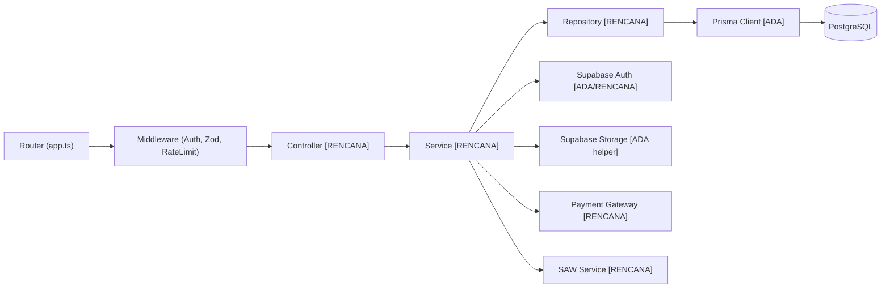

# Arsitektur Aplikasi (`Application Architecture`)

**Status:** `[ADA]` (struktur monorepo, fondasi `backend/src/`, `web/admin-web` TypeScript template, `web/pengunjung-web` template, `mobile/ebook_store` template + paket) | `[RENCANA]` (seluruh modul fitur bisnis pada keempat aplikasi)

---

## 1. Backend (`backend/` — Node.js + Express + TypeScript + Zod + Prisma 7 ESM)

### Lapisan Arsitektur Backend
- **Router & App (`app.ts` `[ADA]`):** Mendaftarkan `helmet`, `cors`, parser JSON, serta rute `/api/v1/*`. Saat ini baru memuat `GET /api/v1/health` dan `GET /api/v1/admin/ping`.
- **Middleware (`[ADA]` kerangka / `[RENCANA]` penuh):**
  - `auth.middleware.ts` (`[ADA]`): `authenticate` (verifikasi JWT Supabase) & `authorize` (`RBAC`).
  - `validate.ts` (`[ADA]`): validasi request dengan **Zod**.
  - `error.middleware.ts` (`[ADA]` aktif di `app.ts`; catatan: terdapat `middleware/error-handler.ts` duplikat yang belum disatukan).
  - `rate-limit.middleware.ts` (`[ADA]` berkas, `[RENCANA]` pemasangan pada rute sensitif di `app.ts`).
- **Controller & Service (`[RENCANA]`):** Mengorkestrasi logika bisnis katalog, pesanan, pembayaran, akses PDF, laporan, dan **SAW Service** (fungsi murni *backend-only*).
- **Repository / Prisma Client (`config/prisma.ts` `[ADA]`):** Akses *type-safe* ke PostgreSQL Supabase melalui Prisma 7 (`schema.prisma` 8 model `[ADA]`; migrasi `[RENCANA]`).
- **Integrasi Eksternal:** Supabase Auth (`config/supabase.ts` `[ADA]`), Storage helper (`integrations/storage/supabase-storage.ts` `[ADA]` dengan `createPrivatePdfSignedUrl`), Payment Gateway (`[RENCANA]`).
- **Logging, Observabilitas, & Testing:** `console.error` dasar pada error handler (`[ADA]`); logging terstruktur produksi (`[RENCANA]`). **Unit test** Vitest: 2 berkas, 5 tes lulus (`[ADA]`); integration test fitur bisnis (`[RENCANA]`).

---

## 2. Admin Web (`web/admin-web/`)

- **Stack (`[ADA]` di `package.json`):** React `^19.3.1`, TypeScript `^6.0.3`, Vite `^8.3.6`, ESLint (`tsc --noEmit` & `lint` PASS). Gaya desain terkunci: **Neo-Brutalism** (3 zona intensitas `[RENCANA]`).
- **Struktur Rencana (`[RENCANA]`):** Halaman login Supabase Auth, proteksi route di UI (*hanya kenyamanan antarmuka, bukan pengganti otorisasi `ADMIN` di backend*), Dashboard ringkasan, Manajemen Kategori & E-Book (+ unggah PDF via backend), Pemantauan Pelanggan/Pesanan/Pembayaran/Transaksi, Laporan Penjualan, dan Kontrol Bobot SAW (menunggu Keputusan #5 & #9).
- **Status Implementasi:** Template Vite + TypeScript `[ADA]`; seluruh modul admin `[RENCANA]`.

---

## 3. Portal Web Pengunjung (`web/pengunjung-web/`)

- **Stack (`[ADA]` di `package.json`):** React `^19.3.1`, Vite `^8.3.6` (lint & build PASS). Dipertahankan sebagai portal web pelanggan sesuai Keputusan #1 (`[ADA]`).
- **Fitur Rencana (`[RENCANA]`):** Katalog `e-book`, pencarian & filter kategori, detail `e-book`, rekomendasi `SPK SAW` dari backend, *checkout* & pembayaran gateway, riwayat pembelian, dan pembaca PDF internal via `signed URL`.
- **Status Implementasi:** Template default Vite `[ADA]`; seluruh modul pelanggan web `[RENCANA]`.

---

## 4. Mobile Flutter (`mobile/ebook_store/`)

- **Stack (`[ADA]` di `pubspec.yaml`):** Flutter (Dart `^3.12.0`), `flutter_riverpod ^2.6.1` (*state management*), `dio ^5.8.0+1` (*HTTP client*), dan `flutter_secure_storage ^9.2.4` (penyimpanan token aman).
- **Target Platform:** **Android** sebagai target utama fase awal (iOS/Desktop *out-of-scope* fase awal).
- **Fitur Rencana (`[RENCANA]`):** Autentikasi Supabase, katalog & pencarian, rekomendasi `SPK SAW`, *checkout* & pembayaran, riwayat pembelian, serta *in-app PDF reader* via `signed URL` sementara.
- **Status Implementasi Actual:** `lib/main.dart` masih berupa template *counter app* (`flutter analyze` & `flutter test` template PASS); seluruh fitur bisnis `[RENCANA]`.
