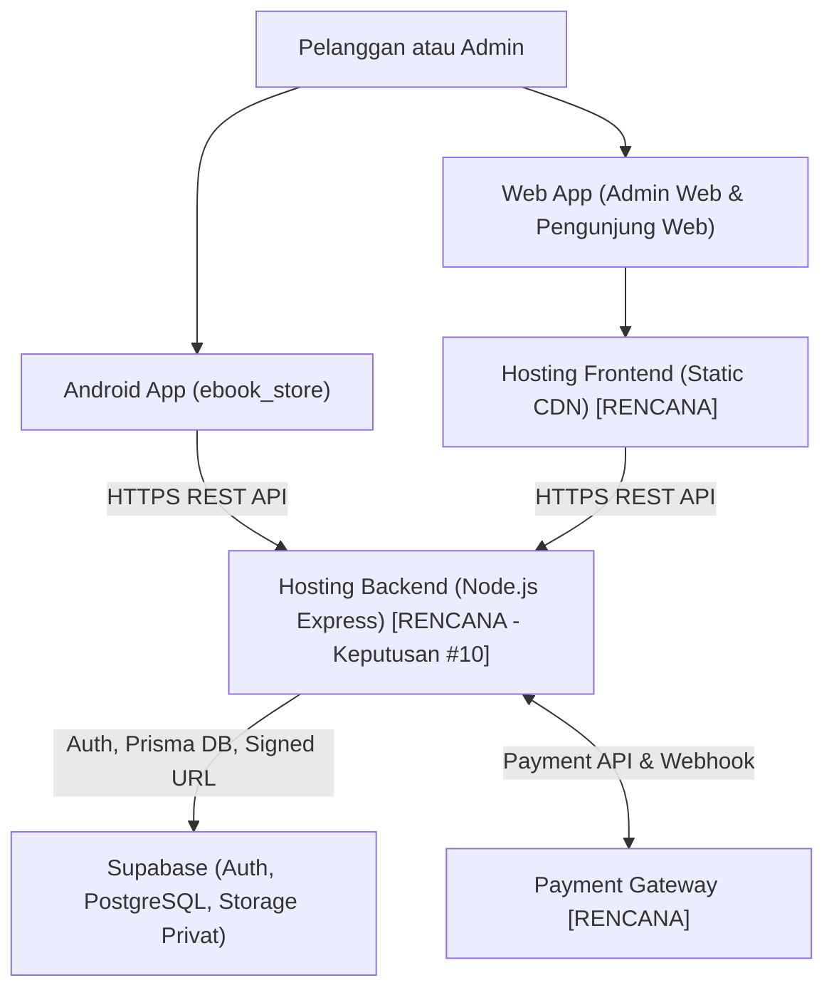

# Arsitektur Deployment (`Deployment Architecture`)

**Status:** `[RENCANA]` — Belum ada proses deployment produksi yang berjalan maupun terverifikasi di repository; pilihan platform hosting backend masih menunggu Keputusan #10 di [`keputusan-terbuka.md`](../00-project/keputusan-terbuka.md).

---

## 1. Lingkungan Sistem

| Lingkungan | Tujuan | Status Aktual |
|---|---|---|
| **Development (Lokal)** | Pengembangan lokal di Windows PowerShell (`npm run dev`, Vite dev server, `flutter run`). | `[ADA]` skrip lokal pada `package.json` & `flutter`; koneksi DB/gateway penuh `[RENCANA]`. |
| **Testing** | Eksekusi otomatis Vitest (`backend`), lint/build (`web`), dan `flutter analyze`/`test`. | `[ADA]` untuk cek fondasi (`test-results.md`); suite integrasi bisnis `[RENCANA]`. |
| **Production** | Rilis operasional terhubung ke Supabase & Payment Gateway live. | `[RENCANA]` — menunggu penyelesaian Fase 1–4 dan Keputusan #10. |

---

## 2. Komponen Infrastruktur Rencana (`[RENCANA]`)

- **Backend Hosting:** Menunggu Keputusan #10 (opsi: PaaS Node.js *long-running* seperti Railway/Render/VPS vs Vercel Functions serverless dengan connection pooler).
- **Database & Storage Supabase:** PostgreSQL Supabase (port `6543` pooler untuk runtime, port `5432` direct untuk migrasi Prisma) dan Supabase Storage `bucket privat`.
- **Admin Web & Web Pengunjung Hosting:** Build statis Vite (`npm run build` -> `dist/`) di-deploy ke layanan hosting web statis/CDN; dilarang menaruh secret di variabel `VITE_*`.
- **Aplikasi Flutter Android:** Build APK/AAB (`flutter build apk` / `appbundle`) untuk perangkat Android dengan base URL API terkonfigurasi aman.
- **Pengelolaan Environment & Secret:** `.env` hanya untuk lokal (diabaikan Git via `.gitignore`); secret produksi (`DATABASE_URL`, `SUPABASE_SERVICE_ROLE_KEY`, *webhook secret* gateway) dikelola melalui *environment variable manager* platform hosting.
- **Health Check & Webhook:** Endpoint `GET /api/v1/health` (`[ADA]`) digunakan untuk pemeriksaan kesiapan (*readiness/liveness*); endpoint `POST /api/v1/payments/webhook` (`[RENCANA]`) wajib dapat diakses publik via HTTPS oleh server Payment Gateway.
- **Logging, Backup, & Monitoring:** Logging error server dasar tersedia di `error.middleware.ts` (`[ADA]`); pemantauan terpusat, backup otomatis database Supabase, dan alerting `[RENCANA]`.

---

## 3. Diagram Deployment Rencana (`[RENCANA]`)

