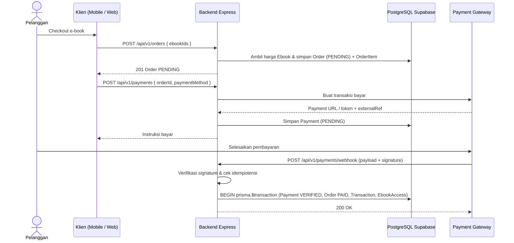
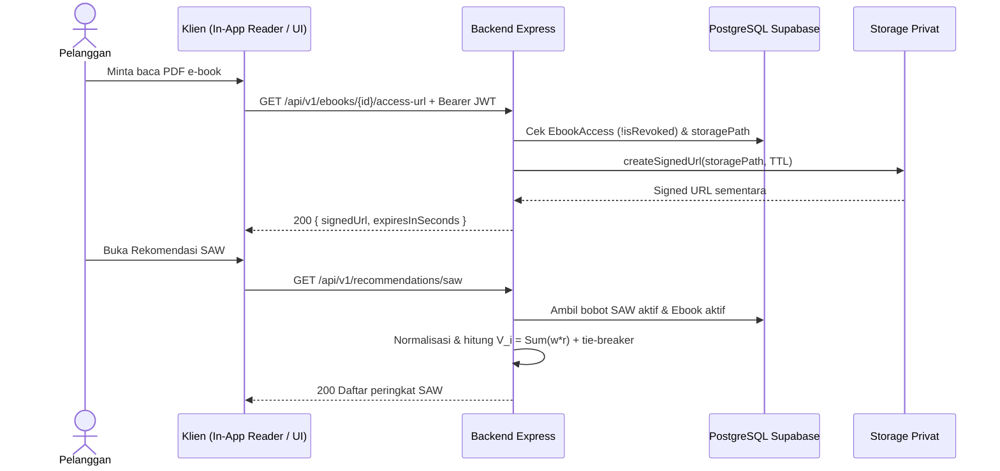

# Arsitektur Integrasi (`Integration Architecture`)

**Status:** `[ADA]` (klien Supabase dasar `config/supabase.ts`, `config/prisma.ts`, dan helper `supabase-storage.ts`) | `[RENCANA]` (integrasi runtime penuh ke Supabase Auth/DB/Storage, Payment Gateway, dan ketiga aplikasi klien)

---

## 1. Matriks Integrasi Sistem

| Integrasi | Arah Data | Mekanisme | Data Utama | Kontrol Keamanan | Kegagalan yang Ditangani | Status |
|---|---|---|---|---|---|---|
| **Supabase Auth** | Klien -> Auth; Backend <-> Auth | SDK Supabase di klien; `getUser(token)` di `backend/` | Email, `JWT`, `supabaseUserId`, `app_metadata.role` | Verifikasi JWT di backend (`401`), cek `isActive` (`403`) | Token kedaluwarsa, token palsu, akun nonaktif | `[ADA]` middleware / `[RENCANA]` sync DB |
| **PostgreSQL Supabase** | Backend <-> DB | Prisma 7 + `@prisma/adapter-pg` | `User`, `Category`, `Ebook`, `Order`, `Payment`, `Transaction`, `EbookAccess` | Koneksi hanya dari `backend/` (`.env`); *prepared queries* Prisma | Rollback `prisma.$transaction`, penolakan relasi `Restrict` | `[ADA]` `schema.prisma` / `[RENCANA]` migrasi |
| **Supabase Storage (`Bucket Privat`)** | Backend <-> Storage; Klien <- Storage | Service Role API di server; `signed URL` TTL singkat | File PDF e-book, `storagePath` | Bucket **privat**; cek `EbookAccess` (`!isRevoked`) sebelum terbit `signed URL` | Gagal unggah, gagal buat `signed URL` (`500`), akses tanpa hak (`403`) | `[ADA]` helper / `[RENCANA]` endpoint |
| **Payment Gateway** | Backend <-> Gateway; Gateway -> Backend | REST API gateway + *Webhook* HTTP | `orderNumber`, `amount`, `externalRef`, status bayar | Verifikasi *signature webhook*, cek nominal, *idempotensi*, transaksi atomik | *Signature* invalid (`401`), duplikat *webhook* (`200`), timeout gateway (`502/503`) | `[RENCANA]` |
| **Klien Mobile (`ebook_store`)** | Mobile <-> Backend | Dio REST JSON + *Bearer JWT* | Katalog, rekomendasi SAW, order, `signedUrl` | Secure storage token, tanpa secret/kalkulasi SAW di Flutter | Error jaringan, `401` refresh sesi, `signedUrl` expired | `[RENCANA]` |
| **Klien Web Pengunjung** | Web <-> Backend | Fetch/HTTP REST JSON + *Bearer JWT* | Katalog, rekomendasi SAW, order, `signedUrl` | Tanpa secret di `VITE_*`, proteksi CORS di `app.ts` | Error validasi `400`, `403` akses ditolak | `[RENCANA]` |
| **Admin Web** | Admin Web <-> Backend | Fetch/HTTP REST JSON + *Bearer JWT* (`ADMIN`) | CRUD kategori/e-book/PDF, laporan, bobot SAW | Wajib role `ADMIN` di `backend/` (menu UI hanya kosmetik) | Non-admin (`403`), konflik hapus (`409`) | `[RENCANA]` |

---

## 2. Prinsip Mediator Backend
- **Mediator Tunggal:** `backend/` menjadi satu-satunya mediator ke PostgreSQL dan Supabase Storage.
- **Webhook & Atomisitas:** *Webhook* gateway masuk ke `backend/`, diverifikasi *signature*-nya, lalu memperbarui `Payment`, `Order`, `Transaction`, dan `EbookAccess` secara atomik.
- **Penerbitan `Signed URL` & SAW:** Hanya `backend/` yang menerbitkan `signed URL` sementara dan menghitung peringkat `SPK SAW` dari data valid di database.

---

## 3. Sequence Diagram Integrasi Kunci (`[RENCANA]`)

### 3.1 Checkout Hingga Pembayaran Berhasil & 3.2 Webhook Payment Gateway

### 3.3 Permintaan Signed URL & 3.4 Permintaan Rekomendasi SAW

