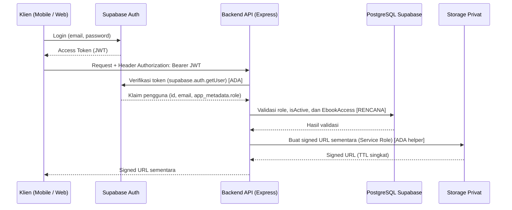

# Arsitektur Keamanan (`Security Architecture`)

**Status:** `[ADA]` (kebijakan di `AGENTS.md`, `.gitignore`, middleware kerangka `auth.middleware.ts`, `rate-limit.middleware.ts`, `error.middleware.ts`, `validate.ts`, dan helper `createPrivatePdfSignedUrl`) | `[RENCANA]` (integrasi penuh runtime, sinkronisasi `User.isActive`, *signature webhook*, dan audit keamanan operasional)

---

## 1. Alur Keamanan Lintas Komponen (`[ADA]` Kerangka / `[RENCANA]` Bisnis)

---

## 2. Lapisan Kontrol Keamanan

| Domain Keamanan | Mekanisme & Aturan | Status Aktual |
|---|---|---|
| **Autentikasi Supabase Auth & Bearer JWT** | Klien login ke **Supabase Auth**; `backend/` memverifikasi *Bearer JWT* via `supabase.auth.getUser(token)` (`auth.middleware.ts`). | `[ADA]` middleware dasar / `[RENCANA]` sinkronisasi tabel `users` |
| **RBAC (`CUSTOMER` & `ADMIN`)** | `authorize('ADMIN')` menegakkan kontrol peran di `backend/`. Menyembunyikan menu di UI hanya kosmetik. | `[ADA]` kerangka pada `/api/v1/admin/ping` / `[RENCANA]` endpoint bisnis |
| **Pembeda `401` vs `403`** | `401 Unauthorized`: token tidak ada/tidak valid/kedaluwarsa. `403 Forbidden`: token valid, tetapi role/kepemilikan/status aktif tidak memenuhi syarat. | `[ADA]` di `auth.middleware.ts` |
| **Validasi Input (Zod)** | Seluruh payload request divalidasi dengan **Zod** (`middleware/validate.ts`) sebelum menyentuh logika bisnis. | `[ADA]` helper / `[RENCANA]` skema tiap modul |
| **Rate Limiting & Helmet** | `helmet()` aktif di `app.ts`; `sensitiveEndpointLimiter` (`express-rate-limit`) tersedia di `rate-limit.middleware.ts`. | `[ADA]` `helmet` & berkas limiter / `[RENCANA]` pasang limiter di rute |
| **Integritas Harga & Total Pesanan** | `backend/` menghitung `totalAmount` dan `unitPrice` langsung dari `Ebook.price` di database; harga/role/bobot SAW dari klien tidak dipercaya. | `[RENCANA]` |
| **Perlindungan Secret** | `.env` diabaikan Git (`.gitignore`). `SUPABASE_SERVICE_ROLE_KEY`, `DATABASE_URL`, dan secret gateway **dilarang** ada di `VITE_*` atau kode Flutter. | `[ADA]` aturan & `.gitignore` / `[RENCANA]` audit rilis |
| **Proteksi PDF (`Bucket Privat` & `Signed URL`)** | PDF berada di `bucket privat`; `backend/` memeriksa `EbookAccess` aktif (`!isRevoked`) sebelum memanggil `createPrivatePdfSignedUrl` (default TTL 300 detik). | `[ADA]` helper storage / `[RENCANA]` endpoint & cek akses |
| **Keamanan Webhook Pembayaran** | Verifikasi *signature* gateway sebelum mutasi, cek nominal, *idempotensi* (abaikan duplikat final), dan transaksi atomik `prisma.$transaction`. | `[RENCANA]` |
| **Sanitasi Error** | `errorHandler` (`error.middleware.ts`) menyembunyikan *stack trace* dan detail query DB pada error `500`. | `[ADA]` di `app.ts` |

---

## 3. Audit Keamanan yang Masih `[RENCANA]`
Seluruh uji penetrasi/keamanan fungsional pada [`test-cases.md`](../09-testing/test-cases.md) (`TC-AUTH-03`, `TC-ACC-01`, `TC-PAY-02`) dan pemindaian secret pra-rilis (`security-audit`) masih berstatus `[RENCANA]` hingga fitur bisnis diimplementasikan.
