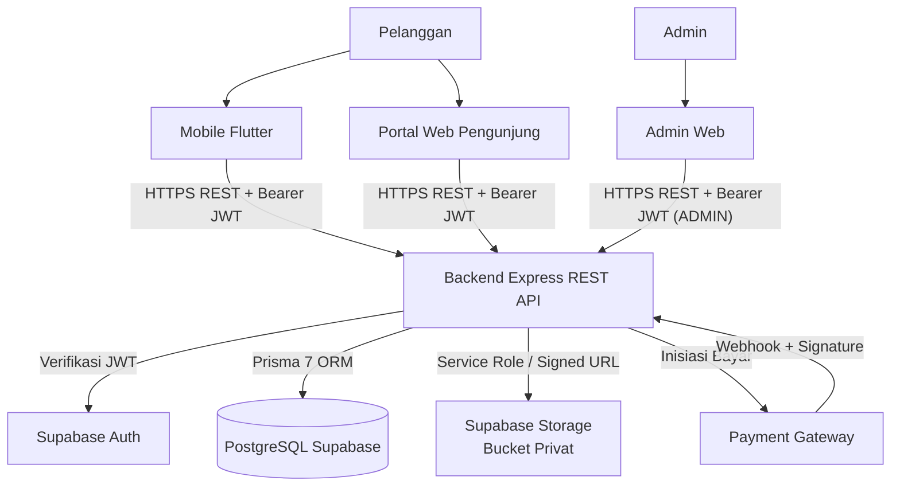

# Arsitektur Sistem (`System Architecture`)

**Status:** `[ADA]` (arsitektur target terkunci pada `AGENTS.md`, fondasi `backend/`, `schema.prisma`, dan template klien) | `[RENCANA]` (implementasi fitur bisnis, integrasi penuh Supabase Auth/Storage privat, Payment Gateway, dan `SPK SAW`)

---

## 1. Tujuan & Ruang Lingkup Arsitektur Sistem

Dokumen ini menetapkan arsitektur tingkat tinggi **Sistem Informasi E-Commerce E-Book dan SPK (Metode SAW)** untuk menyelaraskan komunikasi antar-komponen, batas keamanan, dan jalur data utama. Ruang lingkup mencakup model *Single-Seller B2C* ([ADR-0001](../adr/0001-single-seller-b2c.md)) dengan **2 aktor utama**: **Pelanggan** dan **Admin**.

---

## 2. Diagram Arsitektur Sistem (`[ADA]` Kerangka / `[RENCANA]` Bisnis)

> **Penegasan Batas Akses:** Aplikasi klien (`Mobile Flutter`, `Portal Web Pengunjung`, `Admin Web`) **tidak mengakses** PostgreSQL Supabase, `Storage Bucket Privat`, maupun perhitungan `SPK SAW` secara langsung. Seluruh kendali otorisasi, bisnis, transaksi, dan penerbitan `signed URL` terpusat di `Backend Express REST API`.

---

## 3. Komponen Sistem, Tanggung Jawab, & Status Aktual

| Komponen | Tanggung Jawab Utama | Batas Akses | Status Implementasi |
|---|---|---|---|
| **Mobile Flutter (`mobile/ebook_store`)** | Antarmuka Android Pelanggan: katalog, rekomendasi SAW, checkout, riwayat, dan *in-app PDF reader*. | Hanya memanggil REST API backend & login Supabase Auth. | `[ADA]` template + paket (`pubspec.yaml`); `[RENCANA]` fitur |
| **Portal Web Pengunjung (`web/pengunjung-web`)** | Antarmuka web Pelanggan (Keputusan #1 `[ADA]`). | Tidak menyimpan secret di `VITE_*`; hanya via REST API backend. | `[ADA]` template Vite; `[RENCANA]` fitur |
| **Admin Web (`web/admin-web`)** | Antarmuka operasional Admin (Neo-Brutalism): kelola katalog/PDF, kategori, order, laporan, SAW. | Proteksi UI bersifat kosmetik; otorisasi ditegakkan backend. | `[ADA]` template TypeScript; `[RENCANA]` fitur |
| **Backend REST API (`backend/`)** | *Single source of truth*: verifikasi JWT, `RBAC`, validasi Zod, checkout, *webhook*, `signed URL`, dan `SPK SAW`. | Satu-satunya komponen yang memegang *service role key* & *webhook secret*. | `[ADA]` fondasi (`/health`, `/admin/ping`, middleware, `schema.prisma`); `[RENCANA]` modul bisnis |
| **Supabase Auth** | Registrasi, login, dan penerbitan `JWT` sesi. | Diverifikasi ulang oleh `backend/` sebelum akses data. | `[ADA]` Keputusan #2 & `auth.middleware.ts`; `[RENCANA]` sinkronisasi DB |
| **PostgreSQL Supabase** | Penyimpanan persisten data relasional via Prisma 7. | Tidak terekspos langsung ke klien publik. | `[ADA]` `schema.prisma` (8 model); `[RENCANA]` migrasi SQL |
| **Supabase Storage (`Bucket Privat`)** | Penyimpanan file PDF `e-book` secara privat. | Akses baca hanya via `signed URL` TTL singkat dari `backend/`. | `[ADA]` helper dasar `supabase-storage.ts`; `[RENCANA]` endpoint & upload |
| **Payment Gateway** | Pemrosesan pembayaran daring nyata (Keputusan #3 `[ADA]`). | Status pembayaran sah hanya lewat *webhook* terverifikasi di `backend/`. | `[RENCANA]` |

---

## 4. Jalur Data Utama, Risiko, & Referensi

- **Jalur Data Utama (`[RENCANA]`):** (1) Autentikasi Supabase Auth -> verifikasi JWT backend; (2) Katalog publik terpaginasi tanpa `storagePath`; (3) Rekomendasi `SPK SAW` *backend-only*; (4) Checkout dengan *snapshot* harga DB -> Payment Gateway -> *webhook* idempoten -> transaksi atomik `Transaction` + `EbookAccess`; (5) Permintaan `signed URL` sementara untuk *in-app PDF reader*.
- **Risiko & Dependensi Utama:** Ketergantungan pada penyelesaian Keputusan #5–#11 di [`keputusan-terbuka.md`](../00-project/keputusan-terbuka.md) (terutama #9 konflik kriteria SAW dan #10 hosting backend), keamanan *webhook* lokal/produksi, serta perlindungan bucket privat.
- **Referensi Terkait:** [`architecture.md`](../01-design/architecture.md) | [`api-spec.yaml`](../02-api/api-spec.yaml) | [`erd.md`](../01-design/erd.md) | [`security-overview.md`](../07-security/security-overview.md) | [`adr/`](../adr/0001-single-seller-b2c.md).
