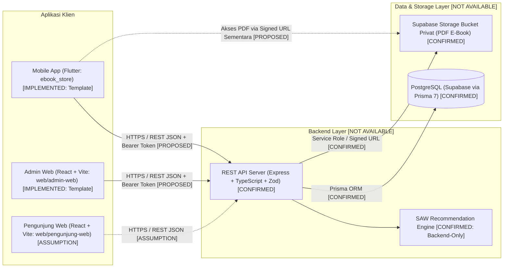
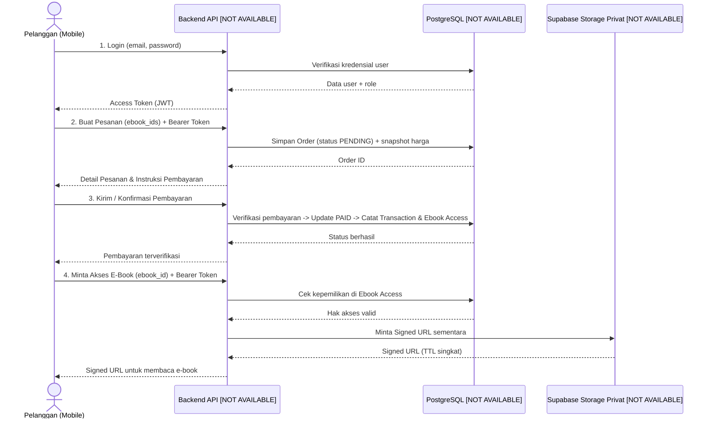

# Arsitektur Sistem (`System Architecture`)

**Status:** `[CONFIRMED]` (arsitektur target pada `AGENTS.md`) | `[PROPOSED]` (detail alur komunikasi & pemrosesan) | `[NOT AVAILABLE]` (implementasi backend & database)

---

## 1. Gambaran Umum Arsitektur

Sistem Informasi E-Commerce E-Book dirancang menggunakan arsitektur **Client–Server (N-Tier)** dengan satu layanan backend terpusat sebagai *single source of truth* untuk logika bisnis, otorisasi, transaksi, pemberian hak akses e-book, serta perhitungan SPK (SAW).

---

## 2. Hubungan Antarkomponen

### A. Mobile Application (`mobile/ebook_store`) dengan Backend
- **Status:** `[NOT AVAILABLE]` (belum ada HTTP client maupun endpoint; `lib/main.dart` masih berupa template default).
- **Rancangan (`[CONFIRMED]` / `[PROPOSED]`):**
  - Aplikasi mobile menggunakan **Dio** (`[CONFIRMED]` pada `AGENTS.md`) untuk berkomunikasi dengan Backend REST API melalui JSON.
  - Aplikasi mobile **tidak** terhubung langsung ke database PostgreSQL dan **tidak** menyimpan *service role key* Supabase (`[CONFIRMED]`).
  - Perhitungan rekomendasi e-book (SAW) hanya dipanggil dari endpoint backend; klien mobile hanya menerima hasil peringkat (`[CONFIRMED]`).

### B. Admin Web (`web/admin-web`) dengan Backend
- **Status:** `[NOT AVAILABLE]` (belum ada integrasi API; `src/App.jsx` masih berupa template Vite).
- **Rancangan (`[CONFIRMED]` / `[PROPOSED]`):**
  - Admin Web berkomunikasi dengan Backend REST API yang sama dengan proteksi role `ADMIN` (`[CONFIRMED]`).
  - Penyembunyian menu di UI hanya bersifat kosmetik; seluruh validasi hak akses admin wajib ditegakkan di backend (`[CONFIRMED]`).

### C. Pengunjung Web (`web/pengunjung-web`) dengan Backend
- **Status:** `[ASSUMPTION]` — Direktori ditemukan sebagai template React + Vite, namun belum tercantum dalam `AGENTS.md`. Jika digunakan untuk pelanggan versi web, komunikasinya mengikuti pola yang sama dengan Mobile App melalui REST API.

### D. Backend dengan Database & Storage
- **Status:** `[NOT AVAILABLE]` — Belum ada `schema.prisma` maupun kode backend.
- **Rancangan (`[CONFIRMED]`):**
  - Backend mengakses PostgreSQL Supabase menggunakan **Prisma 7** (`DATABASE_URL` port 6543 untuk runtime dan `DIRECT_URL` port 5432 untuk migrasi).
  - File PDF e-book disimpan pada **Supabase Storage bucket privat**; backend menghasilkan *signed URL* berjangka waktu pendek hanya setelah hak akses pelanggan terverifikasi.

---

## 3. Alur Komunikasi API, Autentikasi, Transaksi, dan Hak Akses E-Book (`[PROPOSED]`)

### Prinsip Arsitektur Kunci (`[CONFIRMED]`)
1. **Otorisasi Terpusat di Backend:** Setiap endpoint terproteksi memeriksa validitas token dan role (`CUSTOMER` / `ADMIN`).
2. **Integritas Harga & Transaksi:** Harga item pada pesanan diambil dari harga database saat transaksi dibuat (*snapshot*), bukan dari input klien.
3. **Pemberian Hak Akses E-Book Berbasis Verifikasi:** Hak akses (`Ebook Access`) hanya diberikan setelah status pembayaran berstatus terverifikasi/lunas (`PAID`), bukan sekadar saat pesanan dibuat.
