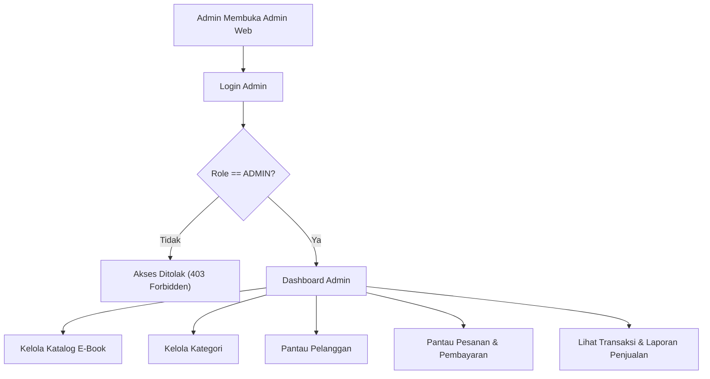

# Alur Proses Bisnis Admin (`Admin Workflow`)

**Status:** `[CONFIRMED]` (kebutuhan alur dasar) | `[PROPOSED]` (detail proses) | `[NOT AVAILABLE]` (implementasi di `web/admin-web` & `backend/`)

---

## 1. Alur Utama Administrasi

1. **Login Admin:** Admin masuk melalui halaman login `admin-web`; backend memvalidasi kredensial serta memastikan role akun adalah `ADMIN`.
2. **Membuka Dashboard:** Admin melihat ringkasan operasional (total penjualan, jumlah pesanan, e-book aktif, pelanggan terdaftar).
3. **Mengelola Katalog E-Book:** Admin menambah e-book baru (beserta unggah file PDF ke bucket privat), memperbarui metadata/harga, atau menonaktifkan e-book.
4. **Mengelola Kategori E-Book:** Admin menambah, mengubah, atau menonaktifkan kategori e-book.
5. **Mengelola Data Penulis & Pelanggan:** Admin mengelola data penulis (jika dipisahkan sebagai entitas) dan memantau daftar pelanggan sesuai kewenangan.
6. **Memantau Pesanan & Pembayaran:** Admin melihat daftar pesanan masuk, status pembayaran, serta menindaklanjuti kendala verifikasi jika diperlukan.
7. **Melihat Informasi Penjualan & Transaksi:** Admin meninjau riwayat transaksi dan laporan penjualan berdasarkan periode tertentu.

---

## 2. Diagram Alur Admin (`[PROPOSED]`)

---

## 3. Ketentuan Keamanan Alur Admin (`[CONFIRMED]`)

- Pembatasan menu di `web/admin-web` tidak cukup; setiap endpoint admin di backend wajib dilindungi middleware autentikasi + otorisasi role `ADMIN`.
- Perubahan data master (seperti penghapusan e-book yang sudah pernah dibeli) tidak boleh merusak riwayat transaksi dan hak akses pelanggan yang sudah membayar (*soft delete* / arsip `[PROPOSED]`).
