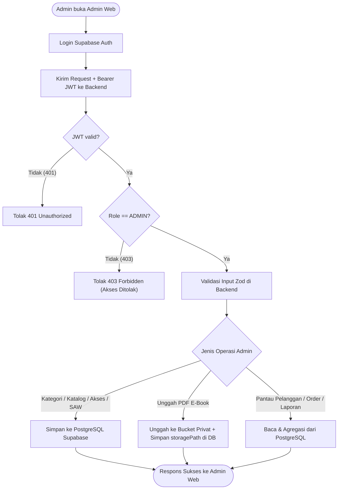

# Alur Proses Bisnis Admin (`Admin Workflow`)

**Status:** `[RENCANA]` — Seluruh proses operasional **Admin** di bawah ini merupakan rancangan target pada `web/admin-web` dan `backend/`. Saat ini baru tersedia endpoint uji `GET /api/v1/admin/ping` (`[ADA]`) yang dilindungi middleware `authenticate` + `authorize('ADMIN')`.

---

## 1. Diagram Alur Admin & Batas Keamanan (`[RENCANA]`)

> **Penegasan Keamanan:** Pembatasan menu di `web/admin-web` hanya bersifat kosmetik; seluruh penegakan role `ADMIN` wajib berjalan di `backend/`.

---

## 2. Spesifikasi Proses Bisnis Admin (`BP-A01` s.d. `BP-A16`)

| ID Proses | Nama Proses | Aktor | Tujuan | Prakondisi | Pemicu | Alur Utama | Alur Alternatif | Alur Gagal | Pascakondisi | Data Utama | Kebutuhan | Status |
|---|---|---|---|---|---|---|---|---|---|---|---|---|
| **BP-A01** | Login Sebagai Admin | Admin, Supabase Auth, `backend` | Masuk ke `admin-web` dengan role `ADMIN` terverifikasi. | Akun ber-role `ADMIN` & `isActive=true`. | Admin submit login. | Login Supabase -> kirim JWT ke backend -> `authorize('ADMIN')`. | — | Non-admin (`403`), token invalid (`401`). | Sesi Admin aktif. | Email, password, JWT. | `FR-A01` | `[RENCANA]` |
| **BP-A02** | Mengelola Profil Admin | Admin, `backend` | Memperbarui `fullName` / `phone` admin. | Admin login. | Edit profil di `admin-web`. | `PATCH /api/v1/users/me` + validasi Zod -> update `users`. | — | Input invalid (`400`). | Profil admin terbarui. | `fullName`, `phone`. | `FR-C02` | `[RENCANA]` |
| **BP-A03** | Mengelola Kategori | Admin, `backend` | CRUD kategori `e-book`. | Role `ADMIN`. | Tambah/ubah/hapus kategori. | Validasi Zod (`name`, `slug`) -> simpan/update `categories`. | Nonaktifkan kategori (`isActive=false`). | Hapus kategori yang masih punya `e-book` (`409`). | Data `Category` tersimpan. | `name`, `slug`, `description`. | `FR-A03` | `[RENCANA]` |
| **BP-A04** | Membuat E-Book | Admin, `backend` | Menambah entri katalog `e-book` baru. | Role `ADMIN`, kategori ada. | Submit form tambah e-book. | Validasi Zod (`price >= 0`, `categoryId`) -> simpan `ebooks`. | Disertai unggah sampul & PDF (`BP-A07`, `BP-A08`). | `categoryId` tidak ada (`404`), harga negatif (`400`). | `Ebook` baru tersimpan. | Metadata `Ebook`. | `FR-A04` | `[RENCANA]` |
| **BP-A05** | Memperbarui E-Book | Admin, `backend` | Mengubah metadata atau harga `e-book`. | Role `ADMIN`, `Ebook` ada. | Submit form edit e-book. | Validasi Zod -> update `ebooks` (tidak ubah `OrderItem.unitPrice` lama). | Ganti PDF atau sampul baru. | ID tidak ditemukan (`404`). | Metadata/harga baru aktif. | Field `Ebook` yang diubah. | `FR-A04` | `[RENCANA]` |
| **BP-A06** | Mengarsipkan E-Book | Admin, `backend` | Menonaktifkan `e-book` dari katalog publik tanpa merusak riwayat. | Role `ADMIN`, `Ebook` ada. | Klik Arsipkan/Nonaktifkan. | `DELETE /api/v1/admin/ebooks/{id}` -> set `isActive = false`. | Aktifkan kembali (`isActive = true`). | ID tidak ditemukan (`404`). | `Ebook` hilang dari katalog publik, pembeli lama tetap akses. | `ebookId`, `isActive`. | `FR-A04`, `BR-O02` | `[RENCANA]` |
| **BP-A07** | Mengunggah Sampul E-Book | Admin, `backend` | Mengunggah gambar sampul `e-book`. | Role `ADMIN`. | Pilih file gambar di form e-book. | Backend validasi tipe/ukuran gambar -> simpan URL ke `coverUrl`. | Sampul opsional (`null`). | Format/ukuran file tidak valid (`400`). | `coverUrl` tersimpan. | File gambar, `coverUrl`. | `FR-A04` | `[RENCANA]` |
| **BP-A08** | Mengunggah PDF ke Storage Privat | Admin, `backend`, Supabase Storage | Menyimpan file PDF `e-book` ke `bucket privat`. | Role `ADMIN`. | Pilih file PDF di form e-book. | Backend validasi MIME/ukuran PDF -> unggah ke `bucket privat` -> simpan `storagePath` di `ebooks`. | Ganti file PDF versi revisi. | Bukan PDF / gagal upload (`400`/`500`). | PDF aman di `bucket privat`. | File PDF, `storagePath`. | `FR-A04`, `NFR-02` | `[RENCANA]` |
| **BP-A09** | Melihat Data Pelanggan | Admin, `backend` | Memantau daftar & detail pelanggan. | Role `ADMIN`. | Buka menu Pelanggan. | `GET /api/v1/admin/customers` & `/{id}` (search & pagination). | Filter pencarian nama/email. | Non-admin (`403`). | Daftar/detail pelanggan tampil. | `search`, `page`, `limit`. | `FR-A05` | `[RENCANA]` |
| **BP-A10** | Memantau Pesanan | Admin, `backend` | Memeriksa daftar & rincian `Order`. | Role `ADMIN`. | Buka menu Pesanan. | `GET /api/v1/admin/orders` & `/{id}` (filter status/tanggal). | Cek detail `OrderItem`. | Rentang tanggal terbalik (`400`). | Daftar pesanan terpantau. | `status`, `startDate`, `endDate`. | `FR-A06` | `[RENCANA]` |
| **BP-A11** | Memantau Pembayaran | Admin, `backend` | Memantau status `Payment` & `externalRef`. | Role `ADMIN`. | Buka menu Pembayaran. | `GET /api/v1/admin/payments` terpaginasi. | Telusuri pembayaran gagal/expired. | Non-admin (`403`). | Status pembayaran terpantau. | `page`, `limit`. | `FR-A07` | `[RENCANA]` |
| **BP-A12** | Memantau Transaksi | Admin, `backend` | Mengaudit catatan `Transaction` resmi. | Role `ADMIN`. | Buka menu Transaksi. | `GET /api/v1/admin/transactions` (filter periode). | Cek `transactionCode` & relasi order. | Rentang tanggal invalid (`400`). | Buku besar transaksi tampil. | `startDate`, `endDate`. | `FR-A08` | `[RENCANA]` |
| **BP-A13** | Membuat / Melihat Laporan Penjualan | Admin, `backend` | Melihat agregasi pendapatan dan produk terlaris. | Role `ADMIN`. | Buka Dashboard / Laporan Penjualan. | `GET /api/v1/admin/dashboard` & `/admin/reports/sales`. | Kelompokkan per hari/bulan (`groupBy`). | Rentang tanggal invalid (`400`). | Ringkasan & laporan siap ditinjau. | `startDate`, `endDate`, `groupBy`. | `FR-A02`, `FR-A09` | `[RENCANA]` |
| **BP-A14** | Mengatur Bobot SAW | Admin, `backend` | Memperbarui bobot kriteria SAW *(menunggu Keputusan #5 & #9)*. | Role `ADMIN`, kriteria final dikunci. | Simpan bobot baru di panel SAW. | `PUT /api/v1/admin/saw/weights` -> validasi bobot `> 0` & `Σ = 1.0` -> simpan. | Lihat bobot aktif (`GET`). | Total bobot `!= 1.0` (`400 SAW_CONFIGURATION_INVALID`). | Bobot baru berlaku di backend. | Bobot kriteria SAW. | `FR-A10`, `FR-S02` | `[RENCANA]` |
| **BP-A15** | Melihat Audit Hasil SAW | Admin, `backend` | Meninjau riwayat/snapshot peringkat SAW *(menunggu Keputusan #11)*. | Role `ADMIN`, fitur snapshot disetujui. | Buka log audit SAW. | Ambil snapshot bobot & peringkat historis dari DB. | Pratinjau peringkat langsung. | Snapshot belum diaktifkan (`[RENCANA]`). | Audit trail SAW tampil. | Snapshot bobot & skor. | `FR-S05` | `[RENCANA]` |
| **BP-A16** | Mencabut / Memulihkan `EbookAccess` | Admin, `backend` | Mengubah `isRevoked` pada kasus sengketa/refund. | Role `ADMIN`, `EbookAccess` ada. | Klik Cabut/Pulihkan Akses. | `PATCH /api/v1/admin/accesses/{id}` (`{ isRevoked }`) -> update `ebook_accesses`. | Pulihkan kembali (`isRevoked = false`). | ID akses tidak ada (`404`). | Permintaan PDF selanjutnya mengikuti status baru. | `accessId`, `isRevoked`. | `FR-A11` | `[RENCANA]` |
