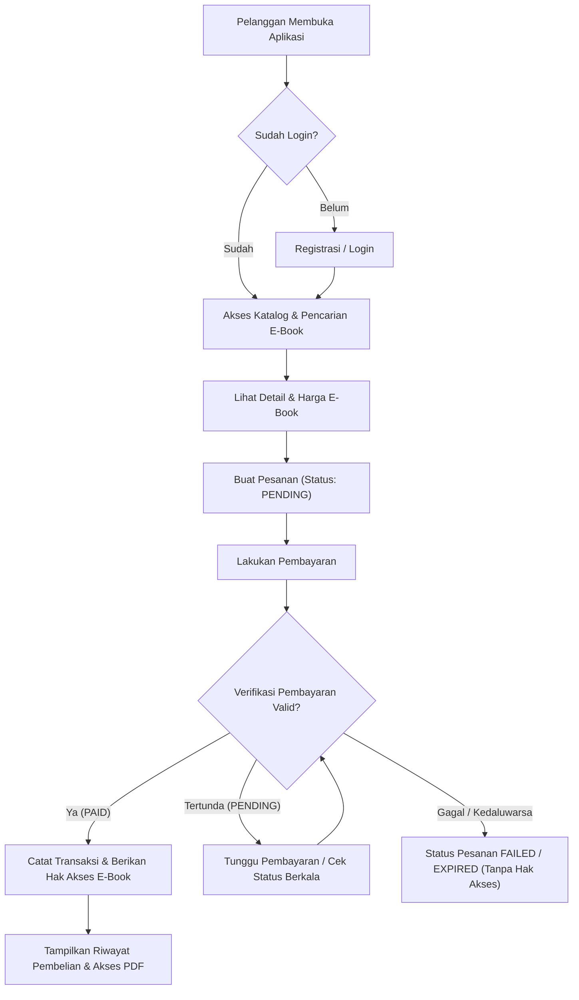

# Alur Proses Bisnis Pelanggan (`Customer Workflow`)

**Status:** `[RENCANA]` (kebutuhan alur utama) | `[RENCANA]` (detail alur alternatif & diagram) | `[RENCANA]` (implementasi di kode)

---

## 1. Alur Utama Pelanggan (*Happy Path*)

1. **Pelanggan membuka aplikasi** (`ebook_store` atau web pelanggan `[RENCANA]`).
2. **Registrasi / Login:** Pelanggan membuat akun baru atau login untuk memperoleh token sesi. *(Penjelajahan katalog publik dapat dilakukan sebelum login `[RENCANA]`, tetapi pemesanan dan akses e-book wajib terautentikasi `[RENCANA]`.)*
3. **Mengakses katalog e-book:** Pelanggan menelusuri daftar e-book, memfilter kategori, mencari kata kunci, atau melihat rekomendasi SPK (SAW) dari backend.
4. **Memilih e-book & melihat detail:** Pelanggan memeriksa judul, penulis, kategori, deskripsi, dan harga.
5. **Membuat pesanan (*Order*):** Pelanggan memilih satu atau beberapa e-book lalu membuat pesanan; sistem mengunci harga dari database (*snapshot*).
6. **Melakukan pembayaran:** Pelanggan memilih metode pembayaran yang tersedia dan mengirimkan pembayaran.
7. **Verifikasi pembayaran oleh sistem:** Backend memverifikasi status pembayaran dari penyedia/simulasi pembayaran.
8. **Pemberian hak akses e-book:** Jika pembayaran valid (`PAID`), sistem membuat catatan hak akses (`Ebook Access`), mencatat transaksi (`Transaction`), dan memperbarui riwayat pembelian (`Purchase History`).
9. **Mengakses e-book:** Pelanggan membuka menu riwayat/pustaka dan membaca e-book menggunakan *signed URL* sementara dari bucket privat.

---

## 2. Diagram Alur Pelanggan (`[RENCANA]`)

---

## 3. Alur Alternatif dan Penanganan Pengecualian (`[RENCANA]`)

| Skenario Alternatif | Kondisi Pemicu | Perilaku Sistem yang Direncanakan |
|---|---|---|
| **Pembayaran Gagal** | Pembayaran ditolak metode pembayaran atau dibatalkan pengguna. | Status pembayaran menjadi `FAILED`, status pesanan `CANCELLED`/`FAILED`, hak akses e-book **tidak** diberikan. Pelanggan dapat membuat pesanan ulang. |
| **Pembayaran Tertunda** | Pelanggan belum menyelesaikan transfer/pembayaran dalam jendela waktu aktif. | Status pesanan tetap `PENDING` dan status pembayaran `PENDING`. E-book belum dapat diakses sampai verifikasi sukses. |
| **Pesanan Kedaluwarsa** | Batas waktu pembayaran terlewati tanpa ada konfirmasi sukses. | Status pesanan otomatis berubah menjadi `EXPIRED`; pembayaran setelah kedaluwarsa ditolak atau dialihkan ke penanganan khusus. |
| **Verifikasi Pembayaran Gagal** | Callback/webhook tidak valid, nominal tidak cocok, atau timeout koneksi ke layanan verifikasi. | Sistem menolak perubahan status ke `PAID`, mencatat log error untuk audit, dan menjaga hak akses tetap terkunci hingga verifikasi valid. |
| **Kesalahan Pemberian Akses E-Book** | Pembayaran sudah `PAID`, tetapi pembuatan record `Ebook Access` gagal karena gangguan database. | Proses pemberian akses harus bersifat atomik (*database transaction*) bersama pembaruan status pembayaran, atau memiliki mekanisme *idempotent retry* agar pelanggan tidak dirugikan. |
