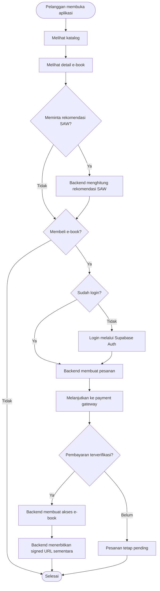

# Alur Proses Bisnis Pelanggan (`Customer Workflow`)

**Status:** `[RENCANA]` — Seluruh perjalanan **Pelanggan** di bawah ini merupakan rancangan proses bisnis target; implementasi dan pengujian fitur bisnis pada `backend/`, `web/pengunjung-web`, serta `mobile/ebook_store` belum tersedia.

---

## 1. Diagram Aktivitas Perjalanan Pelanggan (`[RENCANA]`)

---

## 2. Spesifikasi Proses Bisnis Pelanggan (`BP-C01` s.d. `BP-C12`)

### `BP-C01` — Registrasi dan Login
| Elemen | Isi |
|---|---|
| **ID Proses** | `BP-C01` |
| **Nama Proses** | Registrasi dan Login |
| **Aktor** | Pelanggan, Supabase Auth, `backend` |
| **Tujuan** | Mengautentikasi Pelanggan secara sah dan menyinkronkan profil pada tabel `users`. |
| **Prakondisi** | Pelanggan membuka halaman registrasi/login di `mobile/ebook_store` atau `web/pengunjung-web`. |
| **Pemicu** | Pelanggan mengirimkan email dan password. |
| **Alur Utama** | 1. Klien mengirim kredensial ke Supabase Auth. 2. Supabase Auth mengembalikan `JWT`. 3. Klien memanggil `POST /api/v1/auth/sync` dengan Bearer `JWT`. 4. Backend memverifikasi `JWT` dan menyinkronkan `User` (`role = CUSTOMER`). |
| **Alur Alternatif** | Pelanggan sudah memiliki akun -> langsung login tanpa registrasi ulang. |
| **Alur Gagal** | Kredensial salah -> pesan error generik; token tidak valid (`401`); akun nonaktif (`403`). |
| **Pascakondisi** | Token sesi tersimpan aman di klien dan record `User` aktif tersedia di PostgreSQL. |
| **Data Utama** | Masukan: email, password (ke Supabase Auth), Bearer `JWT`; Keluaran: profil `User` (`id`, `role`). |
| **Kebutuhan Terkait** | `FR-C01`, `NFR-01` |
| **Status** | `[RENCANA]` |

### `BP-C02` — Melihat Katalog E-Book
| Elemen | Isi |
|---|---|
| **ID Proses** | `BP-C02` |
| **Nama Proses** | Melihat Katalog E-Book |
| **Aktor** | Pelanggan, `backend` |
| **Tujuan** | Menampilkan daftar `e-book` aktif (`isActive = true`) secara terpaginasi. |
| **Prakondisi** | Terdapat data `Category` dan `Ebook` aktif di database. |
| **Pemicu** | Pelanggan membuka beranda/katalog aplikasi. |
| **Alur Utama** | 1. Klien memanggil `GET /api/v1/ebooks?page=1&limit=20`. 2. Backend memvalidasi query Zod. 3. Backend mengembalikan daftar metadata `e-book` aktif tanpa `storagePath`. |
| **Alur Alternatif** | Katalog masih kosong -> klien menampilkan *empty state*. |
| **Alur Gagal** | Parameter paginasi tidak valid -> `400 VALIDATION_ERROR`. |
| **Pascakondisi** | Daftar `e-book` tampil di layar Pelanggan. |
| **Data Utama** | Masukan: `page`, `limit`; Keluaran: daftar `EbookSummary` + `PaginationMeta`. |
| **Kebutuhan Terkait** | `FR-C03` |
| **Status** | `[RENCANA]` |

### `BP-C03` — Pencarian E-Book
| Elemen | Isi |
|---|---|
| **ID Proses** | `BP-C03` |
| **Nama Proses** | Pencarian E-Book |
| **Aktor** | Pelanggan, `backend` |
| **Tujuan** | Menemukan `e-book` berdasarkan kata kunci judul atau penulis. |
| **Prakondisi** | Pelanggan berada pada halaman katalog. |
| **Pemicu** | Pelanggan mengetik kata kunci pada kolom pencarian. |
| **Alur Utama** | 1. Klien memanggil `GET /api/v1/ebooks?search=...`. 2. Backend memvalidasi parameter `search` via Zod. 3. Backend memfilter `Ebook` aktif yang cocok dan mengembalikan hasil terpaginasi. |
| **Alur Alternatif** | Kata kunci dikosongkan -> kembali ke daftar katalog default. |
| **Alur Gagal** | Panjang `search` melebihi batas atau tipe salah -> `400 VALIDATION_ERROR`. |
| **Pascakondisi** | Hasil pencarian tampil sesuai kata kunci. |
| **Data Utama** | Masukan: `search`, `page`, `limit`; Keluaran: daftar `EbookSummary`. |
| **Kebutuhan Terkait** | `FR-C04` |
| **Status** | `[RENCANA]` |

### `BP-C04` — Filter Kategori
| Elemen | Isi |
|---|---|
| **ID Proses** | `BP-C04` |
| **Nama Proses** | Filter Kategori |
| **Aktor** | Pelanggan, `backend` |
| **Tujuan** | Menyaring katalog `e-book` berdasarkan kategori pilihan. |
| **Prakondisi** | Daftar kategori aktif telah dimuat dari `GET /api/v1/categories`. |
| **Pemicu** | Pelanggan memilih salah satu kategori. |
| **Alur Utama** | 1. Klien memanggil `GET /api/v1/ebooks?categoryId=<uuid>`. 2. Backend memvalidasi UUID kategori. 3. Backend mengembalikan `e-book` aktif pada kategori tersebut. |
| **Alur Alternatif** | Pelanggan menggabungkan filter `categoryId` dengan `search`. |
| **Alur Gagal** | Format `categoryId` bukan UUID -> `400 VALIDATION_ERROR`. |
| **Pascakondisi** | Katalog tersaring sesuai kategori pilihan. |
| **Data Utama** | Masukan: `categoryId`; Keluaran: daftar `EbookSummary`. |
| **Kebutuhan Terkait** | `FR-C03` |
| **Status** | `[RENCANA]` |

### `BP-C05` — Melihat Detail E-Book
| Elemen | Isi |
|---|---|
| **ID Proses** | `BP-C05` |
| **Nama Proses** | Melihat Detail E-Book |
| **Aktor** | Pelanggan, `backend` |
| **Tujuan** | Menampilkan informasi lengkap `e-book` (judul, penulis, kategori, sinopsis, harga, halaman, tahun, `ratingAvg`, `salesCount`). |
| **Prakondisi** | `Ebook` berstatus `isActive = true`. |
| **Pemicu** | Pelanggan menekan kartu `e-book` di katalog atau rekomendasi. |
| **Alur Utama** | 1. Klien memanggil `GET /api/v1/ebooks/{id}`. 2. Backend memvalidasi UUID dan mengambil detail tanpa `storagePath`. |
| **Alur Alternatif** | Pelanggan yang sudah membeli melihat indikator bahwa `e-book` sudah ada di pustaka. |
| **Alur Gagal** | ID tidak ditemukan atau nonaktif -> `404 NOT_FOUND`. |
| **Pascakondisi** | Detail `e-book` tampil untuk keputusan pembelian. |
| **Data Utama** | Masukan: `id` (UUID); Keluaran: metadata detail `Ebook`. |
| **Kebutuhan Terkait** | `FR-C05` |
| **Status** | `[RENCANA]` |

### `BP-C06` — Mendapatkan Rekomendasi SAW
| Elemen | Isi |
|---|---|
| **ID Proses** | `BP-C06` |
| **Nama Proses** | Mendapatkan Rekomendasi SAW |
| **Aktor** | Pelanggan, `backend` (`SPK SAW`) |
| **Tujuan** | Memberikan peringkat `e-book` berdasarkan perhitungan metode SAW di backend. |
| **Prakondisi** | Konfigurasi bobot SAW aktif (`Σ = 1,0`) tersedia di backend (menunggu Keputusan #5 & #9). |
| **Pemicu** | Pelanggan membuka tab/menu Rekomendasi SAW. |
| **Alur Utama** | 1. Klien memanggil `GET /api/v1/recommendations/saw`. 2. Backend mengambil kandidat `e-book` aktif dan bobot server. 3. Backend menormalisasi, menghitung skor $V_i$, mengurutkan dengan *tie-breaker* A–Z, dan mengembalikan hasil. |
| **Alur Alternatif** | Filter opsional `categoryId` atau `limit` diterapkan sebelum pemeringkatan akhir. |
| **Alur Gagal** | Bobot server tidak valid -> `500 SAW_CONFIGURATION_INVALID`; katalog kosong -> daftar kosong `[]`. |
| **Pascakondisi** | Pelanggan melihat daftar peringkat rekomendasi tanpa kalkulasi di klien. |
| **Data Utama** | Masukan: `categoryId?`, `limit?`; Keluaran: daftar `{ ebookId, title, sawScore, rank }`. |
| **Kebutuhan Terkait** | `FR-C06`, `FR-S01`–`FR-S04` |
| **Status** | `[RENCANA]` |

### `BP-C07` — Membuat Pesanan (*Checkout*)
| Elemen | Isi |
|---|---|
| **ID Proses** | `BP-C07` |
| **Nama Proses** | Membuat Pesanan |
| **Aktor** | Pelanggan, `backend` |
| **Tujuan** | Membentuk `Order` (`PENDING`) dan `OrderItem` dengan *snapshot* harga resmi dari database. |
| **Prakondisi** | Pelanggan login (`CUSTOMER`); `e-book` aktif dan belum ada di `EbookAccess`. |
| **Pemicu** | Pelanggan menekan tombol Checkout. |
| **Alur Utama** | 1. Klien mengirim `POST /api/v1/orders` berisi `ebookIds`. 2. Backend memverifikasi `JWT` & role `CUSTOMER`. 3. Backend cek e-book aktif & belum dimiliki, menghitung `totalAmount` dari DB, lalu menyimpan `Order` + `OrderItem`. |
| **Alur Alternatif** | Pelanggan membeli beberapa judul sekaligus dalam satu pesanan. |
| **Alur Gagal** | Daftar kosong (`400`), e-book tidak aktif (`404`), atau sudah dimiliki (`409 CONFLICT`). |
| **Pascakondisi** | `Order` berstatus `PENDING` dengan `expiresAt` tercatat di PostgreSQL. |
| **Data Utama** | Masukan: `ebookIds[]`; Keluaran: `Order` (`id`, `orderNumber`, `totalAmount`, `status`). |
| **Kebutuhan Terkait** | `FR-C07`, `NFR-07` |
| **Status** | `[RENCANA]` |

### `BP-C08` — Melanjutkan Pembayaran
| Elemen | Isi |
|---|---|
| **ID Proses** | `BP-C08` |
| **Nama Proses** | Melanjutkan Pembayaran |
| **Aktor** | Pelanggan, `backend`, Payment Gateway |
| **Tujuan** | Menginisiasi pembayaran pesanan `PENDING` melalui *payment gateway* nyata. |
| **Prakondisi** | `Order` milik Pelanggan berstatus `PENDING` dan belum kedaluwarsa. |
| **Pemicu** | Pelanggan memilih metode pembayaran dan menekan Bayar. |
| **Alur Utama** | 1. Klien mengirim `POST /api/v1/payments`. 2. Backend memvalidasi kepemilikan & status `Order`. 3. Backend memanggil API Payment Gateway, menyimpan `Payment` (`PENDING`, `externalRef`), dan mengembalikan instruksi/URL bayar. |
| **Alur Alternatif** | Pelanggan mengulang pembayaran baru jika `Payment` sebelumnya gagal/kedaluwarsa sementara `Order` masih aktif. |
| **Alur Gagal** | Bukan pemilik order (`403`), order tidak `PENDING` (`409`), atau gateway gagal merespons (`502/503`). |
| **Pascakondisi** | Instruksi pembayaran tampil dan `Payment` menunggu konfirmasi *webhook*. |
| **Data Utama** | Masukan: `orderId`, `paymentMethod`; Keluaran: `paymentId`, `status`, instruksi gateway. |
| **Kebutuhan Terkait** | `FR-C08` |
| **Status** | `[RENCANA]` |

### `BP-C09` — Melihat Status Pembayaran
| Elemen | Isi |
|---|---|
| **ID Proses** | `BP-C09` |
| **Nama Proses** | Melihat Status Pembayaran |
| **Aktor** | Pelanggan, `backend` |
| **Tujuan** | Memantau perkembangan status `Payment` (`PENDING`, `VERIFIED`, `FAILED`, `EXPIRED`). |
| **Prakondisi** | Pelanggan login dan memiliki record `Payment`. |
| **Pemicu** | Pelanggan membuka halaman status pembayaran atau melakukan *refresh*. |
| **Alur Utama** | 1. Klien memanggil `GET /api/v1/payments/{id}` + Bearer `JWT`. 2. Backend memverifikasi kepemilikan dan mengembalikan status terkini dari DB. |
| **Alur Alternatif** | Klien melakukan *polling* berkala setelah kembali dari halaman Payment Gateway. |
| **Alur Gagal** | Bukan milik Pelanggan (`403 FORBIDDEN`) atau tidak ditemukan (`404 NOT_FOUND`). |
| **Pascakondisi** | Pelanggan mengetahui status pembayaran yang akurat. |
| **Data Utama** | Masukan: `paymentId`; Keluaran: `status`, `amount`, `paidAt?`. |
| **Kebutuhan Terkait** | `FR-C09` |
| **Status** | `[RENCANA]` |

### `BP-C10` — Melihat Riwayat Pesanan
| Elemen | Isi |
|---|---|
| **ID Proses** | `BP-C10` |
| **Nama Proses** | Melihat Riwayat Pesanan |
| **Aktor** | Pelanggan, `backend` |
| **Tujuan** | Meninjau daftar seluruh pesanan dan transaksi yang pernah dibuat oleh Pelanggan terkait. |
| **Prakondisi** | Pelanggan sudah login. |
| **Pemicu** | Pelanggan membuka menu Riwayat Pesanan / Pembelian. |
| **Alur Utama** | 1. Klien memanggil `GET /api/v1/orders/me`. 2. Backend memfilter ketat berdasarkan `userId` dari `JWT` dan mengembalikan daftar pesanan terpaginasi. |
| **Alur Alternatif** | Pelanggan memfilter riwayat berdasarkan `status` (`PAID`, `PENDING`, dll.). |
| **Alur Gagal** | Token tidak valid (`401`). |
| **Pascakondisi** | Daftar riwayat pesanan milik sendiri tampil. |
| **Data Utama** | Masukan: `page`, `limit`, `status?`; Keluaran: daftar `Order` + `OrderItem`. |
| **Kebutuhan Terkait** | `FR-C09`, `FR-C10` |
| **Status** | `[RENCANA]` |

### `BP-C11` — Mengakses E-Book yang Telah Dibeli
| Elemen | Isi |
|---|---|
| **ID Proses** | `BP-C11` |
| **Nama Proses** | Mengakses E-Book yang Telah Dibeli |
| **Aktor** | Pelanggan, `backend` |
| **Tujuan** | Memverifikasi hak akses `EbookAccess` aktif dan memperoleh `signed URL` sementara. |
| **Prakondisi** | Pembayaran terverifikasi sehingga `EbookAccess` aktif (`isRevoked = false`) sudah diterbitkan. |
| **Pemicu** | Pelanggan memilih `e-book` pada pustaka pribadi dan menekan Baca. |
| **Alur Utama** | 1. Klien memanggil `GET /api/v1/ebooks/{id}/access-url`. 2. Backend memverifikasi `JWT` dan `EbookAccess` aktif (`!isRevoked`). 3. Backend meminta `signed URL` TTL singkat ke `bucket privat` dan mengembalikannya. |
| **Alur Alternatif** | `Ebook` telah diarsipkan oleh Admin (`isActive = false`), tetapi pembeli sah lama tetap diizinkan membaca. |
| **Alur Gagal** | Belum membeli atau `isRevoked = true` (`403 EBOOK_ACCESS_DENIED`); gagal membuat URL (`500`). |
| **Pascakondisi** | Klien menerima `signedUrl` sementara dan `expiresInSeconds`. |
| **Data Utama** | Masukan: `ebookId`, Bearer `JWT`; Keluaran: `signedUrl`, `expiresInSeconds`. |
| **Kebutuhan Terkait** | `FR-C11`, `NFR-02` |
| **Status** | `[RENCANA]` |

### `BP-C12` — Membaca PDF Melalui Pembaca Internal dengan `Signed URL`
| Elemen | Isi |
|---|---|
| **ID Proses** | `BP-C12` |
| **Nama Proses** | Membaca PDF Melalui Pembaca Internal |
| **Aktor** | Pelanggan, Klien (*In-App PDF Reader*), Supabase Storage (`bucket privat`) |
| **Tujuan** | Merender konten PDF di dalam aplikasi tanpa menyediakan tautan unduhan publik bebas. |
| **Prakondisi** | Klien telah menerima `signedUrl` yang masih berlaku dari `BP-C11`. |
| **Pemicu** | Klien membuka layar *in-app PDF reader* dengan `signedUrl`. |
| **Alur Utama** | 1. *In-app reader* mengambil stream PDF dari `signedUrl`. 2. Halaman PDF ditampilkan di dalam aplikasi tanpa tombol ekspor/unduh bebas. |
| **Alur Alternatif** | Jika `signedUrl` kedaluwarsa di tengah sesi, klien meminta `signedUrl` baru melalui `BP-C11`. |
| **Alur Gagal** | `signedUrl` sudah kedaluwarsa (`403`/`400` dari Storage) -> muat ulang URL dari backend. |
| **Pascakondisi** | Pelanggan dapat membaca `e-book` dengan aman di dalam aplikasi. |
| **Data Utama** | Masukan: `signedUrl` sementara; Keluaran: stream halaman PDF pada *reader* internal. |
| **Kebutuhan Terkait** | `FR-C11`, `NFR-02` |
| **Status** | `[RENCANA]` |
