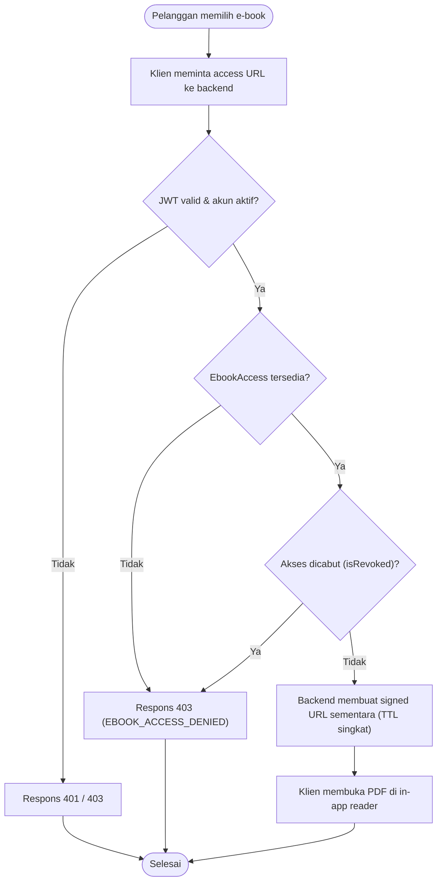

# Alur Akses PDF E-Book (`E-Book Access Workflow`)

**Status:** `[ADA]` (keputusan #4 `bucket privat` + *in-app PDF reader*, helper dasar `createPrivatePdfSignedUrl` pada `backend/src/integrations/storage/supabase-storage.ts`, dan model `EbookAccess` di `schema.prisma`) | `[RENCANA]` (endpoint `/api/v1/ebooks/{id}/access-url`, validasi `EbookAccess` runtime, serta *in-app PDF reader* di mobile dan web)

---

## 1. Diagram Aktivitas Akses PDF (`[RENCANA]`)

---

## 2. Langkah Proses & Penanganan Kasus Khusus (`[RENCANA]`)

1. **Pelanggan Login & Memilih E-Book:** Pelanggan terautentikasi membuka pustaka pribadi dan memilih `e-book` yang sudah lunas.
2. **Permintaan ke Backend:** Klien mengirim `GET /api/v1/ebooks/{id}/access-url` dengan `Authorization: Bearer <JWT>`.
3. **Verifikasi JWT & Status Akun:** Backend memvalidasi `JWT` via Supabase Auth (`401` jika tidak valid) dan memeriksa `User.isActive` (`403` jika akun dinonaktifkan).
4. **Verifikasi `EbookAccess` & `isRevoked`:** Backend memeriksa record `ebook_accesses` untuk pasangan `(userId, ebookId)`. Jika belum pernah membeli (`EbookAccess` tidak ada) atau `isRevoked == true`, backend mengembalikan `403 EBOOK_ACCESS_DENIED`.
5. **Penerbitan `Signed URL` Sementara:** Backend mengambil `Ebook.storagePath` internal lalu memanggil Supabase Storage API (*service role*) untuk membuat `signed URL` berumur pendek (default `300` detik pada `supabase-storage.ts`).
6. **Pembacaan di *In-App Reader*:** Klien memuat stream PDF dari `signed URL` di dalam *in-app PDF reader* tanpa menyediakan tombol unduh bebas atau URL permanen.
7. **Penanganan `Signed URL` Kedaluwarsa:** Apabila `signed URL` melewati TTL saat sesi baca berlangsung, klien meminta `signed URL` baru ke backend (selama `EbookAccess` masih aktif).

---

## 3. Keamanan, Risiko, & Referensi Kebijakan

- **Larangan URL Publik Permanen:** File PDF berada di **Supabase Storage `bucket privat`**; `storagePath` tidak pernah dikembalikan pada respons API.
- **Risiko Utama:** Kebocoran tautan jika TTL terlalu panjang atau bucket disetel publik -> dimitigasi dengan TTL singkat dan audit konfigurasi bucket.
- **Referensi Kebijakan:** [`security-architecture.md`](../02-architecture/security-architecture.md) | [`security-guidelines.md`](../07-security/security-guidelines.md) | [`ebook-access.md`](../06-modules/ebook-access.md).
