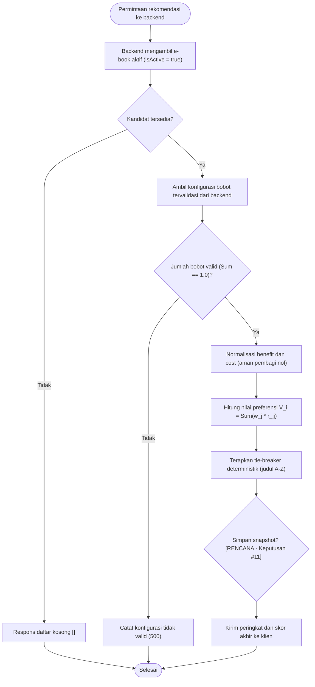

# Alur Rekomendasi `SPK SAW` (`SAW Recommendation Workflow`)

**Status:** `[ADA]` (keputusan arsitektur `backend-only` pada [ADR-0002](../adr/0002-backend-only-saw.md)) | `[RENCANA]` (implementasi `saw.service`, penetapan final jumlah kriteria & bobot pada Keputusan #5, #7, #9, #11, dan unit test SAW)

---

## 1. Diagram Proses Rekomendasi SAW (`[RENCANA]`)

---

## 2. Aturan Proses & Status Keputusan Terbuka (`[RENCANA]`)

1. **Sumber Data Kandidat:** Hanya `Ebook` dengan `isActive = true` yang diikutkan sebagai alternatif.
2. **Kriteria & Bobot (`[RENCANA]` — Menunggu Keputusan #9):**
   - Penyelesaian konflik antara **4 kriteria** (`0,35 / 0,30 / 0,20 / 0,15`) vs **5 kriteria** pada perhitungan manual awal masih tercatat terbuka pada [`keputusan-terbuka.md`](../00-project/keputusan-terbuka.md) (#9).
   - Hak pengubahan bobot (hanya Admin vs preset Pelanggan) menunggu Keputusan #5.
3. **Validasi Bobot:** Backend menolak/mengabaikan bobot mentah dari request klien publik dan memvalidasi `Σ w_j == 1.0` serta setiap `w_j > 0`.
4. **Normalisasi *Benefit* dan *Cost*:**
   - **Kriteria *Benefit*** (nilai lebih besar lebih baik): $r_{ij} = \frac{x_{ij}}{\max_i(x_{ij})}$.
   - **Kriteria *Cost*** (nilai lebih kecil lebih baik, mis. harga): $r_{ij} = \frac{\min_i(x_{ij})}{x_{ij}}$.
5. **Nilai Preferensi & *Tie-Breaker*:**
   - Skor dihitung dengan $V_i = \sum_{j=1}^{n} w_j \cdot r_{ij}$ menggunakan presisi penuh sebelum pembulatan tampilan.
   - Jika terdapat skor $V_i$ yang sama persis, pemeringkatan dipecah secara deterministik menggunakan urutan alfabetis judul `e-book` (A–Z).
6. ***Edge Case* yang Ditangani:**
   - **Katalog kandidat kosong:** Kembalikan array kosong `[]` tanpa error.
   - **Pembagi nol (`max = 0` atau `x_ij = 0`):** Hasil normalisasi ditetapkan `0` agar tidak menghasilkan `NaN` atau `Infinity`.
   - **`E-book` tanpa rating (`ratingAvg = 0`):** Kebijakan finalnya masih `[RENCANA]` menunggu Keputusan #7 pada [`keputusan-terbuka.md`](../00-project/keputusan-terbuka.md).
7. **Snapshot Hasil (`[RENCANA]`):** Penyimpanan riwayat bobot dan peringkat historis menunggu Keputusan #11.
8. **Larangan Kalkulasi Klien:** Mobile dan web hanya menampilkan peringkat serta skor yang dikembalikan oleh backend.
