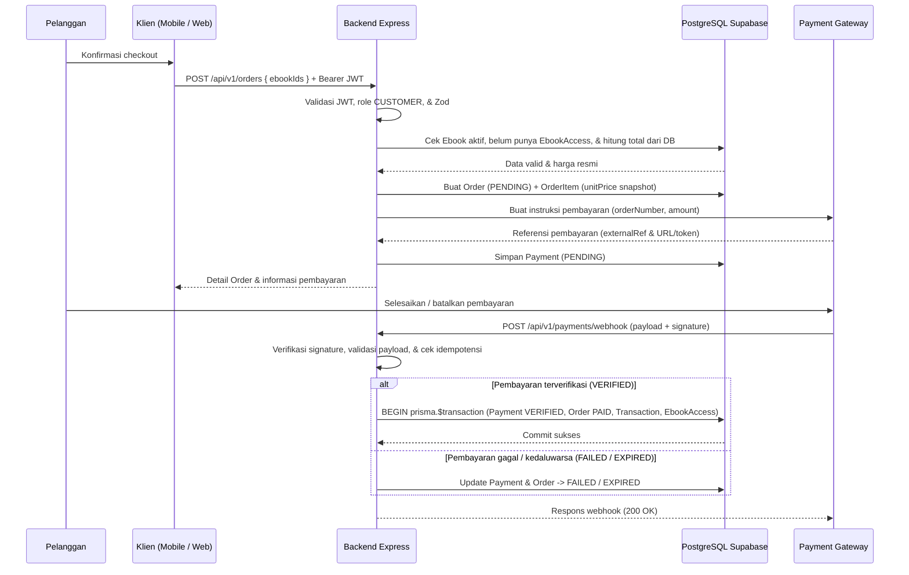

# Alur Pesanan dan Pembayaran (`Order and Payment Workflow`)

**Status:** `[RENCANA]` — Alur pesanan, inisiasi *payment gateway*, *webhook* idempoten, transaksi atomik, dan penerbitan `EbookAccess` belum diimplementasikan di `backend/`. Definisi enum `OrderStatus` dan `PaymentStatus` sudah `[ADA]` pada [`backend/prisma/schema.prisma`](../../backend/prisma/schema.prisma).

> **Catatan Penamaan Berkas:** Dokumen ini mencakup alur pesanan dan pembayaran (*order-and-payment-workflow*) agar tidak terjadi duplikasi berkas pada `docs/03-business-process/`.

---

## 1. Sequence Diagram Pesanan, Pembayaran, & Webhook (`[RENCANA]`)

---

## 2. Rincian Langkah Proses Pesanan & Pembayaran (`[RENCANA]`)

1. **Pembuatan Pesanan (`POST /api/v1/orders`):**
   - **Validasi Autentikasi & Role:** `backend` memverifikasi `JWT` dan memastikan `role = CUSTOMER`.
   - **Validasi E-Book:** Memastikan seluruh `ebookIds` ada, berstatus `isActive = true`, dan Pelanggan **belum** memiliki `EbookAccess` aktif (`!isRevoked`). Jika sudah dimiliki -> tolak `409 CONFLICT`.
   - **Perhitungan Harga di Backend:** `backend` mengambil `Ebook.price` langsung dari PostgreSQL, menghitung `totalAmount`, lalu membentuk `Order` (`status = PENDING`, `expiresAt`) beserta `OrderItem` (`unitPrice` *snapshot*). Nilai harga dari klien tidak pernah dipercaya.
2. **Inisiasi Pembayaran (`POST /api/v1/payments`):**
   - `backend` memverifikasi bahwa `Order` milik `userId` terkait, berstatus `PENDING`, dan belum melewati `expiresAt`.
   - `backend` membuat transaksi di **Payment Gateway** (Keputusan #3 `[ADA]`), menyimpan `Payment` (`status = PENDING`, `externalRef`), lalu mengembalikan instruksi/redirect pembayaran ke klien.
3. **Skenario Status Pembayaran:**
   - **Tertunda (`PENDING`):** Pelanggan belum menyelesaikan pembayaran; akses PDF tetap terkunci.
   - **Berhasil (`VERIFIED`):** Dikonfirmasi melalui *webhook* resmi Payment Gateway.
   - **Gagal (`FAILED`) / Kedaluwarsa (`EXPIRED`):** Pembayaran ditolak atau batas waktu habis; tidak ada `Transaction` maupun `EbookAccess` yang diterbitkan.
4. **Webhook, Idempotensi, & Transaksi Atomik (`POST /api/v1/payments/webhook`):**
   - **Validasi Signature:** Tolak `401 WEBHOOK_SIGNATURE_INVALID` bila *signature* tidak cocok.
   - **Idempotensi:** Jika `Payment.status` sudah final (`VERIFIED`, `FAILED`, `EXPIRED`), kembalikan `200 OK` (`DUPLICATE_WEBHOOK`) tanpa mutasi ulang.
   - **Transaksi Atomik (`prisma.$transaction`):** Ketika status gateway terverifikasi `VERIFIED`, `backend` secara atomik: (a) memperbarui `Payment.status = VERIFIED` & `paidAt`, (b) memperbarui `Order.status = PAID`, (c) membuat `Transaction` (`transactionCode`, `amount`), dan (d) melakukan *upsert* `EbookAccess` (`isRevoked = false`) + increment `Ebook.salesCount`.
   - **Pembaruan Status ke Klien:** Klien memantau status terbaru melalui `GET /api/v1/orders/{id}` atau `GET /api/v1/payments/{id}`.

---

## 3. Tabel Transisi Status (`OrderStatus` & `PaymentStatus` dari `schema.prisma`)

| Entitas | Status Awal | Peristiwa | Status Berikutnya | Validasi | Status Dokumentasi |
|---|---|---|---|---|---|
| **`Order`** | `—` | Pelanggan checkout valid | `PENDING` | JWT valid, e-book aktif & belum dimiliki, harga dari DB | `[RENCANA]` |
| **`Order`** | `PENDING` | Webhook payment `VERIFIED` | `PAID` | Signature valid, nominal cocok, transaksi atomik sukses | `[RENCANA]` |
| **`Order`** | `PENDING` | Webhook payment `FAILED` | `FAILED` | Signature valid dari gateway | `[RENCANA]` |
| **`Order`** | `PENDING` | Batas waktu `expiresAt` habis / webhook `EXPIRE` | `EXPIRED` | Cek waktu server / webhook gateway | `[RENCANA]` |
| **`Order`** | `PENDING` | Pelanggan membatalkan sebelum bayar | `CANCELLED` | Kepemilikan order & status masih `PENDING` | `[RENCANA]` |
| **`Payment`** | `—` | Inisiasi pembayaran ke gateway | `PENDING` | Order milik user, status `PENDING`, belum kedaluwarsa | `[RENCANA]` |
| **`Payment`** | `PENDING` | Webhook gateway sukses (`SETTLEMENT/PAID`) | `VERIFIED` | Signature valid, nominal sama, belum final (idempoten) | `[RENCANA]` |
| **`Payment`** | `PENDING` | Webhook gateway ditolak (`DENY/FAILURE`) | `FAILED` | Signature valid | `[RENCANA]` |
| **`Payment`** | `PENDING` | Webhook gateway kedaluwarsa (`EXPIRE`) | `EXPIRED` | Signature valid | `[RENCANA]` |
