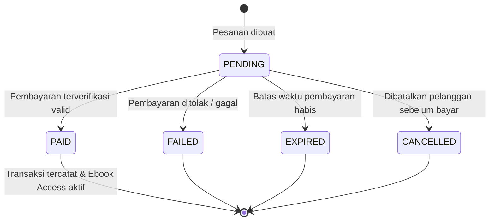

# Alur Pemrosesan Transaksi & Hak Akses (`Transaction Workflow`)

**Status:** `[PROPOSED]` (rancangan alur status transaksi) | `[NOT AVAILABLE]` (implementasi di kode)

---

## 1. Siklus Status Pesanan dan Pembayaran

Agar tidak terjadi inkonsistensi antara pesanan, pembayaran, transaksi, dan hak akses e-book, sistem memisahkan status pada level **Order** dan **Payment**.

---

## 2. Aturan Pemrosesan Transaksi (`[PROPOSED]`)

1. **Snapshot Harga Saat Checkout:**
   Saat pesanan dibuat, nilai `price` pada setiap item pesanan disalin dari tabel `ebooks` pada saat itu. Perubahan harga e-book oleh admin di kemudian hari tidak mengubah nilai pesanan yang sudah dibuat.
2. **Idempotensi Verifikasi Pembayaran:**
   Jika notifikasi/verifikasi pembayaran diterima lebih dari sekali untuk `payment_id` yang sama, backend tidak boleh menggandakan record `Transaction` maupun `Ebook Access`.
3. **Atomisitas Pemberian Hak Akses:**
   Pembaruan status `Order -> PAID`, `Payment -> VERIFIED/SUCCESS`, pencatatan `Transaction`, dan pembuatan `Ebook Access` harus dijalankan dalam satu **database transaction** agar tidak terjadi kondisi "sudah bayar tetapi akses e-book belum aktif".
4. **Kontrol Akses File PDF:**
   Endpoint pengunduhan/pembacaan e-book tidak hanya mengecek apakah user login, tetapi juga memverifikasi adanya record aktif di `Ebook Access` untuk pasangan `(customer_id, ebook_id)` sebelum menerbitkan *signed URL*.
