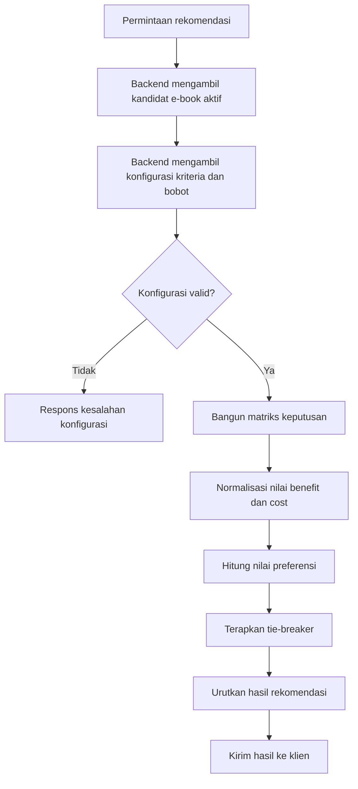

# Dokumentasi Metode Simple Additive Weighting (SAW)

> **Status Dokumen:** `[ADA]` (Dokumentasi rancangan metode SAW; keputusan arsitektur `backend-only` pada [`ADR-0002`](../adr/0002-backend-only-saw.md))
> **Status Implementasi & Pengujian:** `[RENCANA]` (Implementasi `saw.service`, endpoint API, konfigurasi bobot persisten, dan unit test backend belum tersedia)
> **Sumber Kebenaran Utama:** [`docs-proyek-ebook-ecommerce.md`](../docs-proyek-ebook-ecommerce.md)

---

## 1. Tujuan Rekomendasi E-Book

Sistem Pendukung Keputusan (SPK) pada proyek E-Book E-Commerce bertujuan membantu **Pelanggan** (serta Pengunjung Publik pada portal web apabila diizinkan oleh keputusan akses final) menemukan `e-book` yang paling sesuai dengan kriteria mutu dan nilai ekonomis secara objektif, transparan, dan terukur. Metode **Simple Additive Weighting (SAW)** dipilih karena sifatnya yang deterministik, mudah diaudit, serta memisahkan kriteria yang ingin dimaksimalkan (*Benefit*) dan kriteria yang ingin diminimalkan (*Cost*).

---

## 2. Ruang Lingkup & Batasan Mutlak (`Backend-Only`)

1. **Perhitungan Hanya di Backend:** Sesuai [`ADR-0002`](../adr/0002-backend-only-saw.md) dan [`AGENTS.md`](../../AGENTS.md), seluruh pengambilan kandidat, pembangunan matriks keputusan, normalisasi, pembobotan, perhitungan nilai preferensi ($V_i$), dan pemeringkatan **wajib** dieksekusi di **backend** (`Express + TypeScript + Prisma 7`) sebagai fungsi murni (*pure function*).
2. **Larangan Kalkulasi Klien:** Aplikasi `mobile/ebook_store`, `web/admin-web`, dan `web/pengunjung-web` dilarang menghitung skor akhir SAW dan hanya menampilkan hasil peringkat beserta rincian yang dikirim backend.
3. **Larangan Kepercayaan Bobot Klien Publik:** Bobot mentah yang dikirim dalam request klien publik tidak dipercaya oleh backend.

---

## 3. Aktor yang Terlibat

| Aktor | Peran dalam Proses SAW | Status |
| :--- | :--- | :--- |
| **Pelanggan** *(serta Pengunjung Publik `[RENCANA]`)* | Menerima daftar rekomendasi `e-book` terurut beserta skor dan rincian transparansi perhitungan dari backend; dapat memfilter kategori/kandidat sesuai kontrak API. | `[RENCANA]` |
| **Admin** | Mengelola konfigurasi bobot kriteria SAW dan mengaudit matriks serta hasil perhitungan SAW *(apabila kebijakan manajemen bobot Admin disahkan penuh; lihat Keputusan #5)*. | `[RENCANA]` |
| **Backend (`SawService`)** | Mengambil kandidat `e-book` aktif dari PostgreSQL, mengambil konfigurasi kriteria & bobot tervalidasi, mengeksekusi algoritma SAW secara deterministik, dan mengembalikan hasil terurut. | `[RENCANA]` |

---

## 4. Konsep Dasar Metode SAW

Metode SAW (*Weighted Sum Model*) mencari penjumlahan terbobot dari rating kinerja setiap alternatif pada semua atribut/kriteria. Tahapan konseptualnya meliputi:

1. **Identifikasi Alternatif & Matriks Keputusan ($X$):**
   Setiap alternatif $A_i$ (yaitu `Ebook` aktif dengan `isActive = true`) dipetakan ke nilai mentah $x_{ij}$ pada masing-masing kriteria $C_j$ yang berasal dari database PostgreSQL (`Ebook`).
2. **Kriteria & Bobot ($w_j$):**
   Setiap kriteria diklasifikasikan sebagai **Benefit** (semakin besar nilai semakin baik) atau **Cost** (semakin kecil nilai semakin baik), dengan bobot $w_j \ge 0$ dan total bobot $\sum w_j = 1.0$ (lihat [`criteria-and-weights.md`](./criteria-and-weights.md)).
3. **Normalisasi Matriks Keputusan ($R$):**
   Mengubah nilai mentah berbagai satuan (rupiah, bintang rating, jumlah terjual) ke skala terbanding $[0, 1]$:

### Normalisasi benefit

```text
rᵢⱼ = xᵢⱼ / max(xᵢⱼ)
```

### Normalisasi cost

```text
rᵢⱼ = min(xᵢⱼ) / xᵢⱼ
```

4. **Perhitungan Nilai Preferensi ($V_i$):**
   Mengalikan setiap nilai ternormalisasi dengan bobot kriterianya lalu menjumlahkannya menggunakan presisi penuh (*full floating-point precision*) tanpa pembulatan di tengah proses:

### Nilai preferensi

```text
Vᵢ = Σ(wⱼ × rᵢⱼ)
```

5. **Pemeringkatan & *Tie-Breaker*:**
   Alternatif diurutkan dari nilai $V_i$ terbesar ke terkecil (descending). Apabila terdapat dua atau lebih alternatif dengan nilai $V_i$ yang sama persis, diterapkan ***tie-breaker* deterministik** sesuai [`requirements.md`](../00-project/requirements.md) (`FR-S04`), yaitu pengurutan alfabetis berdasarkan judul `e-book` secara menaik (**A–Z**).

---

## 5. Penjelasan Simbol

| Simbol | Arti |
|---|---|
| `xᵢⱼ` | Nilai alternatif ke-i pada kriteria ke-j |
| `rᵢⱼ` | Nilai hasil normalisasi |
| `wⱼ` | Bobot kriteria |
| `Vᵢ` | Nilai preferensi alternatif |
| `i` | Indeks alternatif atau e-book |
| `j` | Indeks kriteria |

---

## 6. Diagram Proses Metode SAW (`[RENCANA]`)



---

## 7. Data Sumber & Status Implementasi

- **Sumber Data Kandidat (`[ADA]` di `schema.prisma`, `[RENCANA]` pengisian & query produksi):** Model `Ebook` pada [`backend/prisma/schema.prisma`](../../backend/prisma/schema.prisma) telah menyediakan atribut `price`, `ratingAvg`, `salesCount`, `pageCount`, `publishedYear`, dan `isActive`.
- **Konfigurasi Kriteria, Bobot & Snapshot (`[RENCANA]`):** Belum tersedia tabel `SawCriterionConfig` maupun `SawCalculationSnapshot` di `schema.prisma`, dan belum ada implementasi `saw.service` maupun unit test SAW di `backend/src/`.

---

## 8. Keterbatasan Metode

1. **Sensitif terhadap Skala Ekstrem:** Pada normalisasi linier SAW, satu alternatif dengan nilai harga sangat murah atau penjualan sangat tinggi dapat menekan skor relatif alternatif lain secara drastis.
2. **Ketergantungan pada Kualitas Data Sumber:** Jika `ratingAvg` atau atribut opsional (`pageCount`, `publishedYear`) bernilai nol/kosong karena belum ada ulasan atau metadata belum lengkap, hasil peringkat dapat terpengaruh sehingga memerlukan aturan *edge case* yang jelas ([`saw-edge-cases.md`](./saw-edge-cases.md)).
3. **Tidak Memodelkan Interaksi Non-Linier Antarkriteria:** SAW mengasumsikan seluruh kriteria saling independen secara aditif.

---

## 9. Referensi Silang

- **Kebutuhan & Keputusan:** [`requirements.md`](../00-project/requirements.md) (`FR-C05`, `FR-C06`, `FR-A10`, `FR-S01`–`FR-S06`), [`keputusan-terbuka.md`](../00-project/keputusan-terbuka.md) (#5, #6, #7, #9, #11)
- **ADR:** [`ADR-0002: Perhitungan SAW Hanya di Backend`](../adr/0002-backend-only-saw.md)
- **Proses Bisnis:** [`saw-recommendation-workflow.md`](../03-business-process/saw-recommendation-workflow.md)
- **API & Database:** [`api-spec.yaml`](../02-api/api-spec.yaml), [`schema.prisma`](../../backend/prisma/schema.prisma)
- **Pengujian:** [`saw-test-specification.md`](./saw-test-specification.md), [`test-cases.md`](../09-testing/test-cases.md)
