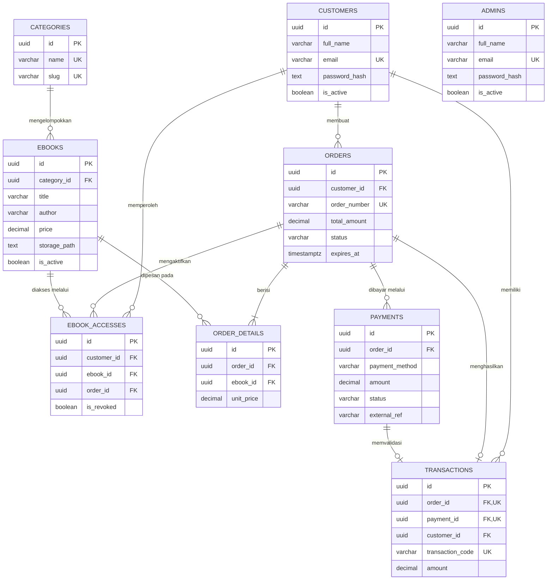

# Entity Relationship Diagram (ERD)

**Status:** `[PROPOSED]` — Rancangan konseptual awal; belum ada implementasi database aktual di repository.

---

## 1. Diagram ERD (`[PROPOSED]`)

---

## 2. Ringkasan Kardinalitas & Integritas Referensial

- `CATEGORIES (1) -> (0..N) EBOOKS`: Satu kategori dapat memiliki banyak e-book; penghapusan kategori yang masih memiliki e-book harus ditolak (`ON DELETE RESTRICT`).
- `CUSTOMERS (1) -> (0..N) ORDERS`: Satu pelanggan dapat membuat banyak pesanan.
- `ORDERS (1) -> (1..N) ORDER_DETAILS` dan `EBOOKS (1) -> (0..N) ORDER_DETAILS`: Merepresentasikan relasi *many-to-many* antara pesanan dan e-book dengan *snapshot* harga (`unit_price`).
- `ORDERS (1) -> (0..N) PAYMENTS`: Satu pesanan dapat memiliki lebih dari satu percobaan pembayaran jika pembayaran sebelumnya gagal/kedaluwarsa, namun hanya satu pembayaran valid yang menghasilkan `TRANSACTIONS` (`1-to-1`).
- `CUSTOMERS (1) -> (0..N) EBOOK_ACCESSES <- (0..N) EBOOKS`: Diikat oleh `UNIQUE (customer_id, ebook_id)` agar satu pelanggan tidak memiliki duplikasi izin untuk judul yang sama.
