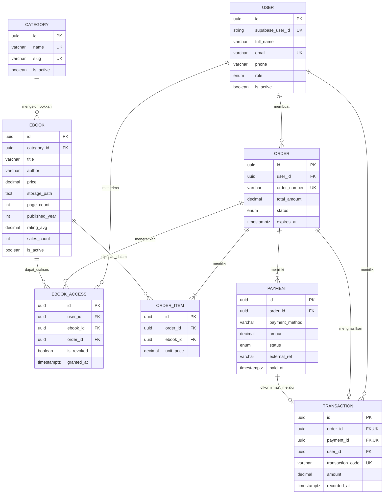

# Entity Relationship Diagram (ERD)

> **Status Dokumen:** `[ADA]` (Diselaraskan penuh dengan [`backend/prisma/schema.prisma`](../../backend/prisma/schema.prisma))
> **Catatan:** Diagram di bawah hanya menampilkan **8 model aktif** yang benar-benar ada di `schema.prisma`. Entitas rencana (`Review`, konfigurasi bobot SAW, snapshot SAW) dipisahkan sebagai `[RENCANA]`.

---

## 1. Diagram ERD (`schema.prisma`)

> **Catatan Storage Privat:** Kolom `EBOOK.storage_path` hanya menyimpan referensi path objek PDF di Supabase Storage **bucket privat**, bukan isi biner/BLOB file PDF.

---

## 2. Ringkasan Primary Key, Foreign Key, Unique Constraint & Indeks (`[ADA]` di `schema.prisma`)

- **Primary Key (`@id @default(uuid())`):** Seluruh 8 model menggunakan `UUID` (`@db.Uuid`).
- **Unique Constraint:**
  - `User`: `supabaseUserId`, `email`
  - `Category`: `name`, `slug`
  - `Order`: `orderNumber`
  - `OrderItem`: `@@unique([orderId, ebookId])`
  - `Transaction`: `orderId`, `paymentId`, `transactionCode`
  - `EbookAccess`: `@@unique([userId, ebookId])`
- **Indeks Eksplisit (`@@index`):** `Ebook(categoryId, isActive)`, `Order(userId, status)`, `OrderItem(ebookId)`, `Payment(orderId)`, `Transaction(userId)`, `EbookAccess(ebookId)`.

---

## 3. Entitas Rencana yang Terpisah (`[RENCANA]`)

Entitas berikut belum ada di `schema.prisma` dan tidak dimasukkan ke diagram aktif di atas:
- `SawCriterionConfig` & `SawCalculationSnapshot` (`[RENCANA]` — Keputusan #5, #9, #11).
- `Review` (`[RENCANA]` — Keputusan #6 & #7).
