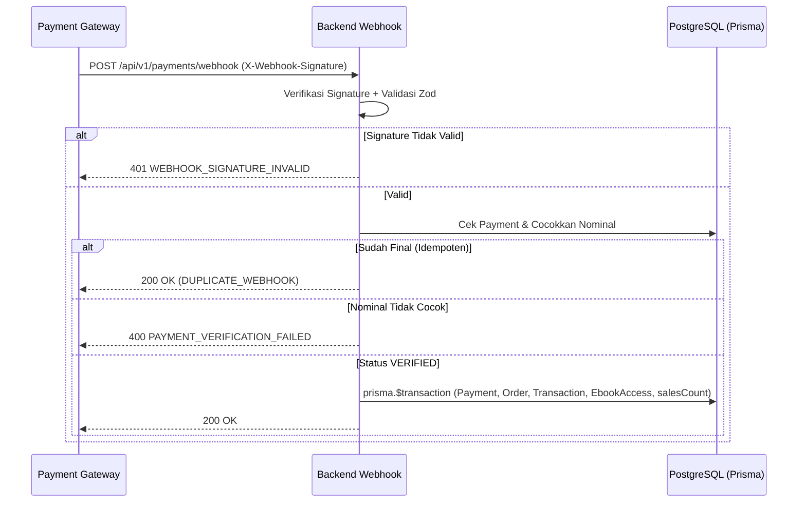

# Kontrak Webhook Payment Gateway (`API Webhook Contract`)

> **Status Dokumen:** `[ADA]` (Dokumentasi kontrak webhook) | **Implementasi Endpoint:** `[RENCANA]`
> **Sumber Utama:** [`docs/02-api/webhook-contract.md`](../02-api/webhook-contract.md) & [`transaction-workflow.md`](../03-business-process/transaction-workflow.md)

---

## 1. Spesifikasi Endpoint & Autentikasi Signature

- **Endpoint:** `POST /api/v1/payments/webhook`
- **Sumber Pemanggil:** Server Payment Gateway (Midtrans/Xendit).
- **Mekanisme Keamanan:** Tidak memakai Bearer JWT Pelanggan; menggunakan verifikasi signature pada header `X-Webhook-Signature` (HMAC/SHA-512 atau sesuai provider) terhadap *raw body* dan webhook secret di `.env` backend.
- **Header Wajib:** `Content-Type: application/json`, `X-Webhook-Signature: <signature>`.

---

## 2. Alur Validasi, Idempotensi & Transaksi Atomik (`prisma.$transaction`)

1. **Verifikasi Signature:** Jika signature tidak cocok → `401 WEBHOOK_SIGNATURE_INVALID` + catat log keamanan.
2. **Validasi Payload (Zod):** Field wajib `externalRef`, `status`, `amount` (opsional `orderNumber`, `paidAt`). Jika cacat → `400 VALIDATION_ERROR`.
3. **Pencocokan Nominal:** `amount` pada payload webhook wajib sama persis dengan `Payment.amount` di PostgreSQL. Jika berbeda → `400 PAYMENT_VERIFICATION_FAILED`.
4. **Pengecekan Idempotensi:** Sebelum melakukan mutasi, cek `Payment.status`. Jika sudah final (`VERIFIED`, `FAILED`, `EXPIRED`), kembalikan `200 OK` (`DUPLICATE_WEBHOOK`) tanpa menulis ulang data.
5. **Transaksi Atomik saat `VERIFIED`:**
   - Update `Payment`: `status = VERIFIED`, `paidAt = now()`.
   - Update `Order`: `status = PAID`.
   - Insert `Transaction` (`orderId`, `paymentId`, `userId`, `transactionCode`, `amount`).
   - Untuk setiap `OrderItem`: upsert `EbookAccess` (`isRevoked = false`) dan naikkan `Ebook.salesCount`.
   - Apabila salah satu langkah gagal → *rollback* seluruh transaksi (`no partial commit`).

---

## 3. Pemetaan Status Gateway ke Internal

| Status Eksternal Gateway | `PaymentStatus` Internal | `OrderStatus` Internal | Aksi Sistem |
| :--- | :--- | :--- | :--- |
| `SETTLEMENT` / `PAID` / `CAPTURED` | `VERIFIED` | `PAID` | Jalankan `prisma.$transaction`: buat `Transaction`, terbitkan `EbookAccess`, naikkan `salesCount` |
| `PENDING` | `PENDING` | `PENDING` | Tidak ada perubahan akses |
| `DENY` / `CANCEL` / `FAILURE` | `FAILED` | `FAILED` | Tandai gagal; tidak ada `Transaction` / `EbookAccess` |
| `EXPIRE` | `EXPIRED` | `EXPIRED` | Tandai kedaluwarsa; tidak ada `Transaction` / `EbookAccess` |

---

## 4. Diagram Sequence Webhook (`[RENCANA]`)



---

## 5. Contoh Payload (`DATA SIMULASI`) & Test Case Wajib

```json
{
  "externalRef": "DATA-SIMULASI-GW-20261114-001",
  "orderNumber": "ORD-DATA-SIMULASI-001",
  "status": "VERIFIED",
  "amount": "75000.00",
  "paidAt": "2026-11-14T04:30:00.000Z"
}
```

**9 Test Case Webhook Wajib (`webhook-contract.md`):**
1. Signature tidak valid → `401`.
2. Payload tidak lengkap → `400`.
3. Nominal berbeda → `400`.
4. `VERIFIED` pertama → atomik membuat `Transaction` + `EbookAccess`.
5. `VERIFIED` duplikat → `200 OK` idempoten.
6. `FAILED` → update status tanpa `EbookAccess`.
7. `EXPIRED` → update status tanpa `EbookAccess`.
8. `PENDING` → status tetap `PENDING`.
9. Error DB saat insert → *rollback* seluruh transaksi.
