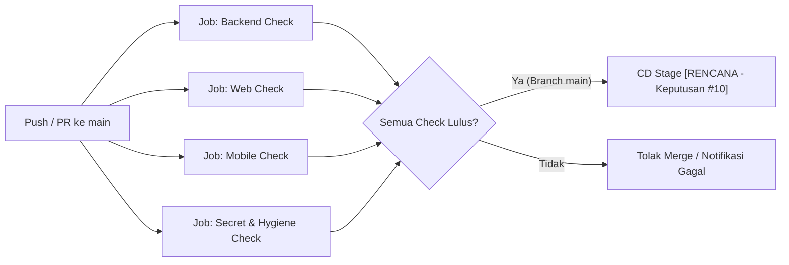

# Rancangan Pipeline CI/CD

**Status:** `[ADA]` placeholder minimal pada [`.github/workflows/ci.yml`](../../.github/workflows/ci.yml) | `[RENCANA]` pipeline build, test, dan deployment otomatis  
**Referensi Utama:** [`.github/workflows/ci.yml`](../../.github/workflows/ci.yml), [`backend/package.json`](../../backend/package.json), [`web/admin-web/package.json`](../../web/admin-web/package.json), [`web/pengunjung-web/package.json`](../../web/pengunjung-web/package.json).

---

## 1. Status Aktual CI/CD di Repository (`[ADA]`)

File [`.github/workflows/ci.yml`](../../.github/workflows/ci.yml) saat ini berisi satu job `placeholder` yang berjalan pada `push` dan `pull_request` ke branch `main`:

- Langkah yang ada hanya `actions/checkout@v4` dan `echo "CI placeholder - belum ada build/test yang dikonfigurasi"`.
- Belum ada pemeriksaan otomatis untuk `backend/`, `web/admin-web/`, `web/pengunjung-web/`, maupun `mobile/ebook_store/`.
- Belum ada workflow Continuous Deployment (CD) ke platform hosting mana pun (menunggu Keputusan #10 dan kesiapan fase implementasi).

---

## 2. Arsitektur Pipeline CI Target (`[RENCANA]`)

---

## 3. Rincian Job CI Target (`[RENCANA]`)

### A. Job Backend (`working-directory: backend`)
1. `npm ci`
2. `npx prisma generate` (agar tipe Prisma Client tersedia untuk `tsc`)
3. `npm run prisma:validate` (dengan dummy URL non-secret bila diperlukan)
4. `npm run typecheck` (`tsc --noEmit`)
5. `npm run test` (`vitest run`)
6. `npm run build` (`tsc`)

### B. Job Web (`web/admin-web` & `web/pengunjung-web`)
1. `web/admin-web`: `npm ci` -> `npm run lint` -> `npm run build` (`tsc --noEmit` + `vite build`).
2. `web/pengunjung-web`: `npm ci` -> `npm run lint` -> `npm run build` (`vite build`).

### C. Job Mobile (`working-directory: mobile/ebook_store`)
1. Setup Flutter SDK (sesuai Dart SDK `^3.12.0`).
2. `flutter pub get`
3. `flutter analyze`
4. `flutter test`

### D. Job Keamanan & Kebersihan Repo (`[RENCANA]`)
1. Pemeriksaan bahwa tidak ada file `.env` (selain `.env.example`) atau file keystore (`.jks`/`.keystore`) yang ter-commit.
2. Pemindaian pola secret (`SUPABASE_SERVICE_ROLE_KEY`, key gateway) di folder `web/` dan `mobile/`.

---

## 4. Rancangan Continuous Deployment / CD (`[RENCANA]`)

- **Urutan CD Target:** `Database Migration (prisma migrate deploy)` -> `Backend Deploy` -> `Smoke Test (/api/v1/health)` -> `Web Static Deploy (admin-web & pengunjung-web)` -> `Mobile Release Artifact (APK/AAB via manual tag/workflow_dispatch)`.
- **Syarat Aktifasi CD:** Keputusan #10 (hosting backend) telah dikunci, secret GitHub Environments (`staging` / `production`) telah dikonfigurasi, dan persetujuan manual diberlakukan sebelum deployment produksi.
