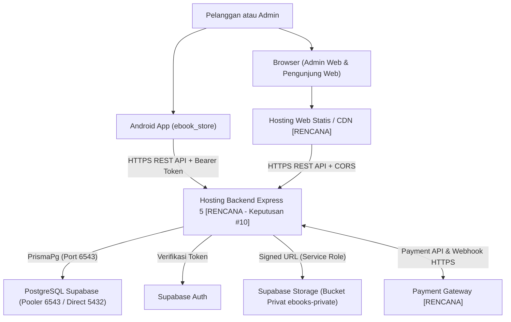

# Panduan Deployment (`Deployment Guide`)

**Status:** `[RENCANA]` (deployment produksi belum berjalan; fondasi konfigurasi lokal sebagian `[ADA]`)  
**Cakupan:** Backend (`Express 5 + Prisma 7`), Web (`admin-web` & `pengunjung-web` via Vite), Mobile (`ebook_store` Flutter Android), Database & Storage Supabase, Environment, Keamanan, CI/CD, dan Checklist Rilis.  
**Referensi Utama:** [`AGENTS.md`](../../AGENTS.md), [`deployment-architecture.md`](../02-architecture/deployment-architecture.md), [`keputusan-terbuka.md`](../00-project/keputusan-terbuka.md).

---

## 1. Ringkasan Eksekutif & Status Saat Ini

Sistem Informasi E-Commerce E-Book & SPK (SAW) dirancang dengan arsitektur terpisah antara backend API, aplikasi web statis, aplikasi mobile Android, serta layanan terkelola Supabase dan Payment Gateway.

- **Hal yang sudah `[ADA]` di repository:**
  - Backend Express 5 + TypeScript ESM (`backend/package.json`), validasi environment Zod (`backend/src/config/env.ts`), konfigurasi Prisma 7 (`backend/prisma.config.ts`, `backend/src/config/prisma.ts`), klien Supabase Storage (`backend/src/config/supabase.ts`), serta endpoint `GET /api/v1/health` dan `GET /api/v1/admin/ping` (`backend/src/app.ts`).
  - Template `.env.example` pada `backend/`, `web/admin-web/`, dan `web/pengunjung-web/`.
  - Skrip build pada `web/admin-web/package.json` dan `web/pengunjung-web/package.json`.
  - Proyek dasar Flutter `mobile/ebook_store` (`pubspec.yaml`, `lib/main.dart`).
  - Placeholder workflow GitHub Actions pada [`.github/workflows/ci.yml`](../../.github/workflows/ci.yml).
- **Hal yang masih `[RENCANA]`:**
  - Keputusan #10: Pemilihan platform hosting backend produksi (PaaS Node.js *long-running* vs Vercel Functions *serverless*).
  - Pembuatan migrasi database (`backend/prisma/migrations/`), konfigurasi RLS & bucket privat produksi di Supabase.
  - Pipeline CI/CD penuh (build, lint, test otomatis, dan CD gating).
  - Rilis hosting web statis/CDN serta signing & distribusi APK/AAB Android.

---

## 2. Peta Lingkungan Sistem

| Lingkungan | Tujuan | Artefak / Skrip Terkait | Status Aktual |
|---|---|---|---|
| **Development (Lokal)** | Pengembangan lokal di Windows PowerShell | `npm run dev` (`backend`), `npm run dev` (`web/*`), `flutter run` (`mobile/ebook_store`) | `[ADA]` skrip lokal; `.env` lokal & DB penuh `[RENCANA]` |
| **Testing** | Pengujian unit/integrasi & verifikasi build | `npm test` (`vitest run`), `npm run typecheck`, `npm run lint`, `npm run build`, `flutter test` | `[ADA]` fondasi & placeholder test; integrasi bisnis penuh `[RENCANA]` |
| **Production** | Layanan live terhubung Supabase & Payment Gateway | `node dist/server.js`, `dist/` statis Vite, APK/AAB bertanda tangan | `[RENCANA]` — menunggu Fase 1–4 & Keputusan #10 |

---

## 3. Topologi Deployment Target (`[RENCANA]`)

---

## 4. Urutan Rilis & Ketergantungan (`AGENTS.md`)

Sesuai aturan pada [`AGENTS.md`](../../AGENTS.md), urutan pengembangan dan rilis sistem adalah:

1. **Database & Storage Supabase** (`[RENCANA]` migrasi awal & verifikasi bucket privat).
2. **Backend API (`backend/`)** (`[RENCANA]` deploy & verifikasi `GET /api/v1/health` sebelum UI dihubungkan).
3. **Admin Web & Web Pengunjung (`web/admin-web/`, `web/pengunjung-web/`)** (`[RENCANA]` build dengan `VITE_API_BASE_URL` mengarah ke backend).
4. **Mobile Android (`mobile/ebook_store/`)** (`[RENCANA]` build APK/AAB dengan `baseUrl` produksi HTTPS).

---

## 5. Daftar Dokumen Deployment (`docs/05-deployment/`)

| Dokumen | Fokus Utama | Status |
|---|---|---|
| [`deployment-backend.md`](./deployment-backend.md) | Build, start, opsi hosting Keputusan #10, health check, CORS, graceful shutdown | `[RENCANA]` (detail fondasi `[ADA]`) |
| [`deployment-web.md`](./deployment-web.md) | Build Vite `admin-web` & `pengunjung-web`, variabel `VITE_*`, SPA fallback | `[RENCANA]` (skrip build `[ADA]`) |
| [`deployment-mobile.md`](./deployment-mobile.md) | Konfigurasi `baseUrl`, signing Android, build APK/AAB, akses PDF | `[RENCANA]` (proyek dasar `[ADA]`) |
| [`deployment-database.md`](./deployment-database.md) | Pooler 6543 vs Direct 5432, Prisma 7 (`PrismaPg`), migrasi, bucket privat, backup | `[RENCANA]` (konfigurasi Prisma `[ADA]`) |
| [`deployment-environment.md`](./deployment-environment.md) | Matriks variabel lingkungan Backend, Web, Mobile sesuai `env.ts` & `.env.example` | `[ADA]` template / `[RENCANA]` nilai produksi |
| [`deployment-security.md`](./deployment-security.md) | Manajemen secret, TLS, CORS, `helmet`, rate limiting, webhook signature | `[RENCANA]` (`helmet` & `cors` `[ADA]`) |
| [`deployment-ci-cd.md`](./deployment-ci-cd.md) | Audit placeholder `.github/workflows/ci.yml` & desain pipeline CI/CD bertahap | `[ADA]` placeholder / `[RENCANA]` pipeline |
| [`deployment-checklist.md`](./deployment-checklist.md) | Checklist Pra-Deployment, Saat Deployment, Pasca-Deployment, & Rollback | `[RENCANA]` |
| [`deployment-traceability.md`](./deployment-traceability.md) | Keterlacakan kebutuhan, keputusan terbuka, & artefak repo | `[ADA]` audit / `[RENCANA]` target |
| [`deployment-gap-register.md`](./deployment-gap-register.md) | Register kesenjangan kondisi aktual vs kesiapan produksi | `[ADA]` register audit |
