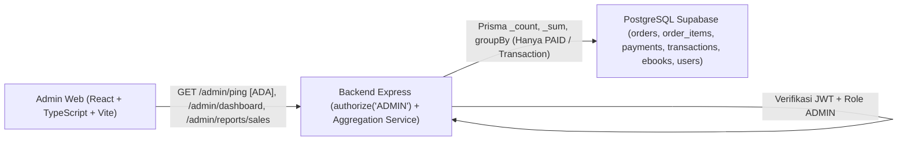

# Modul Dashboard Admin & Laporan Penjualan (`Admin Dashboard & Sales Reporting`)

**Status Implementasi:** `[RENCANA]` — Endpoint dashboard & laporan penjualan serta UI bisnis `web/admin-web` belum diimplementasikan. Endpoint uji otorisasi `GET /api/v1/admin/ping` sudah `[ADA]` pada [`backend/src/app.ts`](../../backend/src/app.ts).

---

## A. Ringkasan Modul

- **Cakupan:** Admin Dashboard Module dan Sales Reporting Module.
- **Status:** `[RENCANA]`.
- **Tujuan Modul:** Menyediakan ringkasan metrik operasional toko e-book serta laporan penjualan periodik (harian/bulanan dan e-book terlaris) khusus untuk role `ADMIN` berdasarkan data transaksi resmi di backend.
- **Aktor:** Admin.
- **Aplikasi Target:** `web/admin-web`, `backend/`.

---

## B. Arsitektur Modul



- Seluruh agregasi metrik dilakukan di backend menggunakan Prisma (`_count`, `_sum`, `groupBy`).
- Otorisasi wajib ditegakkan di backend (`authorize('ADMIN')`); menyembunyikan menu di `web/admin-web` tidak dianggap kontrol keamanan.

---

## C. Model Data (`backend/prisma/schema.prisma`)

Modul ini **tidak menambah model database baru**, melainkan mengagregasi model yang sudah `[ADA]` di `schema.prisma`:

- `Order` & `OrderItem` (status `PAID`, `PENDING`, `FAILED`, `EXPIRED`, `CANCELLED`; `totalAmount` & `unitPrice` bertipe `Decimal(12,2)`).
- `Payment` (`status`, `paymentMethod`, `paidAt`).
- `Transaction` (`amount` bertipe `Decimal(12,2)`, `recordedAt`, `transactionCode`) — sumber utama pendapatan sah.
- `Ebook` (`isActive`, `salesCount`, `title`) & `User` (`role`, `isActive`).
- `EbookAccess` (pemantauan kepemilikan/pencabutan akses).

---

## D. Endpoint API

| Endpoint | Method | Authentication | Authorization | Deskripsi | Status |
|---|---|---|---|---|---|
| `/api/v1/admin/ping` | `GET` | Bearer JWT | `ADMIN` | Uji konektivitas & otorisasi admin | `[ADA]` |
| `/api/v1/admin/dashboard` | `GET` | Bearer JWT | `ADMIN` | Ringkasan statistik operasional | `[RENCANA]` |
| `/api/v1/admin/reports/sales` | `GET` | Bearer JWT | `ADMIN` | Laporan penjualan (`startDate`, `endDate`, `groupBy`) | `[RENCANA]` |
| `/api/v1/admin/payments` | `GET` | Bearer JWT | `ADMIN` | Daftar seluruh pembayaran | `[RENCANA]` |
| `/api/v1/admin/transactions` | `GET` | Bearer JWT | `ADMIN` | Daftar transaksi resmi | `[RENCANA]` |
| `/api/v1/admin/orders` | `GET` | Bearer JWT | `ADMIN` | Daftar seluruh pesanan | `[RENCANA]` |
| `/api/v1/admin/customers` | `GET` | Bearer JWT | `ADMIN` | Daftar pelanggan | `[RENCANA]` |

### Contoh Kontrak (`GET /api/v1/admin/reports/sales` — `[RENCANA]`)
- **Zod Query:** `{ startDate: z.coerce.date(), endDate: z.coerce.date(), groupBy: z.enum(['day', 'month']).default('day') }` dengan validasi `startDate <= endDate`.
- **Response `200 OK` (`"DATA SIMULASI"`):**
  ```json
  {
    "success": true,
    "message": "Laporan penjualan berhasil diambil",
    "data": {
      "summary": {
        "totalRevenue": "1500000.00",
        "totalTransactions": 20,
        "totalUnitsSold": 24
      },
      "series": [
        { "period": "DATA SIMULASI - 2026-11-01", "revenue": "750000.00", "transactions": 10 }
      ]
    }
  }
  ```

---

## E. Alur Proses Bisnis

Mengacu pada `BP-A09`–`BP-A13` di [`admin-workflow.md`](../03-business-process/admin-workflow.md):

1. Admin masuk ke `web/admin-web` menggunakan Supabase Auth (`BP-A01`).
2. Frontend memanggil `GET /api/v1/admin/dashboard` atau `GET /api/v1/admin/reports/sales` dengan Bearer JWT.
3. Backend memverifikasi JWT dan `role === 'ADMIN'`.
4. Backend mengagregasi transaksi (`Transaction`) dan pesanan `PAID`, lalu mengembalikan ringkasan metrik dan seri waktu ke `admin-web`.

---

## F. Aturan Bisnis & Validasi

| ID | Aturan | Entitas | Validasi | Dampak Bila Dilanggar | Sumber | Status |
|---|---|---|---|---|---|---|
| **BR-ADM-01** | Hanya role `ADMIN` diizinkan | `User` | `authorize('ADMIN')` | `403 FORBIDDEN` | `auth.middleware.ts` | `[ADA]` (ping) / `[RENCANA]` |
| **BR-ADM-02** | Order non-`PAID` bukan pendapatan | `Order`, `Transaction` | Hitung pendapatan hanya dari `Transaction` / `Order.PAID` | Akurasi laporan keuangan | `business-rules.md` | `[RENCANA]` |
| **BR-ADM-03** | Validasi rentang tanggal laporan | Query | `startDate <= endDate` | `400 VALIDATION_ERROR` | `api-spec.yaml` | `[RENCANA]` |
| **BR-ADM-04** | `groupBy` hanya `day` atau `month` | Query | `z.enum(['day', 'month'])` | `400 VALIDATION_ERROR` | `api-spec.yaml` | `[RENCANA]` |
| **BR-ADM-05** | Data placeholder UI berlabel `"DATA SIMULASI"` | UI Admin | Konvensi `AGENTS.md` | Kejujuran status data | `AGENTS.md` | `[ADA]` aturan |

---

## G. State Machine

Modul ini bersifat **read-only agregasi** sehingga tidak memiliki state machine tersendiri; modul membaca status dari `OrderStatus`, `PaymentStatus`, `Ebook.isActive`, dan `User.isActive`.

---

## H. Penanganan Error (`docs/02-api/error-catalog.md`)

| Kode Error | HTTP | Kondisi | Pesan Aman | Status |
|---|---:|---|---|---|
| `VALIDATION_ERROR` | `400` | Format tanggal salah, `startDate > endDate`, atau `groupBy` invalid | `"Input tidak valid."` | `[ADA]` (`error.middleware.ts`) |
| `UNAUTHENTICATED` / `UNAUTHORIZED` | `401` | Token tidak ada atau kedaluwarsa | `"Autentikasi diperlukan atau sesi telah kedaluwarsa."` | `[ADA]` mekanisme |
| `FORBIDDEN` | `403` | Pengguna ber-role `CUSTOMER` mengakses endpoint `/admin/*` | `"Anda tidak memiliki hak akses untuk operasi ini."` | `[ADA]` (`auth.middleware.ts`) |

---

## I. Pertimbangan Keamanan

- Seluruh endpoint `/api/v1/admin/*` wajib memakai `authenticate` + `authorize('ADMIN')`.
- Respons dashboard/laporan tidak boleh membocorkan `storagePath` maupun data rahasia gateway.

---

## J. Integrasi dengan Modul Lain

- Mengagregasi data dari **Authentication (User)**, **E-Book Catalog**, **Order Management**, **Payment & Transaction Management**, dan **E-Book Access**.

---

## K. Ketergantungan Keputusan Terbuka

- Implementasi UI `web/admin-web` menunggu penyusunan endpoint backend (`Backend -> Admin Web -> Mobile` sesuai `AGENTS.md`) dan penyelarasan desain neo-brutalism (`docs/01-design/ui-ux/design.md`).

---

## L. Test Case Referensi

- `TC-AUTH-03`: Pelanggan mengakses `/api/v1/admin/*` ditolak dengan `403 Forbidden` (`[RENCANA]` untuk rute bisnis; mekanisme dasar sudah teruji pada `/api/v1/admin/ping` `[ADA]`).

---

## M. Status Implementasi

- **`[ADA]`:** `GET /api/v1/admin/ping` beserta middleware `authenticate` + `authorize('ADMIN')` di `backend/src/app.ts`.
- **`[RENCANA]`:** Endpoint `GET /api/v1/admin/dashboard`, `GET /api/v1/admin/reports/sales`, serta halaman dashboard & laporan pada `web/admin-web`.
