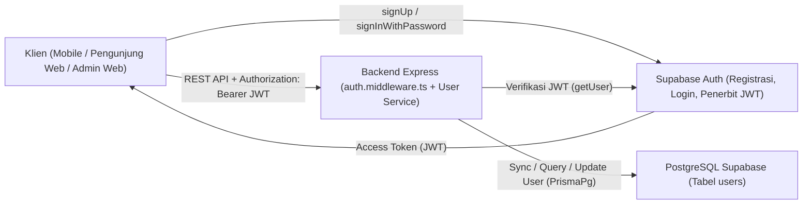
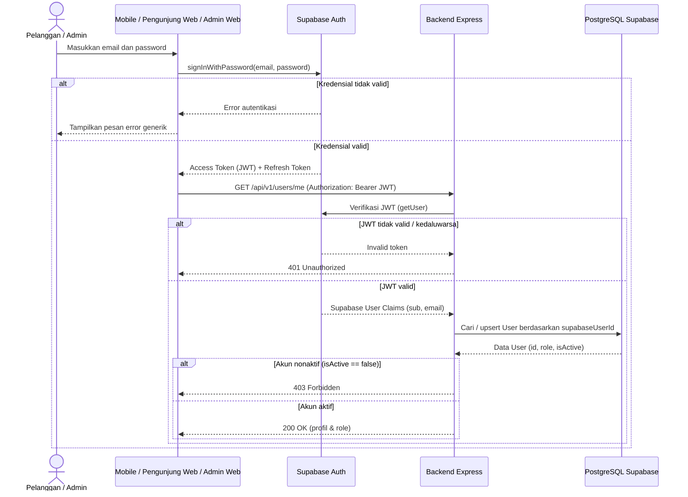
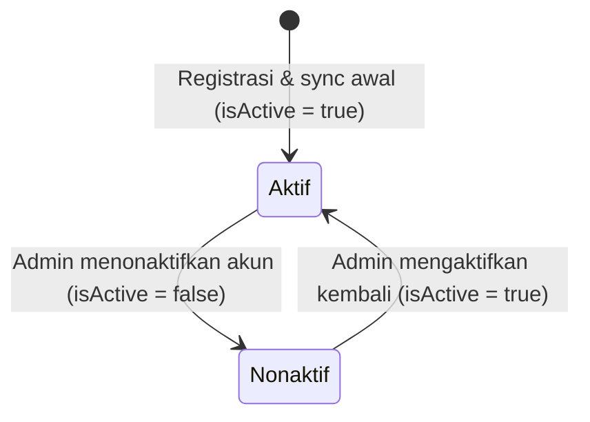

# Modul Autentikasi & Manajemen Pengguna (`Authentication & User Management`)

**Status Implementasi:** `[RENCANA]` — Seluruh modul bisnis dan endpoint autentikasi/pengguna belum diimplementasikan. Fondasi middleware `authenticate` dan `authorize('ADMIN')` sudah `[ADA]` pada [`backend/src/middlewares/auth.middleware.ts`](../../backend/src/middlewares/auth.middleware.ts) dan teruji pada `GET /api/v1/admin/ping` ([`backend/src/app.ts`](../../backend/src/app.ts)).

---

## A. Ringkasan Modul

- **Cakupan:** Authentication Module dan User Management Module.
- **Status:** `[RENCANA]`.
- **Tujuan Modul:** Mengamankan akses sistem melalui verifikasi token JWT **Supabase Auth**, menyinkronkan identitas pengguna ke tabel `users` PostgreSQL, menegakkan otorisasi berbasis role (`CUSTOMER` / `ADMIN`), serta menyediakan pengelolaan profil pelanggan dan pemantauan pelanggan oleh admin.
- **Aktor:** Pelanggan (*Customer*) dan Admin.
- **Aplikasi Target:** `mobile/ebook_store`, `web/pengunjung-web`, `web/admin-web`, `backend/`.

---

## B. Arsitektur Modul



- **Supabase Auth:** Menangani registrasi, login (`email` + `password`), reset password, dan penerbitan JWT. Backend tidak menyimpan `password_hash`.
- **Backend Express:**
  - `auth.middleware.ts` (`[ADA]` kerangka): Memverifikasi Bearer JWT dan menegakkan `authorize(role)` (`[ADA]` teruji di `GET /api/v1/admin/ping`).
  - `POST /api/v1/auth/sync` (`[RENCANA]`): Menyinkronkan claim Supabase (`sub`, `email`) ke model `User` di PostgreSQL.
  - Helper `validate` (`backend/src/middleware/validate.ts` `[ADA]`) & `sendSuccess` (`backend/src/utils/response.ts` `[ADA]`).
- **PostgreSQL (`users`):** Menyimpan profil aplikasi (`role`, `isActive`, `fullName`, `phone`, `supabaseUserId`).
- **Klien:** Menyimpan token sesi secara aman (`flutter_secure_storage` di mobile `[RENCANA]`).

---

## C. Model Data (`backend/prisma/schema.prisma`)

### Model `User` (`@@map("users")`)

| Field | Nama Prisma | Tipe | Nullable | Default | Deskripsi | Status |
|---|---|---|---|---|---|---|
| `id` | `id` | `String @id @db.Uuid` | Tidak | `uuid()` | Primary key pengguna | `[ADA]` (schema) |
| `supabase_user_id` | `supabaseUserId` | `String @unique` | Tidak | — | Subject ID dari Supabase Auth | `[ADA]` (schema) |
| `full_name` | `fullName` | `String @db.VarChar(120)` | Tidak | — | Nama lengkap pengguna | `[ADA]` (schema) |
| `email` | `email` | `String @unique @db.VarChar(150)` | Tidak | — | Email unik pengguna | `[ADA]` (schema) |
| `phone` | `phone` | `String? @db.VarChar(25)` | Ya | `null` | Nomor telepon opsional | `[ADA]` (schema) |
| `role` | `role` | `UserRole` | Tidak | `CUSTOMER` | Peran pengguna (`CUSTOMER` / `ADMIN`) | `[ADA]` (schema) |
| `is_active` | `isActive` | `Boolean` | Tidak | `true` | Status aktif akun | `[ADA]` (schema) |
| `created_at` | `createdAt` | `DateTime @db.Timestamptz()` | Tidak | `now()` | Waktu pembuatan record | `[ADA]` (schema) |
| `updated_at` | `updatedAt` | `DateTime @updatedAt @db.Timestamptz()` | Tidak | `@updatedAt` | Waktu pembaruan terakhir | `[ADA]` (schema) |

- **Enum `UserRole`:** `CUSTOMER`, `ADMIN`.
- **Relasi:** `orders` (`Order[]`), `transactions` (`Transaction[]`), `ebookAccesses` (`EbookAccess[]`).
- **Constraint:** `supabaseUserId` (`@unique`), `email` (`@unique`).

---

## D. Endpoint API

| Endpoint | Method | Authentication | Authorization | Deskripsi | Status |
|---|---|---|---|---|---|
| `/api/v1/auth/sync` | `POST` | Bearer JWT | `CUSTOMER` / `ADMIN` | Sinkronisasi profil Supabase Auth ke DB `users` | `[RENCANA]` |
| `/api/v1/users/me` | `GET` | Bearer JWT | `CUSTOMER` / `ADMIN` | Mengambil profil pengguna aktif | `[RENCANA]` |
| `/api/v1/users/me` | `PATCH` | Bearer JWT | `CUSTOMER` / `ADMIN` | Memperbarui `fullName` dan `phone` sendiri | `[RENCANA]` |
| `/api/v1/admin/customers` | `GET` | Bearer JWT | `ADMIN` | Daftar pelanggan terpaginasi + pencarian | `[RENCANA]` |
| `/api/v1/admin/customers/:id` | `GET` | Bearer JWT | `ADMIN` | Detail pelanggan beserta ringkasan pesanan | `[RENCANA]` |

### Kontrak Request, Response (`"DATA SIMULASI"`), & Validasi Zod (`[RENCANA]`)

1. **`POST /api/v1/auth/sync`**
   - **Zod Body (opsional):** `{ fullName?: z.string().min(2).max(120), phone?: z.string().max(25) }`.
   - **Response `200 OK`:**
     ```json
     {
       "success": true,
       "message": "Profil tersinkronisasi",
       "data": {
         "id": "00000000-0000-0000-0000-000000000001",
         "fullName": "DATA SIMULASI - Budi Santoso",
         "email": "budi.simulasi@example.com",
         "phone": "081200000000",
         "role": "CUSTOMER",
         "isActive": true
       }
     }
     ```
   - **Error:** `401 UNAUTHENTICATED/UNAUTHORIZED`, `403 FORBIDDEN` (akun nonaktif).
2. **`GET /api/v1/users/me`**
   - **Request:** Tanpa body/query; identitas diambil dari `req.user.id`.
   - **Response `200 OK`:** Sama dengan struktur `data` pada `/auth/sync`.
   - **Error:** `401 UNAUTHENTICATED/UNAUTHORIZED`, `403 FORBIDDEN`.
3. **`PATCH /api/v1/users/me`**
   - **Zod Body:** `{ fullName: z.string().min(2).max(120).optional(), phone: z.string().max(25).nullable().optional() }` (`.strict()` agar `role` dan `isActive` ditolak).
   - **Response `200 OK`:** Objek `User` terbaru.
   - **Error:** `400 VALIDATION_ERROR`, `401 UNAUTHENTICATED/UNAUTHORIZED`, `403 FORBIDDEN`.
4. **`GET /api/v1/admin/customers`**
   - **Zod Query:** `{ page?: coerce.number().int().min(1).default(1), limit?: coerce.number().int().min(1).max(100).default(10), search?: z.string().optional(), isActive?: z.enum(['true','false']).optional() }`.
   - **Response `200 OK`:** Daftar pelanggan terpaginasi (`items`, `meta`).
   - **Error:** `400 VALIDATION_ERROR`, `401`, `403 FORBIDDEN`.
5. **`GET /api/v1/admin/customers/:id`**
   - **Zod Params:** `{ id: z.string().uuid() }`.
   - **Response `200 OK`:** Detail `User` + ringkasan pesanan.
   - **Error:** `400 VALIDATION_ERROR`, `401`, `403`, `404 NOT_FOUND`.

---

## E. Alur Proses Bisnis

Mengacu pada `BP-C01` (registrasi & login pelanggan) dan `BP-A01` (login admin) di [`docs/03-business-process/`](../03-business-process/customer-workflow.md) serta [`sequence-diagram.md`](../01-design/sequence-diagram.md) bagian 1:



- **Alur Utama:** Klien login ke Supabase Auth -> menerima JWT -> memanggil `POST /auth/sync` atau `GET /users/me` -> backend memverifikasi JWT & role -> mengembalikan profil.
- **Alur Alternatif:** Saat `PATCH /users/me`, hanya `fullName` dan `phone` yang diperbarui.
- **Alur Gagal:** Token tidak valid/kedaluwarsa (`401`), akun `isActive = false` (`403`), atau pelanggan mengakses `/admin/*` (`403`).

---

## F. Aturan Bisnis & Validasi

| ID | Aturan | Entitas | Validasi | Dampak Bila Dilanggar | Sumber | Status |
|---|---|---|---|---|---|---|
| **BR-AUTH-01** | Email pengguna unik | `User` | Constraint `@unique` di DB | `409 CONFLICT` | `schema.prisma` | `[ADA]` schema / `[RENCANA]` handler |
| **BR-AUTH-02** | `supabaseUserId` unik | `User` | Constraint `@unique` di DB | `409 CONFLICT` / upsert idempoten | `schema.prisma` | `[ADA]` schema / `[RENCANA]` handler |
| **BR-AUTH-03** | Role hanya `CUSTOMER` atau `ADMIN` | `User` | Enum `UserRole` | `400 VALIDATION_ERROR` | `schema.prisma` | `[ADA]` schema |
| **BR-AUTH-04** | Pelanggan dilarang ubah `role` atau `isActive` | `User` | Schema Zod `PATCH /users/me` ketat | `400 VALIDATION_ERROR` / diabaikan | `requirements.md` (`FR-C02`) | `[RENCANA]` |
| **BR-AUTH-05** | Pesan error login generik | `User` | Tidak membocorkan email terdaftar/tidak | Mencegah *user enumeration* | `error-catalog.md` | `[RENCANA]` |
| **BR-AUTH-06** | Akun nonaktif ditolak | `User` | Cek `user.isActive === true` di middleware | `403 FORBIDDEN` | `sequence-diagram.md` | `[RENCANA]` |
| **BR-AUTH-07** | Pencegahan IDOR profil | `User` | Ambil ID dari `req.user.id`, bukan body/query | `403 FORBIDDEN` | `security-guidelines.md` | `[RENCANA]` |
| **BR-AUTH-08** | Backend tidak simpan `password_hash` | `User` | Kredensial dikelola Supabase Auth | Bebas kebocoran hash password | `schema.prisma`, Keputusan #2 | `[ADA]` schema |

---

## G. State Machine (`User.isActive`)



---

## H. Penanganan Error (`docs/02-api/error-catalog.md`)

| Kode Error | HTTP | Kondisi | Pesan Aman | Status |
|---|---:|---|---|---|
| `VALIDATION_ERROR` | `400` | Input body/query/params gagal validasi Zod | `"Input tidak valid."` | `[ADA]` (`error.middleware.ts`) |
| `UNAUTHENTICATED` / `UNAUTHORIZED` | `401` | Bearer token tidak ada, salah format, atau kedaluwarsa | `"Autentikasi diperlukan atau sesi telah kedaluwarsa."` | `[ADA]` mekanisme / `[RENCANA]` penyeragaman kode |
| `FORBIDDEN` | `403` | Role bukan `ADMIN` di `/admin/*` atau `isActive = false` | `"Anda tidak memiliki hak akses untuk operasi ini."` | `[ADA]` (`auth.middleware.ts`) |
| `NOT_FOUND` | `404` | ID pelanggan tidak ditemukan di `/admin/customers/:id` | `"Data yang diminta tidak ditemukan."` | `[RENCANA]` |
| `CONFLICT` | `409` | Duplikasi `email` atau `supabaseUserId` saat sinkronisasi | `"Permintaan tidak dapat diproses karena konflik status data."` | `[RENCANA]` |
| `RATE_LIMITED` | `429` | Permintaan `/auth/sync` melebihi batas rate limiter | `"Terlalu banyak permintaan. Silakan coba beberapa saat lagi."` | `[RENCANA]` |

---

## I. Pertimbangan Keamanan

- Verifikasi JWT dilakukan server-side via `supabase.auth.getUser(token)` menggunakan kredensial backend.
- Penyimpanan token di klien: `flutter_secure_storage` untuk mobile `[RENCANA]`; penyimpanan aman di memori/cookie untuk web `[RENCANA]`.
- Rate limiting (`express-rate-limit` pada `rate-limit.middleware.ts` `[ADA]` file) wajib dipasang pada route auth di `app.ts` (`[RENCANA]`).
- Dilarang menaruh `SUPABASE_SERVICE_ROLE_KEY` di `VITE_*` atau kode Flutter.

---

## J. Integrasi dengan Modul Lain

- Menjadi prasyarat otentikasi dan otorisasi (`req.user`) untuk modul **Order Management**, **Payment Management**, **E-Book Access**, **Admin Dashboard**, dan operasi admin pada **E-Book Catalog & SAW**.

---

## K. Ketergantungan Keputusan Terbuka

- **Keputusan #2** (`keputusan-terbuka.md`): Menggunakan Supabase Auth (`[ADA]` sebagai keputusan).
- Sinkronisasi otomatis vs eksplisit record `User` dari Supabase Auth ke PostgreSQL saat pertama login masih menunggu implementasi (`[RENCANA]`).

---

## L. Test Case Referensi (`docs/09-testing/test-cases.md`)

- `TC-AUTH-01`: Registrasi/sinkronisasi valid, tidak mengembalikan `password_hash` (`[RENCANA]`).
- `TC-AUTH-02`: Duplikasi email mengembalikan `409 Conflict` (`[RENCANA]`).
- `TC-AUTH-03`: Pelanggan (`CUSTOMER`) mengakses `/api/v1/admin/*` mengembalikan `403 Forbidden` (`[RENCANA]`).

---

## M. Status Implementasi

- **`[ADA]`:** Middleware `authenticate` dan `authorize('ADMIN')` (`backend/src/middlewares/auth.middleware.ts`), endpoint uji `GET /api/v1/admin/ping` (`backend/src/app.ts`), serta model `User` & enum `UserRole` (`backend/prisma/schema.prisma`).
- **`[RENCANA]`:** Endpoint `POST /api/v1/auth/sync`, `GET/PATCH /api/v1/users/me`, `GET /api/v1/admin/customers`, `GET /api/v1/admin/customers/:id`, serta UI login/profil di `admin-web`, `pengunjung-web`, dan `ebook_store`.
