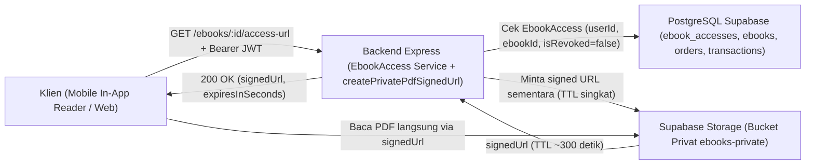
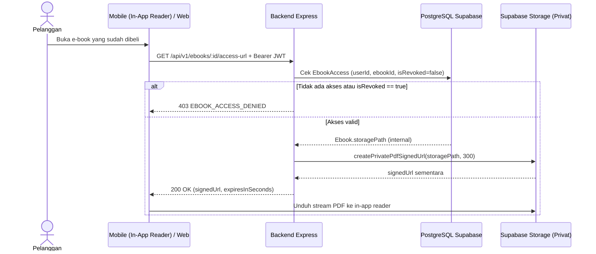
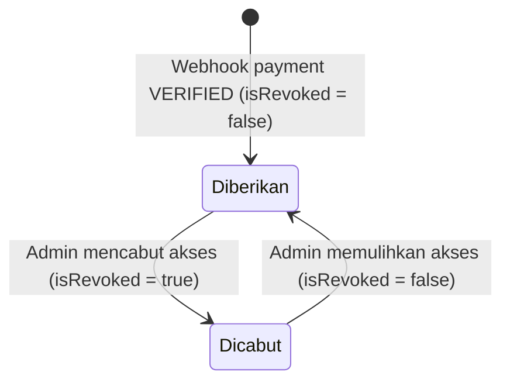

# Modul Riwayat Pembelian & Hak Akses E-Book (`Purchase History & E-Book Access`)

**Status Implementasi:** `[RENCANA]` — Endpoint penerbitan signed URL dan pengelolaan akses admin belum diimplementasikan. Helper `createPrivatePdfSignedUrl` sudah `[ADA]` di [`backend/src/integrations/storage/supabase-storage.ts`](../../backend/src/integrations/storage/supabase-storage.ts) dan model `EbookAccess` sudah `[ADA]` di [`backend/prisma/schema.prisma`](../../backend/prisma/schema.prisma).

---

## A. Ringkasan Modul

- **Cakupan:** Purchase History Module dan E-Book Access Module.
- **Status:** `[RENCANA]`.
- **Tujuan Modul:** Memberikan akses baca PDF secara aman melalui *signed URL* sementara dari bucket privat Supabase Storage hanya kepada pelanggan yang pembayarannya terverifikasi (`EbookAccess` aktif), menampilkan riwayat pembelian/pesanan pribadi, serta memungkinkan admin mencabut atau memulihkan akses bila diperlukan.
- **Aktor:** Pelanggan (*Customer*), Sistem (penerbitan otomatis saat webhook `VERIFIED`), dan Admin.
- **Aplikasi Target:** `mobile/ebook_store`, `web/pengunjung-web`, `web/admin-web`, `backend/`.

---

## B. Arsitektur Modul



- **Backend sebagai Mediator Tunggal:** Klien tidak pernah memegang `SUPABASE_SERVICE_ROLE_KEY` maupun mengetahui `storagePath` mentah.
- **TTL Singkat:** Signed URL hanya berlaku sementara (default `300` detik / 5 menit `[RENCANA]`).

---

## C. Model Data (`backend/prisma/schema.prisma`)

### Model `EbookAccess` (`@@map("ebook_accesses")`)

| Field | Nama Prisma | Tipe | Nullable | Default | Deskripsi | Status |
|---|---|---|---|---|---|---|
| `id` | `id` | `String @id @db.Uuid` | Tidak | `uuid()` | Primary key hak akses | `[ADA]` (schema) |
| `user_id` | `userId` | `String @db.Uuid` | Tidak | — | Foreign key ke `User` | `[ADA]` (schema) |
| `ebook_id` | `ebookId` | `String @db.Uuid` | Tidak | — | Foreign key ke `Ebook` | `[ADA]` (schema) |
| `order_id` | `orderId` | `String @db.Uuid` | Tidak | — | Foreign key ke `Order` sumber akses | `[ADA]` (schema) |
| `granted_at` | `grantedAt` | `DateTime @default(now()) @db.Timestamptz()` | Tidak | `now()` | Waktu pemberian akses | `[ADA]` (schema) |
| `is_revoked` | `isRevoked` | `Boolean` | Tidak | `false` | Status pencabutan akses oleh admin | `[ADA]` (schema) |

- **Constraint & Indeks:** `@@unique([userId, ebookId])` (mencegah duplikasi akses e-book yang sama); `@@index([ebookId])`.
- **Relasi `onDelete`:** `user`, `ebook`, dan `order` seluruhnya menggunakan `onDelete: Restrict`.

---

## D. Endpoint API

| Endpoint | Method | Authentication | Authorization | Deskripsi | Status |
|---|---|---|---|---|---|
| `/api/v1/ebooks/:id/access-url` | `GET` | Bearer JWT | `CUSTOMER` | Minta signed URL sementara untuk baca PDF | `[RENCANA]` |
| `/api/v1/transactions/my` | `GET` | Bearer JWT | `CUSTOMER` | Riwayat transaksi pembelian milik sendiri | `[RENCANA]` |
| `/api/v1/orders/me` | `GET` | Bearer JWT | `CUSTOMER` | Riwayat pesanan milik sendiri | `[RENCANA]` |
| `/api/v1/admin/accesses/:id` | `PATCH` | Bearer JWT | `ADMIN` | Cabut atau pulihkan akses (`{ isRevoked }`) | `[RENCANA]` |

### Contoh Kontrak (`GET /api/v1/ebooks/:id/access-url` — `[RENCANA]`)
- **Zod Params:** `{ id: z.string().uuid() }`.
- **Response `200 OK` (`"DATA SIMULASI"`):**
  ```json
  {
    "success": true,
    "message": "Signed URL akses e-book berhasil dibuat",
    "data": {
      "ebookId": "00000000-0000-0000-0000-000000000101",
      "signedUrl": "https://PROJECT_REF.supabase.co/storage/v1/object/sign/ebooks-private/DATA-SIMULASI.pdf?token=PLACEHOLDER",
      "expiresInSeconds": 300
    }
  }
  ```
- **Error:** `400 VALIDATION_ERROR`, `401`, `403 EBOOK_ACCESS_DENIED`, `500 SIGNED_URL_GENERATION_FAILED`.

---

## E. Alur Proses Bisnis

Mengacu pada `BP-C11` (akses e-book), `BP-C12` (baca PDF in-app), `BP-A16` (cabut/pulihkan akses) pada [`ebook-access-workflow.md`](../03-business-process/ebook-access-workflow.md) dan [`sequence-diagram.md`](../01-design/sequence-diagram.md) bagian 4:



---

## F. Aturan Bisnis & Validasi

| ID | Aturan | Entitas | Validasi | Dampak Bila Dilanggar | Sumber | Status |
|---|---|---|---|---|---|---|
| **BR-ACC-01** | `EbookAccess` terbit hanya setelah `Payment.VERIFIED` | `EbookAccess` | Dibuat di transaksi atomik webhook | Mencegah akses gratis/palsu | `transaction-workflow.md` | `[RENCANA]` |
| **BR-ACC-02** | Tidak ada akses duplikat per user & e-book | `EbookAccess` | `@@unique([userId, ebookId])` | Integritas kepemilikan | `schema.prisma` | `[ADA]` schema |
| **BR-ACC-03** | Akses dicabut atau belum beli ditolak | `EbookAccess` | Cek record ada & `isRevoked === false` | `403 EBOOK_ACCESS_DENIED` | `error-catalog.md` | `[RENCANA]` |
| **BR-ACC-04** | Signed URL TTL singkat (<= 5–15 menit) | Storage | `expiresIn` default `300` detik | Batasi penyebaran URL | `NFR-02` | `[ADA]` helper / `[RENCANA]` endpoint |
| **BR-ACC-05** | `storagePath` tidak terekspos & bucket privat | `Ebook` | Jangan kembalikan `storagePath` di JSON | File asli terlindungi | `security-guidelines.md` | `[RENCANA]` |
| **BR-ACC-06** | Pembeli lama tetap akses e-book yang diarsipkan | `Ebook`, `EbookAccess` | Jangan tolak akses hanya karena `Ebook.isActive == false` | Hak pembeli sah terjaga | `business-rules.md` | `[RENCANA]` |
| **BR-ACC-07** | Pencegahan IDOR | `EbookAccess` | Gunakan `req.user.id` dari token JWT | Tidak bisa baca milik orang lain | `security-guidelines.md` | `[RENCANA]` |
| **BR-ACC-08** | Admin dapat cabut / pulihkan akses | `EbookAccess` | `PATCH /admin/accesses/:id` (`isRevoked`) | Kontrol penyalahgunaan | `FR-A11` | `[RENCANA]` |

---

## G. State Machine (`EbookAccess.isRevoked`)



---

## H. Penanganan Error (`docs/02-api/error-catalog.md`)

| Kode Error | HTTP | Kondisi | Pesan Aman | Status |
|---|---:|---|---|---|
| `VALIDATION_ERROR` | `400` | `:id` bukan UUID atau payload `{ isRevoked }` invalid | `"Input tidak valid."` | `[ADA]` (`error.middleware.ts`) |
| `EBOOK_ACCESS_DENIED` | `403` | Belum membeli e-book atau `isRevoked === true` | `"Anda tidak memiliki akses aktif untuk e-book ini."` | `[RENCANA]` |
| `NOT_FOUND` | `404` | Record `EbookAccess` tidak ditemukan saat admin `PATCH` | `"Data yang diminta tidak ditemukan."` | `[RENCANA]` |
| `SIGNED_URL_GENERATION_FAILED` | `500` | Supabase Storage gagal membuat signed URL | `"Gagal menyiapkan akses baca e-book sementara."` | `[RENCANA]` |

---

## I. Pertimbangan Keamanan

- Bucket Storage `ebooks-private` wajib berstatus privat.
- `storagePath` tidak boleh masuk ke respons API mana pun.
- Pencabutan akses oleh admin (`isRevoked = true`) langsung memblokir permintaan signed URL berikutnya.

---

## J. Integrasi dengan Modul Lain

- Diaktifkan oleh **Payment Management** pasca-webhook `VERIFIED`.
- Membaca `storagePath` dari **E-Book Catalog**.
- Diperiksa oleh **Order Management** untuk mencegah pembelian ulang e-book yang sudah dimiliki.

---

## K. Ketergantungan Keputusan Terbuka

- Pemilihan package PDF viewer pada `mobile/ebook_store` (`pubspec.yaml` saat ini belum memiliki package PDF viewer) `[RENCANA]`.

---

## L. Test Case Referensi

- `TC-ACC-01`: Pelanggan meminta akses e-book yang belum dibeli -> `403 Forbidden`, tanpa signed URL (`[RENCANA]`).
- `TC-ACC-02`: Pelanggan meminta akses e-book yang sudah dibeli & `PAID` -> `200 OK` dengan signed URL sementara (`[RENCANA]`).

---

## M. Status Implementasi

- **`[ADA]`:** Helper `createPrivatePdfSignedUrl` (`backend/src/integrations/storage/supabase-storage.ts`) dan model `EbookAccess` (`backend/prisma/schema.prisma`).
- **`[RENCANA]`:** Endpoint `GET /api/v1/ebooks/:id/access-url`, `PATCH /api/v1/admin/accesses/:id`, dan *in-app PDF reader* di klien.
