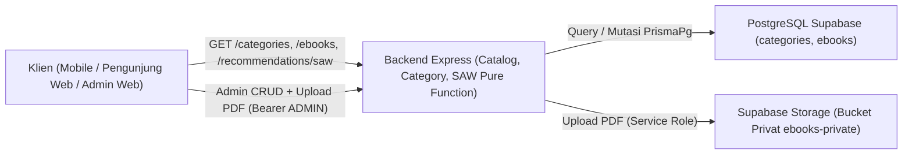
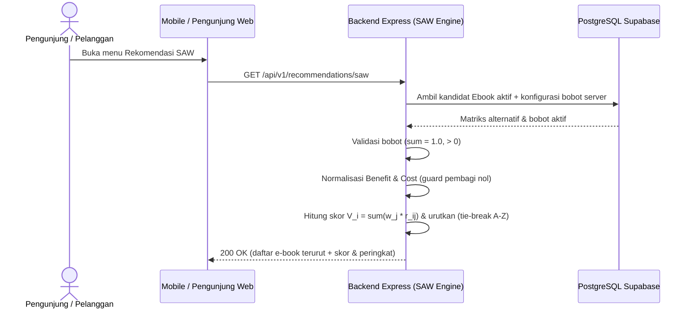
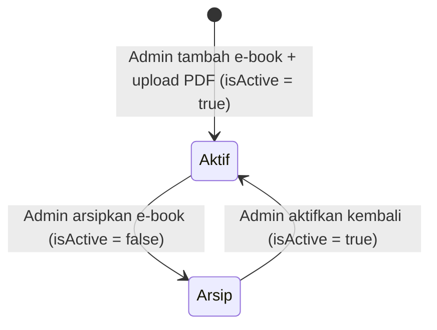

# Modul Katalog E-Book, Kategori, & Rekomendasi SAW (`E-Book Catalog, Category, & SAW`)

**Status Implementasi:** `[RENCANA]` — Seluruh endpoint katalog, kategori, upload PDF, dan perhitungan SAW belum diimplementasikan. Helper `createPrivatePdfSignedUrl` (`backend/src/integrations/storage/supabase-storage.ts`) dan skema Prisma sudah `[ADA]`.

---

## A. Ringkasan Modul

- **Cakupan:** E-Book Catalog Module, Category Management Module, dan SPK SAW Recommendation Module (`ADR-0002`).
- **Status:** `[RENCANA]`.
- **Tujuan Modul:** Menyediakan pengelolaan kategori dan katalog e-book oleh admin (termasuk upload PDF ke bucket privat), penjelajahan/pencarian katalog publik oleh pelanggan & pengunjung, serta pemeringkatan rekomendasi e-book berbasis metode **Simple Additive Weighting (SAW)** secara eksklusif di backend.
- **Aktor:** Pengunjung Publik, Pelanggan (*Customer*), dan Admin.
- **Aplikasi Target:** `mobile/ebook_store`, `web/pengunjung-web`, `web/admin-web`, `backend/`.

---

## B. Arsitektur Modul



- **Backend sebagai Mediator Tunggal:** Klien tidak pernah mengakses database maupun bucket privat Storage secara langsung.
- **SAW Backend-Only (`ADR-0002`):** Pengambilan kandidat aktif, normalisasi benefit/cost, pembobotan, pemeringkatan, dan tie-breaker dijalankan sebagai *pure function* di backend.

---

## C. Model Data (`backend/prisma/schema.prisma`)

### 1. Model `Category` (`@@map("categories")`)

| Field | Nama Prisma | Tipe | Nullable | Default | Deskripsi | Status |
|---|---|---|---|---|---|---|
| `id` | `id` | `String @id @db.Uuid` | Tidak | `uuid()` | Primary key kategori | `[ADA]` (schema) |
| `name` | `name` | `String @unique @db.VarChar(100)` | Tidak | — | Nama kategori unik | `[ADA]` (schema) |
| `slug` | `slug` | `String @unique @db.VarChar(120)` | Tidak | — | Slug URL-friendly unik | `[ADA]` (schema) |
| `description` | `description` | `String?` | Ya | `null` | Deskripsi kategori | `[ADA]` (schema) |
| `is_active` | `isActive` | `Boolean` | Tidak | `true` | Status aktif kategori | `[ADA]` (schema) |
| `created_at` | `createdAt` | `DateTime @db.Timestamptz()` | Tidak | `now()` | Waktu dibuat | `[ADA]` (schema) |
| `updated_at` | `updatedAt` | `DateTime @updatedAt @db.Timestamptz()` | Tidak | `@updatedAt` | Waktu diperbarui | `[ADA]` (schema) |

### 2. Model `Ebook` (`@@map("ebooks")`)

| Field | Nama Prisma | Tipe | Nullable | Default | Deskripsi | Status |
|---|---|---|---|---|---|---|
| `id` | `id` | `String @id @db.Uuid` | Tidak | `uuid()` | Primary key e-book | `[ADA]` (schema) |
| `category_id` | `categoryId` | `String @db.Uuid` | Tidak | — | Foreign key ke `Category` | `[ADA]` (schema) |
| `title` | `title` | `String @db.VarChar(200)` | Tidak | — | Judul e-book | `[ADA]` (schema) |
| `author` | `author` | `String @db.VarChar(150)` | Tidak | — | Penulis e-book | `[ADA]` (schema) |
| `description` | `description` | `String` | Tidak | — | Sinopsis / deskripsi | `[ADA]` (schema) |
| `price` | `price` | `Decimal @db.Decimal(12, 2)` | Tidak | — | Harga jual (Rupiah) | `[ADA]` (schema) |
| `cover_url` | `coverUrl` | `String?` | Ya | `null` | URL gambar sampul | `[ADA]` (schema) |
| `storage_path` | `storagePath` | `String` | Tidak | — | Path file PDF di bucket privat (rahasia internal) | `[ADA]` (schema) |
| `page_count` | `pageCount` | `Int?` | Ya | `null` | Jumlah halaman | `[ADA]` (schema) |
| `published_year` | `publishedYear` | `Int?` | Ya | `null` | Tahun terbit | `[ADA]` (schema) |
| `rating_avg` | `ratingAvg` | `Decimal @default(0) @db.Decimal(3, 2)` | Tidak | `0` | Rata-rata rating (kriteria SAW) | `[ADA]` (schema) |
| `sales_count` | `salesCount` | `Int` | Tidak | `0` | Jumlah penjualan (kriteria SAW) | `[ADA]` (schema) |
| `is_active` | `isActive` | `Boolean` | Tidak | `true` | Status tayang katalog | `[ADA]` (schema) |
| `created_at` | `createdAt` | `DateTime @db.Timestamptz()` | Tidak | `now()` | Waktu dibuat | `[ADA]` (schema) |
| `updated_at` | `updatedAt` | `DateTime @updatedAt @db.Timestamptz()` | Tidak | `@updatedAt` | Waktu diperbarui | `[ADA]` (schema) |

- **Relasi & Constraint:** `Category` 1-to-N `Ebook` dengan `onDelete: Restrict`; indeks `@@index([categoryId])` dan `@@index([isActive])`.

---

## D. Endpoint API

| Endpoint | Method | Authentication | Authorization | Deskripsi | Status |
|---|---|---|---|---|---|
| `/api/v1/categories` | `GET` | Opsional | `PUBLIC` | Daftar kategori aktif | `[RENCANA]` |
| `/api/v1/ebooks` | `GET` | Opsional | `PUBLIC` | Daftar & pencarian e-book aktif (tanpa `storagePath`) | `[RENCANA]` |
| `/api/v1/ebooks/:id` | `GET` | Opsional | `PUBLIC` | Detail e-book aktif (tanpa `storagePath`) | `[RENCANA]` |
| `/api/v1/recommendations/saw` | `GET` | Opsional | `PUBLIC` / `CUSTOMER` | Rekomendasi SAW hasil perhitungan backend | `[RENCANA]` |
| `/api/v1/admin/categories` | `POST` | Bearer JWT | `ADMIN` | Tambah kategori baru | `[RENCANA]` |
| `/api/v1/admin/categories/:id` | `PATCH` | Bearer JWT | `ADMIN` | Ubah kategori | `[RENCANA]` |
| `/api/v1/admin/categories/:id` | `DELETE` | Bearer JWT | `ADMIN` | Hapus kategori (`onDelete: Restrict`) | `[RENCANA]` |
| `/api/v1/admin/ebooks` | `POST` | Bearer JWT | `ADMIN` | Tambah e-book + upload PDF (`multipart/form-data`) | `[RENCANA]` |
| `/api/v1/admin/ebooks/:id` | `PATCH` | Bearer JWT | `ADMIN` | Ubah metadata/harga e-book | `[RENCANA]` |
| `/api/v1/admin/ebooks/:id` | `DELETE` | Bearer JWT | `ADMIN` | Arsipkan e-book (`isActive = false`, soft delete) | `[RENCANA]` |
| `/api/v1/admin/saw/weights` | `GET` | Bearer JWT | `ADMIN` | Lihat konfigurasi bobot SAW aktif | `[RENCANA]` |
| `/api/v1/admin/saw/weights` | `PUT` | Bearer JWT | `ADMIN` | Ubah bobot SAW (validasi total bobot `= 1.0`) | `[RENCANA]` |

### Contoh Respons Publik & Validasi Zod (`[RENCANA]`)

- **`GET /api/v1/ebooks`:** Query Zod `{ page, limit, search, categoryId? (uuid) }`.
- **Contoh Item `"DATA SIMULASI"` (`GET /api/v1/ebooks/:id` — tanpa `storagePath`):**
  ```json
  {
    "success": true,
    "message": "Detail e-book berhasil diambil",
    "data": {
      "id": "00000000-0000-0000-0000-000000000101",
      "title": "DATA SIMULASI - Arsitektur Sistem Informasi",
      "author": "DATA SIMULASI - Andi Wijaya",
      "price": "75000.00",
      "ratingAvg": "4.80",
      "salesCount": 120,
      "pageCount": 240,
      "publishedYear": 2025,
      "isActive": true
    }
  }
  ```
- **`GET /api/v1/recommendations/saw`:** Query opsional `{ categoryId?, limit? }`; mengembalikan daftar e-book dengan `rank`, `score` (`V_i`), dan metadata kriteria tanpa menerima bobot dari klien publik.

---

## E. Alur Proses Bisnis

Mengacu pada `BP-C02`–`BP-C06`, `BP-A03`–`BP-A08`, `BP-A14` ([`docs/03-business-process/`](../03-business-process/saw-recommendation-workflow.md)) dan [`sequence-diagram.md`](../01-design/sequence-diagram.md) bagian 5:



---

## F. Aturan Bisnis & Validasi

| ID | Aturan | Entitas | Validasi | Dampak Bila Dilanggar | Sumber | Status |
|---|---|---|---|---|---|---|
| **BR-CAT-01** | E-book nonaktif tersembunyi di publik & SAW | `Ebook` | Filter `isActive = true` | Tidak tampil di katalog / kandidat SAW | `business-rules.md` | `[RENCANA]` |
| **BR-CAT-02** | `storagePath` tidak pernah terekspos publik | `Ebook` | DTO response publik mengecualikan `storagePath` | Cegah kebocoran path bucket privat | `security-guidelines.md` | `[RENCANA]` |
| **BR-CAT-03** | Nama & slug kategori unik | `Category` | Constraint `@unique` | `409 CONFLICT` | `schema.prisma` | `[ADA]` schema |
| **BR-CAT-04** | Kategori berelasi tidak boleh dihapus | `Category` | `onDelete: Restrict` | `409 CONFLICT` | `schema.prisma` | `[ADA]` schema |
| **BR-CAT-05** | Harga e-book `>= 0` & soft delete | `Ebook` | Zod `price >= 0`; `DELETE` set `isActive = false` | Jaga riwayat pesanan & akses lama | `business-rules.md` | `[RENCANA]` |
| **BR-SAW-01** | SAW hanya di backend; bobot klien ditolak | SAW | Abaikan/tolak bobot dari klien publik | Cegah manipulasi peringkat | `ADR-0002` | `[RENCANA]` |
| **BR-SAW-02** | Validasi bobot SAW (`w_j > 0`, `sum = 1.0`) | SAW | Toleransi floating-point ketat | `400/500 SAW_CONFIGURATION_INVALID` | `criteria-and-weights.md` | `[RENCANA]` |
| **BR-SAW-03** | Normalisasi + guard nol + tie-breaker A–Z | SAW | Pembagi `0` -> nilai aman (tanpa `NaN`), tie-break judul A–Z | Hasil deterministik | `normalization-rules.md` | `[RENCANA]` |
| **BR-CAT-06** | Upload PDF hanya ke bucket privat | `Ebook` | Validasi MIME PDF & role `ADMIN` | File aman di `ebooks-private` | `AGENTS.md` | `[RENCANA]` |

---

## G. State Machine



Untuk `Category`: `Aktif (isActive = true) <-> Nonaktif (isActive = false)`.

---

## H. Penanganan Error (`docs/02-api/error-catalog.md`)

| Kode Error | HTTP | Kondisi | Pesan Aman | Status |
|---|---:|---|---|---|
| `VALIDATION_ERROR` | `400` | Input metadata, pagination, atau file upload tidak valid | `"Input tidak valid."` | `[ADA]` (`error.middleware.ts`) |
| `NOT_FOUND` | `404` | E-book/kategori tidak ada atau `isActive = false` pada endpoint publik | `"Data yang diminta tidak ditemukan."` | `[RENCANA]` |
| `CONFLICT` | `409` | Duplikasi `name`/`slug` kategori atau hapus kategori berelasi | `"Permintaan tidak dapat diproses karena konflik status data."` | `[RENCANA]` |
| `SAW_CONFIGURATION_INVALID` | `400`/`500` | Bobot SAW `<= 0` atau total bobot `!= 1.0` | `"Konfigurasi bobot kriteria SAW tidak valid."` | `[RENCANA]` |

---

## I. Pertimbangan Keamanan

- `storagePath` hanya dipakai internal backend untuk menerbitkan signed URL dan tidak pernah dikirim pada respons katalog publik.
- Upload PDF & mutasi katalog wajib melewati `authenticate` + `authorize('ADMIN')`.
- Bucket Supabase Storage wajib privat (`ebooks-private`).
- Perhitungan SAW kebal manipulasi klien karena bobot dan data kriteria diambil langsung di server.

---

## J. Integrasi dengan Modul Lain

- Bergantung pada **Authentication** untuk endpoint admin.
- Digunakan oleh **Order Management** (verifikasi `isActive` & pengambilan `price`), **E-Book Access** (`storagePath`), dan **Admin Dashboard** (jumlah e-book aktif & terlaris).

---

## K. Ketergantungan Keputusan Terbuka (`keputusan-terbuka.md`)

- **#5:** Hak ubah bobot SAW (Admin vs tetap) `[RENCANA]`.
- **#6 & #7:** Fitur ulasan (`Review` `[RENCANA]`) dan perlakuan e-book tanpa rating (`ratingAvg = 0` default di schema) `[RENCANA]`.
- **#9:** Jumlah kriteria SAW (4 vs 5 kriteria) `[RENCANA]`.
- **#11:** Penyimpanan snapshot historis SAW `[RENCANA]`.

---

## L. Test Case Referensi

- `TC-CAT-01`: Daftar & detail e-book aktif mengembalikan `200 OK` tanpa `storagePath` (`[RENCANA]`).
- `TC-SAW-01` s.d. `TC-SAW-16` pada [`docs/03-saw/saw-test-specification.md`](../03-saw/saw-test-specification.md) & [`docs/09-testing/test-cases.md`](../09-testing/test-cases.md) (`[RENCANA]`).

---

## M. Status Implementasi

- **`[ADA]`:** Helper `createPrivatePdfSignedUrl` (`backend/src/integrations/storage/supabase-storage.ts`), model `Category` & `Ebook` (`backend/prisma/schema.prisma`).
- **`[RENCANA]`:** Seluruh endpoint katalog, kategori, upload PDF, dan mesin rekomendasi SAW.
