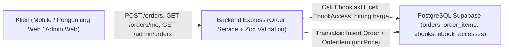
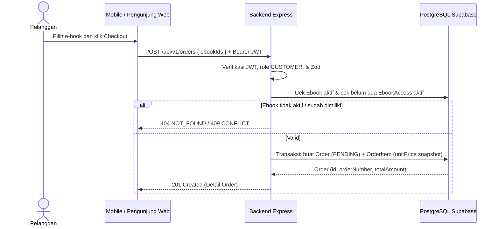
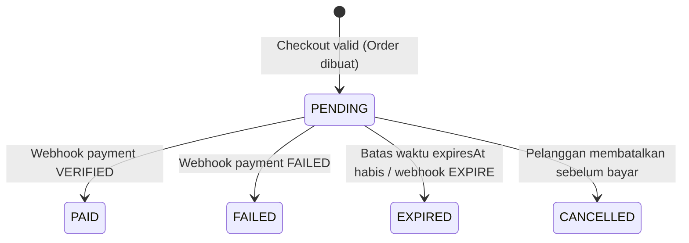

# Modul Manajemen Pesanan (`Order Management`)

**Status Implementasi:** `[RENCANA]` — Seluruh endpoint dan service manajemen pesanan belum diimplementasikan. Model `Order`, `OrderItem`, dan enum `OrderStatus` sudah `[ADA]` pada [`backend/prisma/schema.prisma`](../../backend/prisma/schema.prisma).

---

## A. Ringkasan Modul

- **Cakupan:** Order Management Module.
- **Status:** `[RENCANA]`.
- **Tujuan Modul:** Mengelola pembuatan pesanan e-book oleh pelanggan dengan perhitungan total harga di server, menyimpan *snapshot* harga item (`unitPrice`), menetapkan batas waktu pembayaran (`expiresAt`), serta menyediakan pemantauan pesanan oleh pelanggan dan admin.
- **Aktor:** Pelanggan (*Customer*) dan Admin.
- **Aplikasi Target:** `mobile/ebook_store`, `web/pengunjung-web`, `web/admin-web`, `backend/`.

---

## B. Arsitektur Modul



- Backend mengambil `Ebook.price` langsung dari database untuk menghitung `totalAmount`; nominal dari klien ditolak/diabaikan.
- `OrderItem.unitPrice` bertindak sebagai *snapshot* harga pada saat checkout agar perubahan harga katalog di masa depan tidak mengubah tagihan pesanan yang sudah dibuat.

---

## C. Model Data (`backend/prisma/schema.prisma`)

### 1. Model `Order` (`@@map("orders")`)

| Field | Nama Prisma | Tipe | Nullable | Default | Deskripsi | Status |
|---|---|---|---|---|---|---|
| `id` | `id` | `String @id @db.Uuid` | Tidak | `uuid()` | Primary key pesanan | `[ADA]` (schema) |
| `user_id` | `userId` | `String @db.Uuid` | Tidak | — | Foreign key ke `User` | `[ADA]` (schema) |
| `order_number` | `orderNumber` | `String @unique @db.VarChar(40)` | Tidak | — | Nomor pesanan unik | `[ADA]` (schema) |
| `total_amount` | `totalAmount` | `Decimal @db.Decimal(12, 2)` | Tidak | — | Total tagihan hasil hitung server | `[ADA]` (schema) |
| `status` | `status` | `OrderStatus` | Tidak | `PENDING` | Status pesanan | `[ADA]` (schema) |
| `expires_at` | `expiresAt` | `DateTime @db.Timestamptz()` | Tidak | — | Batas waktu pembayaran | `[ADA]` (schema) |
| `created_at` | `createdAt` | `DateTime @db.Timestamptz()` | Tidak | `now()` | Waktu dibuat | `[ADA]` (schema) |
| `updated_at` | `updatedAt` | `DateTime @updatedAt @db.Timestamptz()` | Tidak | `@updatedAt` | Waktu diperbarui | `[ADA]` (schema) |

### 2. Model `OrderItem` (`@@map("order_items")`)

| Field | Nama Prisma | Tipe | Nullable | Default | Deskripsi | Status |
|---|---|---|---|---|---|---|
| `id` | `id` | `String @id @db.Uuid` | Tidak | `uuid()` | Primary key item | `[ADA]` (schema) |
| `order_id` | `orderId` | `String @db.Uuid` | Tidak | — | Foreign key ke `Order` | `[ADA]` (schema) |
| `ebook_id` | `ebookId` | `String @db.Uuid` | Tidak | — | Foreign key ke `Ebook` | `[ADA]` (schema) |
| `unit_price` | `unitPrice` | `Decimal @db.Decimal(12, 2)` | Tidak | — | Snapshot harga e-book saat checkout | `[ADA]` (schema) |
| `created_at` | `createdAt` | `DateTime @db.Timestamptz()` | Tidak | `now()` | Waktu dibuat | `[ADA]` (schema) |

- **Enum `OrderStatus`:** `PENDING`, `PAID`, `FAILED`, `EXPIRED`, `CANCELLED`.
- **Constraint & Indeks:** `orderNumber` `@unique`; `@@unique([orderId, ebookId])` pada `OrderItem`; `@@index([userId])`, `@@index([status])` pada `Order`; `@@index([ebookId])` pada `OrderItem`.
- **Relasi `onDelete`:** `Order` -> `User` (`Restrict`), `Order` 1-to-N `OrderItem` (`Cascade`), `OrderItem` N-to-1 `Ebook` (`Restrict`).

---

## D. Endpoint API

| Endpoint | Method | Authentication | Authorization | Deskripsi | Status |
|---|---|---|---|---|---|
| `/api/v1/orders` | `POST` | Bearer JWT | `CUSTOMER` | Buat pesanan baru (harga dihitung dari DB) | `[RENCANA]` |
| `/api/v1/orders/me` | `GET` | Bearer JWT | `CUSTOMER` | Daftar pesanan milik pelanggan aktif | `[RENCANA]` |
| `/api/v1/orders/:id` | `GET` | Bearer JWT | `CUSTOMER` | Detail pesanan milik pelanggan aktif | `[RENCANA]` |
| `/api/v1/admin/orders` | `GET` | Bearer JWT | `ADMIN` | Daftar semua pesanan (filter status/tanggal) | `[RENCANA]` |
| `/api/v1/admin/orders/:id` | `GET` | Bearer JWT | `ADMIN` | Detail pesanan apa pun untuk audit admin | `[RENCANA]` |

### Contoh Kontrak (`POST /api/v1/orders` — `[RENCANA]`)
- **Zod Body:** `{ ebookIds: z.array(z.string().uuid()).min(1) }`.
- **Response `201 Created` (`"DATA SIMULASI"`):**
  ```json
  {
    "success": true,
    "message": "Pesanan berhasil dibuat",
    "data": {
      "id": "00000000-0000-0000-0000-000000000201",
      "orderNumber": "DATA-SIMULASI-ORD-20261114-001",
      "totalAmount": "75000.00",
      "status": "PENDING",
      "expiresAt": "2026-11-15T15:00:00.000Z"
    }
  }
  ```
- **Error:** `400 VALIDATION_ERROR`, `401`, `403`, `404 NOT_FOUND` (e-book nonaktif/tidak ada), `409 CONFLICT` (e-book sudah dimiliki).

---

## E. Alur Proses Bisnis

Mengacu pada `BP-C07` (checkout), `BP-C10` (riwayat pesanan), `BP-A10` (pantau pesanan) di [`transaction-workflow.md`](../03-business-process/transaction-workflow.md) dan [`sequence-diagram.md`](../01-design/sequence-diagram.md) bagian 2:



---

## F. Aturan Bisnis & Validasi

| ID | Aturan | Entitas | Validasi | Dampak Bila Dilanggar | Sumber | Status |
|---|---|---|---|---|---|---|
| **BR-ORD-01** | Harga dihitung dari `Ebook.price` di DB | `Order` | Abaikan nominal dari klien | Mencegah manipulasi harga | `business-rules.md` | `[RENCANA]` |
| **BR-ORD-02** | Snapshot `unitPrice` saat checkout | `OrderItem` | Salin `Ebook.price` ke `OrderItem.unitPrice` | Harga pesanan tetap konsisten | `schema.prisma` | `[ADA]` schema |
| **BR-ORD-03** | Satu e-book maksimal 1x per order | `OrderItem` | `@@unique([orderId, ebookId])` & dedup input | Mencegah duplikasi item | `schema.prisma` | `[ADA]` schema |
| **BR-ORD-04** | Tolak checkout jika e-book sudah dimiliki | `EbookAccess` | Cek `(userId, ebookId)` `isRevoked = false` | `409 CONFLICT` | `transaction-workflow.md` | `[RENCANA]` |
| **BR-ORD-05** | Daftar `ebookIds` tidak boleh kosong | `Order` | Zod `.min(1)` | `400 VALIDATION_ERROR` | `api-spec.yaml` | `[RENCANA]` |
| **BR-ORD-06** | E-book nonaktif tidak dapat dibeli | `Ebook` | Cek `isActive === true` | `404 NOT_FOUND` | `transaction-workflow.md` | `[RENCANA]` |
| **BR-ORD-07** | `expiresAt` wajib diisi | `Order` | Set waktu server (mis. +24 jam) | Menjaga batas waktu bayar | `schema.prisma` | `[ADA]` schema |
| **BR-ORD-08** | Pencegahan IDOR pesanan | `Order` | Filter `userId = req.user.id` untuk pelanggan | `403 FORBIDDEN` / `404` | `security-guidelines.md` | `[RENCANA]` |
| **BR-ORD-09** | Pesanan lewat `expiresAt` menjadi `EXPIRED` | `Order` | Cek waktu server / webhook `EXPIRE` | Tidak dapat dibayar lagi | `transaction-workflow.md` | `[RENCANA]` |

---

## G. State Machine (`OrderStatus`)



---

## H. Penanganan Error (`docs/02-api/error-catalog.md`)

| Kode Error | HTTP | Kondisi | Pesan Aman | Status |
|---|---:|---|---|---|
| `VALIDATION_ERROR` | `400` | `ebookIds` kosong, bukan UUID, atau query filter invalid | `"Input tidak valid."` | `[ADA]` (`error.middleware.ts`) |
| `FORBIDDEN` | `403` | Pelanggan mengakses pesanan milik pengguna lain | `"Anda tidak memiliki hak akses untuk operasi ini."` | `[RENCANA]` |
| `NOT_FOUND` | `404` | `Order` atau `Ebook` aktif tidak ditemukan | `"Data yang diminta tidak ditemukan."` | `[RENCANA]` |
| `CONFLICT` | `409` | E-book sudah dimiliki di `EbookAccess` atau status bukan `PENDING` | `"Permintaan tidak dapat diproses karena konflik status data."` | `[RENCANA]` |

---

## I. Pertimbangan Keamanan

- Total tagihan 100% bersumber dari database.
- Endpoint `GET /orders/me` dan `GET /orders/:id` wajib memverifikasi `order.userId === req.user.id`.
- `Order` tidak menggunakan hard delete terhadap `User` atau `Ebook` (`onDelete: Restrict`).

---

## J. Integrasi dengan Modul Lain

- Mengambil data harga dan ketersediaan dari **E-Book Catalog**.
- Memeriksa kepemilikan aktif di **E-Book Access**.
- Menjadi masukan langsung bagi **Payment Management** dan **Admin Dashboard**.

---

## K. Ketergantungan Keputusan Terbuka

- Mekanisme *scheduled job* / lazy check untuk menandai pesanan `PENDING` yang melewati `expiresAt` menjadi `EXPIRED` (`[RENCANA]`).

---

## L. Test Case Referensi

- `TC-ORD-01` (`docs/09-testing/test-cases.md`): Pembuatan pesanan menghitung `totalAmount` dari harga database (`201 Created`) (`[RENCANA]`).

---

## M. Status Implementasi

- **`[ADA]`:** Model `Order`, `OrderItem`, dan enum `OrderStatus` di `backend/prisma/schema.prisma`.
- **`[RENCANA]`:** Seluruh endpoint `/api/v1/orders*` dan `/api/v1/admin/orders*`.
