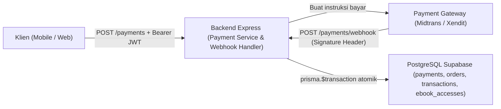
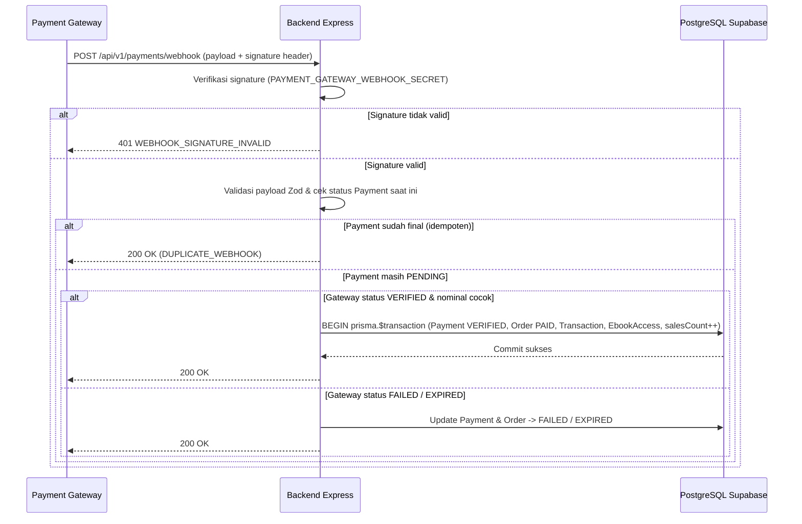
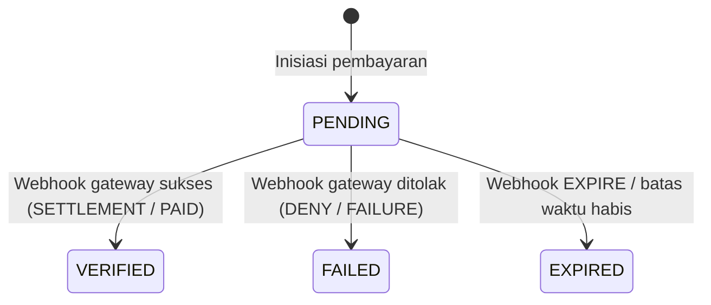

# Modul Pembayaran & Transaksi (`Payment & Transaction Management`)

**Status Implementasi:** `[RENCANA]` — Seluruh endpoint pembayaran, integrasi payment gateway, webhook, dan pencatatan transaksi belum diimplementasikan. Model `Payment`, `Transaction`, dan enum `PaymentStatus` sudah `[ADA]` pada [`backend/prisma/schema.prisma`](../../backend/prisma/schema.prisma).

---

## A. Ringkasan Modul

- **Cakupan:** Payment Module dan Transaction Module.
- **Status:** `[RENCANA]`.
- **Tujuan Modul:** Memproses inisiasi pembayaran untuk pesanan `PENDING`, memverifikasi callback asinkron (*webhook*) dari Payment Gateway secara aman dan idempoten, mencatat `Transaction` resmi, serta memicu penerbitan `EbookAccess` secara atomik.
- **Aktor:** Pelanggan (*Customer*), Admin, dan Sistem/Payment Gateway (Webhook).
- **Aplikasi Target:** `mobile/ebook_store`, `web/pengunjung-web`, `web/admin-web`, `backend/`.

---

## B. Arsitektur Modul

- **Pemisahan Keamanan Webhook:** Endpoint `POST /api/v1/payments/webhook` tidak memakai JWT pelanggan, melainkan memverifikasi *signature* kriptografis menggunakan `PAYMENT_GATEWAY_WEBHOOK_SECRET`.
- **Atomisitas (`prisma.$transaction`):** Seluruh pembaruan `Payment`, `Order`, pembuatan `Transaction`, penerbitan `EbookAccess`, dan penambahan `Ebook.salesCount` berjalan dalam satu transaksi database.

---

## C. Model Data (`backend/prisma/schema.prisma`)

### 1. Model `Payment` (`@@map("payments")`)

| Field | Nama Prisma | Tipe | Nullable | Default | Deskripsi | Status |
|---|---|---|---|---|---|---|
| `id` | `id` | `String @id @db.Uuid` | Tidak | `uuid()` | Primary key pembayaran | `[ADA]` (schema) |
| `order_id` | `orderId` | `String @db.Uuid` | Tidak | — | Foreign key ke `Order` | `[ADA]` (schema) |
| `payment_method` | `paymentMethod` | `String @db.VarChar(50)` | Tidak | — | Metode pembayaran | `[ADA]` (schema) |
| `amount` | `amount` | `Decimal @db.Decimal(12, 2)` | Tidak | — | Nominal tagihan (= `Order.totalAmount`) | `[ADA]` (schema) |
| `status` | `status` | `PaymentStatus` | Tidak | `PENDING` | Status pembayaran | `[ADA]` (schema) |
| `external_ref` | `externalRef` | `String? @db.VarChar(120)` | Ya | `null` | Referensi transaksi dari gateway | `[ADA]` (schema) |
| `paid_at` | `paidAt` | `DateTime? @db.Timestamptz()` | Ya | `null` | Waktu pelunasan terverifikasi | `[ADA]` (schema) |
| `created_at` | `createdAt` | `DateTime @db.Timestamptz()` | Tidak | `now()` | Waktu dibuat | `[ADA]` (schema) |
| `updated_at` | `updatedAt` | `DateTime @updatedAt @db.Timestamptz()` | Tidak | `@updatedAt` | Waktu diperbarui | `[ADA]` (schema) |

### 2. Model `Transaction` (`@@map("transactions")`)

| Field | Nama Prisma | Tipe | Nullable | Default | Deskripsi | Status |
|---|---|---|---|---|---|---|
| `id` | `id` | `String @id @db.Uuid` | Tidak | `uuid()` | Primary key transaksi | `[ADA]` (schema) |
| `order_id` | `orderId` | `String @unique @db.Uuid` | Tidak | — | Foreign key unik ke `Order` | `[ADA]` (schema) |
| `payment_id` | `paymentId` | `String @unique @db.Uuid` | Tidak | — | Foreign key unik ke `Payment` | `[ADA]` (schema) |
| `user_id` | `userId` | `String @db.Uuid` | Tidak | — | Foreign key ke `User` | `[ADA]` (schema) |
| `transaction_code` | `transactionCode` | `String @unique @db.VarChar(50)` | Tidak | — | Kode transaksi resmi unik | `[ADA]` (schema) |
| `amount` | `amount` | `Decimal @db.Decimal(12, 2)` | Tidak | — | Nominal tercatat | `[ADA]` (schema) |
| `recorded_at` | `recordedAt` | `DateTime @default(now()) @db.Timestamptz()` | Tidak | `now()` | Waktu pencatatan transaksi | `[ADA]` (schema) |

- **Enum `PaymentStatus`:** `PENDING`, `VERIFIED`, `FAILED`, `EXPIRED`.
- **Constraint & Indeks:** `Transaction.orderId` `@unique`, `Transaction.paymentId` `@unique`, `transactionCode` `@unique`; `@@index([orderId])` pada `Payment`; `@@index([userId])` pada `Transaction`.

---

## D. Endpoint API

| Endpoint | Method | Authentication | Authorization | Deskripsi | Status |
|---|---|---|---|---|---|
| `/api/v1/payments` | `POST` | Bearer JWT | `CUSTOMER` | Inisiasi pembayaran untuk order `PENDING` | `[RENCANA]` |
| `/api/v1/payments/:id` | `GET` | Bearer JWT | `CUSTOMER` | Cek status pembayaran milik sendiri | `[RENCANA]` |
| `/api/v1/payments/webhook` | `POST` | Signature Header | `PAYMENT_GATEWAY` | Callback verifikasi pembayaran asinkron | `[RENCANA]` |
| `/api/v1/transactions/my` | `GET` | Bearer JWT | `CUSTOMER` | Riwayat transaksi resmi pelanggan | `[RENCANA]` |
| `/api/v1/admin/payments` | `GET` | Bearer JWT | `ADMIN` | Daftar seluruh pembayaran | `[RENCANA]` |
| `/api/v1/admin/transactions` | `GET` | Bearer JWT | `ADMIN` | Daftar transaksi resmi (filter tanggal) | `[RENCANA]` |

- **Contoh Payload Inisiasi (`POST /api/v1/payments` — `"DATA SIMULASI"`):**
  - Zod Body: `{ orderId: z.string().uuid(), paymentMethod: z.string().min(2).max(50) }`.
  - Response `201 Created`: `{ id, orderId, paymentMethod, amount: "75000.00", status: "PENDING", externalRef: "DATA-SIMULASI-PG-001" }`.

---

## E. Alur Proses Bisnis

Mengacu pada `BP-C08`, `BP-C09`, dan [`transaction-workflow.md`](../03-business-process/transaction-workflow.md) serta [`sequence-diagram.md`](../01-design/sequence-diagram.md) bagian 3:

---

## F. Aturan Bisnis & Validasi

| ID | Aturan | Entitas | Validasi | Dampak Bila Dilanggar | Sumber | Status |
|---|---|---|---|---|---|---|
| **BR-PAY-01** | Bayar hanya untuk order `PENDING` milik sendiri | `Order`, `Payment` | Cek `order.userId === req.user.id`, `status === PENDING`, belum lewat `expiresAt` | `403` / `409 CONFLICT` / `409 ORDER_EXPIRED` | `transaction-workflow.md` | `[RENCANA]` |
| **BR-PAY-02** | `Payment.amount` harus sama dengan `Order.totalAmount` | `Payment` | Ambil dari `Order.totalAmount` | Konsistensi nominal | `business-rules.md` | `[RENCANA]` |
| **BR-PAY-03** | Verifikasi signature webhook | Webhook | Cocokkan signature header dengan secret | `401 WEBHOOK_SIGNATURE_INVALID` | `webhook-contract.md` | `[RENCANA]` |
| **BR-PAY-04** | Validasi payload & nominal webhook | Webhook | Zod + cek `gatewayAmount == Payment.amount` | `400 VALIDATION_ERROR` / `PAYMENT_VERIFICATION_FAILED` | `error-catalog.md` | `[RENCANA]` |
| **BR-PAY-05** | Webhook bersifat idempoten | `Payment` | Jika status sudah final -> tidak ada mutasi | `200 DUPLICATE_WEBHOOK` | `NFR-06` | `[RENCANA]` |
| **BR-PAY-06** | Transaksi database atomik & rollback penuh | `Payment`, `Order`, `Transaction`, `EbookAccess` | `prisma.$transaction(...)` | Tidak ada partial commit | `NFR-06` | `[RENCANA]` |
| **BR-PAY-07** | Integritas audit `Transaction` (immutable) | `Transaction` | `orderId @unique`, `paymentId @unique`, `transactionCode @unique`, tidak dihapus | 1 order = 1 transaksi resmi | `schema.prisma` | `[ADA]` schema |

---

## G. State Machine (`PaymentStatus`)

---

## H. Penanganan Error (`docs/02-api/error-catalog.md`)

| Kode Error | HTTP | Kondisi | Pesan Aman | Status |
|---|---:|---|---|---|
| `VALIDATION_ERROR` | `400` | Body inisiasi atau payload webhook tidak valid | `"Input tidak valid."` | `[ADA]` (`error.middleware.ts`) |
| `PAYMENT_VERIFICATION_FAILED` | `400` | Nominal dari gateway tidak cocok dengan tagihan | `"Verifikasi pembayaran gagal."` | `[RENCANA]` |
| `WEBHOOK_SIGNATURE_INVALID` | `401` | Signature kriptografis webhook tidak valid | `"Signature webhook tidak valid."` | `[RENCANA]` |
| `ORDER_EXPIRED` | `409` | Order sudah melewati `expiresAt` | `"Batas waktu pembayaran pesanan telah berakhir."` | `[RENCANA]` |
| `PAYMENT_PENDING` | `409` | Masih ada pembayaran `PENDING` aktif untuk order ini | `"Pembayaran untuk pesanan ini masih menunggu konfirmasi."` | `[RENCANA]` |
| `DUPLICATE_WEBHOOK` | `200` | Webhook dikirim ulang setelah status final | `"Notifikasi pembayaran sudah diproses sebelumnya."` | `[RENCANA]` |

---

## I. Pertimbangan Keamanan

- `PAYMENT_GATEWAY_SERVER_KEY` dan `PAYMENT_GATEWAY_WEBHOOK_SECRET` hanya berada di backend (`env.ts`).
- Webhook wajib memverifikasi signature sebelum membaca status transaksi.
- Pencegahan IDOR pada `GET /payments/:id` dan `GET /transactions/my` berdasarkan `req.user.id`.

---

## J. Integrasi dengan Modul Lain

- Membaca data tagihan dari **Order Management**.
- Mengaktifkan hak akses di **E-Book Access** dan memperbarui `Ebook.salesCount` di **E-Book Catalog**.
- Menjadi sumber data pendapatan resmi untuk **Admin Dashboard**.

---

## K. Ketergantungan Keputusan Terbuka

- Pemilihan provider Payment Gateway (Midtrans vs Xendit) dan implementasi adapter gateway (`[RENCANA]`).

---

## L. Test Case Referensi

- `TC-PAY-01`: Pembayaran `VERIFIED` mengubah `Order -> PAID`, mencatat `Transaction`, dan mengaktifkan `EbookAccess` (`[RENCANA]`).
- `TC-PAY-02`: Webhook duplikat bersifat idempoten tanpa duplikasi `Transaction`/`EbookAccess` (`[RENCANA]`).

---

## M. Status Implementasi

- **`[ADA]`:** Model `Payment`, `Transaction`, enum `PaymentStatus` di `backend/prisma/schema.prisma`, serta variabel `PAYMENT_GATEWAY_*` di `backend/src/config/env.ts`.
- **`[RENCANA]`:** Seluruh endpoint `/api/v1/payments*`, `/api/v1/transactions/my`, `/api/v1/admin/payments`, dan `/api/v1/admin/transactions`.
