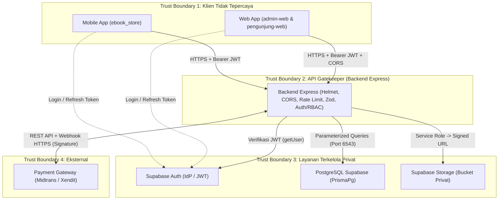

# Arsitektur Keamanan Berlapis (`Security Architecture`)

**Status:** `[ADA]` (kebijakan & middleware kerangka) | `[RENCANA]` (integrasi penuh & operasional produksi)  
**Sumber:** [`docs/02-architecture/security-architecture.md`](../02-architecture/security-architecture.md), [`backend/src/app.ts`](../../backend/src/app.ts), [`backend/prisma.config.ts`](../../backend/prisma.config.ts).

---

## 1. Diagram Arsitektur Keamanan & Trust Boundaries

### 7 Trust Boundaries Sistem
1. **Boundary 1 (Internet -> Klien):** Input pengguna di mobile/web dianggap tidak tepercaya.
2. **Boundary 2 (Klien -> Backend):** Wajib HTTPS di produksi, melewati `helmet()`, `cors()`, `express.json({ limit: '1mb' })`, rate limiter `[RENCANA]`, Zod `validate`, dan `authenticate`/`authorize`.
3. **Boundary 3 (Backend -> Supabase Auth):** Verifikasi keaslian JWT ke server Supabase Auth (`getUser`).
4. **Boundary 4 (Backend -> PostgreSQL):** Akses privat via Prisma ORM (parameterized queries) melalui `DATABASE_URL` / `DIRECT_URL`.
5. **Boundary 5 (Backend -> Supabase Storage):** Akses privat memakai `SUPABASE_SERVICE_ROLE_KEY` untuk upload admin & penerbitan signed URL sementara.
6. **Boundary 6 (Backend -> Payment Gateway):** Komunikasi server-to-server memakai `PAYMENT_GATEWAY_SERVER_KEY`.
7. **Boundary 7 (Payment Gateway -> Backend Webhook):** Callback asinkron wajib diverifikasi *signature*-nya menggunakan `PAYMENT_GATEWAY_WEBHOOK_SECRET`.

---

## 2. Prinsip Mediator Tunggal Backend

- **Satu-satunya Mediator ke DB & Storage:** Klien (`ebook_store`, `admin-web`, `pengunjung-web`) dilarang terhubung langsung ke PostgreSQL atau bucket privat Storage.
- **Webhook Hanya ke Backend:** Status pelunasan transaksi hanya sah apabila diverifikasi oleh backend melalui webhook terotentikasi signature, bukan dari klaim sukses di sisi klien.

---

## 3. Lapisan Kontrol Keamanan

| Domain | Mekanisme & Aturan | Status Aktual | Bukti File |
|---|---|---|---|
| **Autentikasi & JWT** | Verifikasi Bearer JWT via Supabase Auth | `[ADA]` kerangka / `[RENCANA]` DB sync | `backend/src/middlewares/auth.middleware.ts` |
| **RBAC (`CUSTOMER`/`ADMIN`)** | Middleware `authorize('ADMIN')` | `[ADA]` kerangka / `[RENCANA]` bisnis | `auth.middleware.ts`, `app.ts` |
| **Pembeda `401` vs `403`** | `401` gagal autentikasi; `403` gagal otorisasi/kepemilikan | `[ADA]` di `auth.middleware.ts` | `backend/src/middlewares/auth.middleware.ts` |
| **Validasi Input** | Middleware `validate` berbasis Zod | `[ADA]` helper / `[RENCANA]` skema | `backend/src/middleware/validate.ts` |
| **Hardening HTTP & Rate Limit** | `helmet()`, `cors()`, `sensitiveEndpointLimiter` | `[ADA]` sebagian / `[RENCANA]` mount limiter | `app.ts`, `rate-limit.middleware.ts` |
| **Integritas Harga & SAW** | Harga dari DB; SAW murni di backend | `[RENCANA]` | `ADR-0002`, `docs/03-saw/` |
| **Perlindungan Secret** | `.gitignore` & Zod env schema | `[ADA]` aturan & `.gitignore` | `.gitignore`, `backend/src/config/env.ts` |
| **Proteksi PDF** | Bucket privat + `createPrivatePdfSignedUrl` | `[ADA]` helper / `[RENCANA]` cek `EbookAccess` | `supabase-storage.ts` |
| **Keamanan Webhook** | Verifikasi signature, idempotensi, `prisma.$transaction` | `[RENCANA]` | `docs/02-api/webhook-contract.md` |
| **Sanitasi Error** | `errorHandler` sembunyikan stack trace | `[ADA]` di `app.ts` | `backend/src/middlewares/error.middleware.ts` |

---

## 4. Matriks Port & Koneksi

| Dari | Ke | Port | Protokol | Tujuan | Status |
|---|---|---|---|---|---|
| Klien (Mobile/Web) | Backend Express | `443` (Prod) / `3000` (Lokal) | HTTPS / HTTP | REST API (`/api/v1/*`) | `[ADA]` lokal / `[RENCANA]` prod |
| Backend Express | PostgreSQL Supabase (Runtime) | `6543` | PostgreSQL (PgBouncer TLS) | Query & transaksi runtime (`DATABASE_URL`) | `[ADA]` config / `[RENCANA]` prod |
| Prisma CLI (Migrasi) | PostgreSQL Supabase (Direct) | `5432` | PostgreSQL (TLS) | `prisma migrate` (`DIRECT_URL`) | `[ADA]` config / `[RENCANA]` migrasi |
| Backend Express | Supabase Auth | `443` | HTTPS | `supabase.auth.getUser(token)` | `[ADA]` kode / `[RENCANA]` prod |
| Backend Express | Supabase Storage | `443` | HTTPS | Upload PDF & `createSignedUrl` | `[ADA]` helper / `[RENCANA]` prod |
| Backend Express | Payment Gateway | `443` | HTTPS | Buat transaksi pembayaran | `[RENCANA]` |
| Payment Gateway | Backend Express | `443` | HTTPS | Webhook `POST /api/v1/payments/webhook` | `[RENCANA]` |
