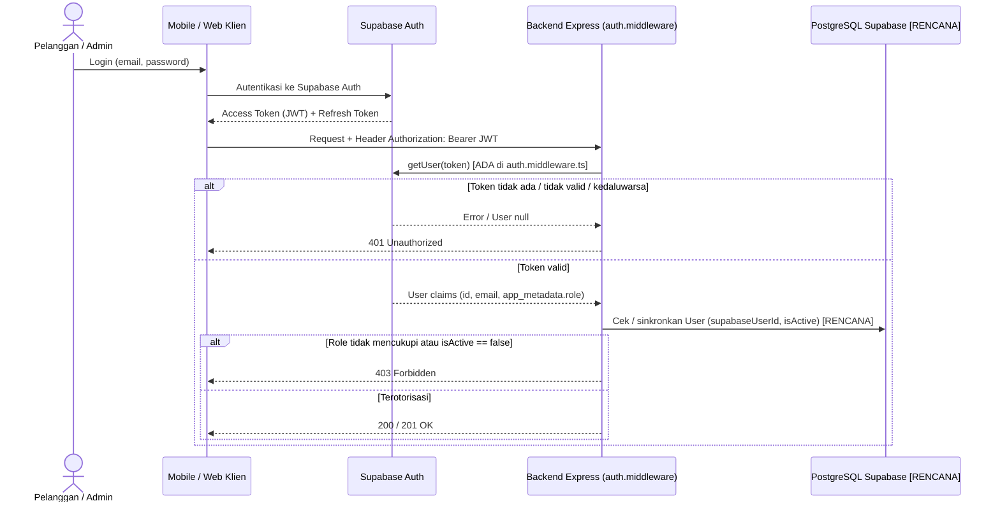

# Keamanan Autentikasi & Otorisasi (`Authentication & Authorization Security`)

**Status:** `[ADA]` (middleware kerangka `authenticate` & `authorize` di `auth.middleware.ts`, proteksi `/api/v1/admin/ping`) | `[RENCANA]` (sinkronisasi `User` ke PostgreSQL, pengecekan `isActive`, & seluruh endpoint bisnis)  
**Sumber:** [`docs/02-api/authentication-and-authorization.md`](../02-api/authentication-and-authorization.md), [`backend/src/middlewares/auth.middleware.ts`](../../backend/src/middlewares/auth.middleware.ts).

---

## 1. Batas Tanggung Jawab: Supabase Auth vs Backend

- **Supabase Auth (IdP):** Registrasi akun, login (`email` + `password`), reset password, dan penerbitan JWT (`Access Token` + `Refresh Token`).
- **Backend Express (`backend/`):** Tidak menyimpan `password_hash` dan tidak menangani login password lokal. Backend memverifikasi Bearer JWT melalui `supabase.auth.getUser(token)` dan menegakkan RBAC (`CUSTOMER` / `ADMIN`).

---

## 2. Alur Token & Verifikasi JWT

### Status Mekanisme Saat Ini
1. **Ekstraksi & Verifikasi Bearer JWT (`[ADA]`):** `authenticate` di `auth.middleware.ts` memvalidasi prefix `Bearer ` dan memanggil `getSupabaseAdmin().auth.getUser(token)`.
2. **Penentuan Role (`[ADA]` dasar / `[RENCANA]` DB sync):** Saat ini membaca `data.user.app_metadata?.role` (`'ADMIN'` atau `'CUSTOMER'`). Sinkronisasi dengan `User.role` dan pengecekan `User.isActive` di PostgreSQL masih `[RENCANA]`.
3. **Middleware `authorize(...allowedRoles)` (`[ADA]`):** Menegakkan daftar role yang diizinkan dan mengembalikan `403 FORBIDDEN` bila tidak sesuai.

> **Catatan Inkonsistensi Kode Error:** `auth.middleware.ts` (`[ADA]`) saat ini mengembalikan kode `"UNAUTHORIZED"` untuk status `401`, sedangkan `error-catalog.md` merekomendasikan kode `"UNAUTHENTICATED"`. Penyeragaman kode error ini dicatat pada [`security-gap-register.md`](./security-gap-register.md).

---

## 3. Perbedaan `401 Unauthorized` vs `403 Forbidden`

| HTTP Status | Makna | Kondisi Pemicu |
|---|---|---|
| **`401 Unauthorized`** | Belum terautentikasi | Header `Authorization: Bearer ...` kosong/salah format, JWT tidak valid, atau JWT kedaluwarsa. |
| **`403 Forbidden`** | Terautentikasi, tidak berhak | `CUSTOMER` mengakses `/api/v1/admin/*`, `User.isActive == false`, akses order/payment milik user lain (IDOR), atau akses PDF tanpa `EbookAccess` aktif. |

---

## 4. Matriks Endpoint Publik vs Terproteksi

| Kategori Akses | Endpoint | Autentikasi | Role Minimum | Status |
|---|---|---|---|---|
| **Publik** | `GET /api/v1/health` | Tidak | Publik | `[ADA]` |
| **Publik** | `GET /api/v1/categories`, `GET /api/v1/ebooks*`, `GET /api/v1/recommendations/saw` | Tidak / Opsional | Publik | `[RENCANA]` |
| **User Aktif** | `POST /api/v1/auth/sync`, `GET/PATCH /api/v1/users/me` | Wajib Bearer JWT | `CUSTOMER \| ADMIN` | `[RENCANA]` |
| **Pelanggan** | `/api/v1/orders*`, `/api/v1/payments*`, `/api/v1/transactions/my`, `/api/v1/ebooks/:id/access-url` | Wajib Bearer JWT | `CUSTOMER` | `[RENCANA]` |
| **Admin** | `GET /api/v1/admin/ping` | Wajib Bearer JWT | `ADMIN` | `[ADA]` |
| **Admin** | Seluruh `/api/v1/admin/*` lainnya | Wajib Bearer JWT | `ADMIN` | `[RENCANA]` |
| **Gateway** | `POST /api/v1/payments/webhook` | Signature Header | `PAYMENT_GATEWAY` | `[RENCANA]` |

---

## 5. Pencegahan IDOR, Akun Nonaktif, & Sinkronisasi `User`

1. **Pencegahan IDOR (`[RENCANA]`):** Seluruh endpoint pelanggan wajib menggunakan `req.user.id` dari token JWT terverifikasi, bukan parameter `userId` dari body atau query klien.
2. **Penolakan Akun Nonaktif (`[RENCANA]`):** Jika `User.isActive === false`, backend wajib menolak permintaan dengan `403 FORBIDDEN`.
3. **Sinkronisasi `User` (`POST /api/v1/auth/sync` `[RENCANA]`):** Upsert berdasarkan `supabaseUserId` dengan role default `CUSTOMER`. Klien tidak pernah diperbolehkan mengirim atau mengubah `role` maupun `isActive`.
4. **Rate Limiting Auth (`[RENCANA]`):** `sensitiveEndpointLimiter` (`rate-limit.middleware.ts` `[ADA]`) wajib dipasang pada route sinkronisasi/auth di `app.ts`.
