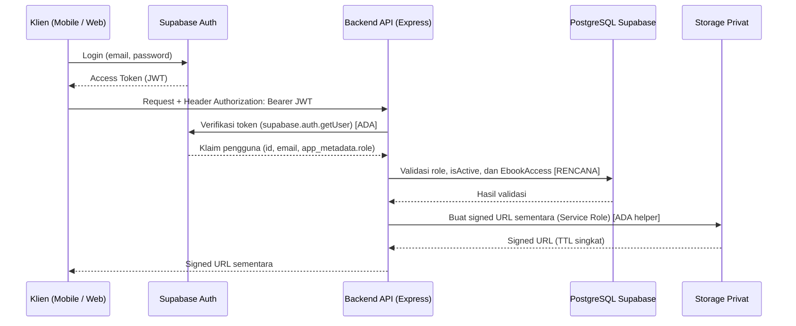

# Gambaran Umum Keamanan (`Security Overview`)

**Status:** `[RENCANA]` (kontrol runtime bisnis, integrasi penuh, dan audit operasional belum diimplementasikan) | `[ADA]` (kebijakan `AGENTS.md`, `.gitignore`, `.env.example`, middleware kerangka, dan helper storage)  
**Referensi Utama:** [`AGENTS.md`](../../AGENTS.md), [`security-architecture.md`](../02-architecture/security-architecture.md), [`requirements.md`](../00-project/requirements.md).

> **Catatan Kejujuran Audit:** Karena fitur bisnis backend, migrasi database, integrasi payment gateway, dan antarmuka aplikasi klien belum diimplementasikan, **sistem ini belum dapat diklaim aman secara operasional**. Dokumen ini memetakan fondasi teknis yang sudah `[ADA]` beserta kontrol keamanan `[RENCANA]` yang wajib dibangun dan diuji sebelum rilis produksi.

---

## 1. Tujuan & Lingkup Keamanan

Dokumen ini menjadi titik masuk (*entry point*) seluruh spesifikasi keamanan untuk **Sistem Informasi E-Commerce E-Book & SPK (SAW)**, mencakup 7 komponen:
1. **Backend API (`backend/`):** Express 5 + TypeScript ESM + Zod + Prisma 7.
2. **Aplikasi Web (`web/admin-web`, `web/pengunjung-web`):** React + Vite.
3. **Aplikasi Mobile (`mobile/ebook_store`):** Flutter + Riverpod + Dio (Android).
4. **Database (`PostgreSQL Supabase`):** Skema Prisma + adapter `PrismaPg`.
5. **Storage (`Supabase Storage`):** Bucket privat `ebooks-private` untuk file PDF.
6. **Payment Gateway:** Integrasi eksternal & callback webhook `[RENCANA]`.
7. **Modul SPK SAW:** Perhitungan rekomendasi eksklusif di backend (`ADR-0002`).

---

## 2. Matriks Status Kontrol Keamanan (15 Domain)

| # | Domain Keamanan | Mekanisme & Aturan | Status Aktual | Bukti File | Target |
|---|---|---|---|---|---|
| 1 | **Autentikasi** | Supabase Auth + verifikasi Bearer JWT (`getUser`) | `[ADA]` kerangka / `[RENCANA]` DB sync | `backend/src/middlewares/auth.middleware.ts` | Penuh + cek `isActive` |
| 2 | **Otorisasi (RBAC)** | Penegakan `UserRole` (`CUSTOMER` / `ADMIN`) di backend | `[ADA]` kerangka / `[RENCANA]` bisnis | `auth.middleware.ts`, `app.ts` (`/admin/ping`) | Seluruh endpoint |
| 3 | **Validasi Input** | Validasi `body`, `query`, `params` dengan **Zod** | `[ADA]` middleware / `[RENCANA]` skema modul | `backend/src/middleware/validate.ts` | Seluruh endpoint |
| 4 | **Rate Limiting** | Pembatasan laju permintaan endpoint sensitif (`express-rate-limit`) | `[ADA]` berkas / `[RENCANA]` mount | `backend/src/middlewares/rate-limit.middleware.ts` | Terpasang di `app.ts` |
| 5 | **HTTP Headers (`Helmet`)** | Header keamanan HTTP (`helmet()`) | `[ADA]` aktif di `app.ts` | `backend/src/app.ts` | Produksi + CSP/HSTS |
| 6 | **CORS** | Whitelist origin dari `CORS_ORIGINS` (`credentials: true`) | `[ADA]` di `app.ts` | `backend/src/app.ts`, `env.ts` | Domain HTTPS resmi |
| 7 | **Perlindungan Secret** | `.env` & keystore diabaikan Git; validasi env Zod | `[ADA]` aturan & `.gitignore` | `.gitignore`, `.env.example`, `env.ts` | Audit pra-rilis bersih |
| 8 | **Pemisahan Klien vs Server** | Larangan secret pada `VITE_*` dan kode Flutter | `[ADA]` aturan | `AGENTS.md`, `web/*/.env.example` | Audit build & repo |
| 9 | **Perlindungan Data (PII & IDOR)** | Tanpa `password_hash` di DB; filter kepemilikan `req.user.id` | `[ADA]` skema `User` / `[RENCANA]` handler | `backend/prisma/schema.prisma` | Anti-IDOR di semua route |
| 10 | **Keamanan File PDF** | Bucket privat + signed URL sementara (default TTL 300s) | `[ADA]` helper / `[RENCANA]` endpoint | `supabase-storage.ts` | Tanpa bocor `storagePath` |
| 11 | **Validasi Pembayaran** | Verifikasi signature webhook, nominal, idempotensi, atomik | `[RENCANA]` | — (desain di `webhook-contract.md`) | `prisma.$transaction` |
| 12 | **Pencegahan Akses Tanpa Hak** | Cek `EbookAccess` aktif (`isRevoked = false`) sebelum signed URL | `[ADA]` model / `[RENCANA]` runtime | `backend/prisma/schema.prisma` | `403 EBOOK_ACCESS_DENIED` |
| 13 | **Sanitasi Error** | Sembunyikan stack trace & query DB; pesan generik `500` | `[ADA]` di `app.ts` | `backend/src/middlewares/error.middleware.ts` | Konsisten semua modul |
| 14 | **Audit Log** | Pencatatan aktivitas kritis (gagal login, webhook, akses) | `[RENCANA]` | — | Log terstruktur |
| 15 | **Backup & Recovery** | Backup otomatis PostgreSQL Supabase & uji restore | `[RENCANA]` | — | PITR & uji berkala |

---

## 3. Alur Keamanan Lintas Komponen (`[ADA]` Kerangka / `[RENCANA]` Bisnis)

---

## 4. Ringkasan 7 Kebijakan Keamanan Utama (`AGENTS.md`)

1. **SAW hanya di backend (`ADR-0002`):** Bobot dan perhitungan peringkat tidak pernah dipercayakan ke klien.
2. **Otorisasi di backend:** Token + role (`CUSTOMER` / `ADMIN`) ditegakkan di server; menyembunyikan menu di UI hanya kosmetik.
3. **Bucket PDF privat + signed URL sementara:** File PDF tidak pernah dipublikasikan via URL statis permanen.
4. **Tidak ada secret di repository:** `.env`, service role key, dan kunci gateway dilarang di Git, `VITE_*`, maupun kode Flutter.
5. **Data simulasi berlabel `"DATA SIMULASI"`:** Seluruh contoh payload/UI placeholder wajib ditandai eksplisit.
6. **Status dokumentasi jujur:** Hanya komponen dengan bukti nyata di repository yang berstatus `[ADA]`.
7. **Urutan pengerjaan terkunci:** `Backend -> Admin Web -> Mobile`.

---

## 5. Daftar Dokumen Keamanan (`docs/07-security/`)

| Dokumen | Fokus | Status |
|---|---|---|
| [`security-overview.md`](./security-overview.md) | Gambaran umum, matriks 15 domain, & kebijakan inti | `[ADA]` kerangka / `[RENCANA]` prod |
| [`security-guidelines.md`](./security-guidelines.md) | Pedoman praktis pengembangan aman (Backend, Web, Mobile) | `[ADA]` aturan / `[RENCANA]` praktik |
| [`security-architecture.md`](./security-architecture.md) | Arsitektur berlapis, 7 *trust boundary*, mediator backend, matriks port | `[ADA]` kerangka / `[RENCANA]` prod |
| [`security-authentication.md`](./security-authentication.md) | Supabase Auth vs Backend, RBAC, `401` vs `403`, anti-IDOR, `/auth/sync` | `[ADA]` kerangka / `[RENCANA]` sync |
| [`security-data-protection.md`](./security-data-protection.md) | Proteksi PDF, PII, secret, integritas transaksi, & data retention | `[ADA]` parsial / `[RENCANA]` penuh |
| [`security-payment.md`](./security-payment.md) | Keamanan pembayaran, signature webhook, idempotensi, & atomisitas | `[RENCANA]` |
| [`security-api-hardening.md`](./security-api-hardening.md) | Zod, Helmet, CORS, rate limiting, sanitasi error, anti-injection, TLS | `[ADA]` dasar / `[RENCANA]` penuh |
| [`security-saw.md`](./security-saw.md) | Keamanan SPK SAW, anti-tampering bobot, & proteksi data internal | `[ADA]` ADR-0002 / `[RENCANA]` kode |
| [`security-threat-model.md`](./security-threat-model.md) | Model ancaman STRIDE per komponen & matriks risiko | `[RENCANA]` |
| [`security-audit-checklist.md`](./security-audit-checklist.md) | Checklist audit pra-rilis, pasca-rilis, & template hasil audit | `[RENCANA]` |
| [`security-traceability.md`](./security-traceability.md) | Keterlacakan `NFR-01`–`NFR-08`, `AGENTS.md`, & keputusan ke bukti | `[ADA]` pemetaan |
| [`security-gap-register.md`](./security-gap-register.md) | Register kesenjangan keamanan aktual & keputusan terbuka | `[ADA]` register audit |
