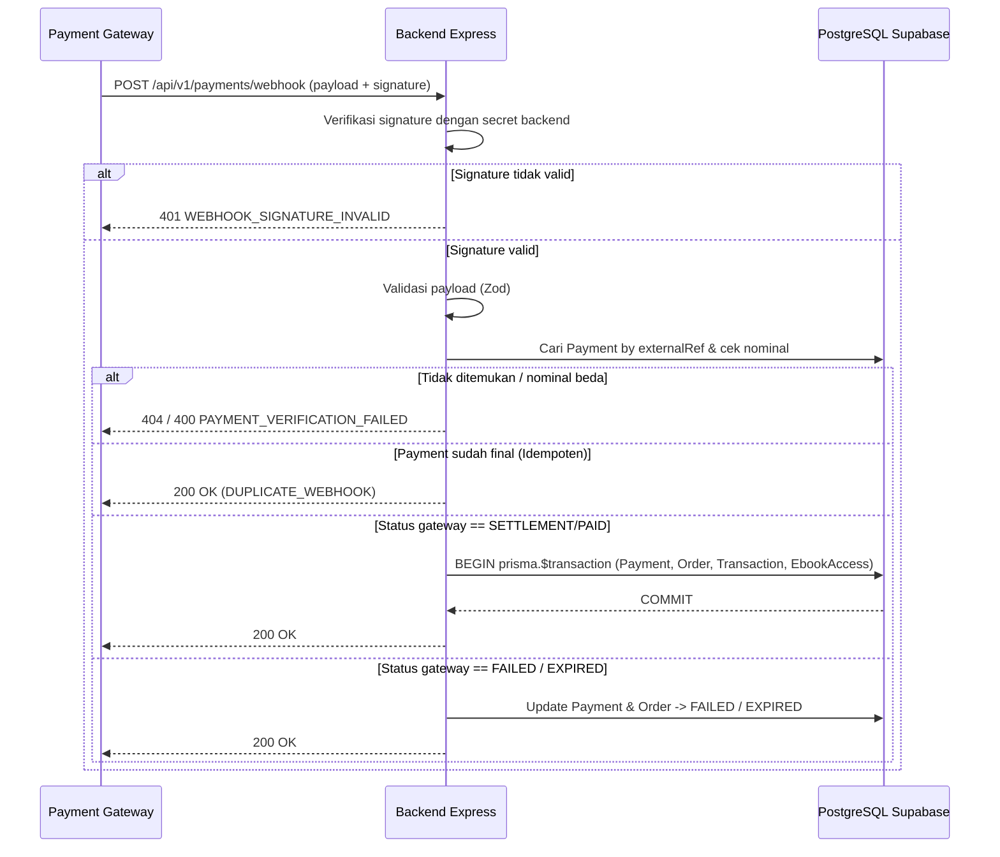

# Keamanan Pembayaran & Webhook (`Payment & Webhook Security`)

**Status:** `[RENCANA]` — Endpoint pembayaran, integrasi gateway nyata (Keputusan #3), dan handler webhook belum diimplementasikan di `backend/`.  
**Sumber:** [`docs/02-api/webhook-contract.md`](../02-api/webhook-contract.md), [`docs/03-business-process/transaction-workflow.md`](../03-business-process/transaction-workflow.md), [`docs/02-api/error-catalog.md`](../02-api/error-catalog.md).

---

## 1. Verifikasi Signature Webhook

- Endpoint `POST /api/v1/payments/webhook` menerima callback dari Payment Gateway (Midtrans/Xendit) tanpa JWT pelanggan.
- Header signature (mis. `X-Webhook-Signature`) wajib diverifikasi menggunakan `PAYMENT_GATEWAY_WEBHOOK_SECRET` terhadap *raw request body* (bukan objek JSON hasil re-serialisasi) dengan algoritma HMAC/SHA-512 sesuai spesifikasi provider.
- Jika signature tidak cocok -> tolak `401 WEBHOOK_SIGNATURE_INVALID` dan catat log keamanan.

---

## 2. Validasi Payload & Kecocokan Nominal

1. **Validasi Zod:** Payload wajib memiliki `externalRef`, `status`, dan `amount` yang valid. Payload cacat -> `400 VALIDATION_ERROR`.
2. **Kecocokan Nominal:** `amount` pada payload webhook wajib sama persis dengan `Payment.amount` di PostgreSQL. Ketidakcocokan -> `400 PAYMENT_VERIFICATION_FAILED`.

---

## 3. Idempotensi & Transaksi Atomik (`prisma.$transaction`)

- **Idempotensi:** Sebelum melakukan mutasi, backend memeriksa `Payment.status`. Jika sudah final (`VERIFIED`, `FAILED`, `EXPIRED`), callback diabaikan secara aman dengan respons `200 OK` (`DUPLICATE_WEBHOOK`) tanpa membuat `Transaction` atau `EbookAccess` ganda.
- **Transaksi Atomik saat `VERIFIED`:**
  1. Perbarui `Payment`: `status = VERIFIED`, `paidAt = now()`.
  2. Perbarui `Order`: `status = PAID`.
  3. Buat record `Transaction` (`orderId`, `paymentId`, `userId`, `transactionCode`, `amount`).
  4. Untuk tiap `OrderItem`: *upsert* `EbookAccess` (`isRevoked = false`) dan increment `Ebook.salesCount`.
  5. Jika satu langkah gagal -> *rollback* seluruh transaksi (tidak ada *partial commit*).

---

## 4. Integritas Harga & Pemetaan Status

- `Order.totalAmount` dihitung dari `Ebook.price` di database; `Payment.amount` harus sama dengan `Order.totalAmount`.

| Status Gateway | `PaymentStatus` | `OrderStatus` | Aksi Sistem |
|---|---|---|---|
| `SETTLEMENT` / `PAID` / `CAPTURED` | `VERIFIED` | `PAID` | Transaksi atomik + terbitkan `EbookAccess` |
| `PENDING` | `PENDING` | `PENDING` | Tetap menunggu; akses PDF terkunci |
| `DENY` / `CANCEL` / `FAILURE` | `FAILED` | `FAILED` | Tandai gagal; akses PDF terkunci |
| `EXPIRE` | `EXPIRED` | `EXPIRED` | Tandai kedaluwarsa; akses PDF terkunci |

---

## 5. Ancaman & Kontrol Pembayaran

| Ancaman | Dampak | Kontrol | Status |
|---|---|---|---|
| **Webhook palsu (spoofing)** | Akses e-book gratis | Verifikasi signature kriptografis + secret backend | `[RENCANA]` |
| **Nominal dimanipulasi** | Kerugian pendapatan | Cek `gatewayAmount == Payment.amount` | `[RENCANA]` |
| **Webhook duplikat** | Transaksi ganda | Cek status final (`DUPLICATE_WEBHOOK`) + `@unique` di DB | `[ADA]` schema / `[RENCANA]` handler |
| **Race condition / Partial commit** | Order `PAID` tanpa `EbookAccess` | `prisma.$transaction` + unique constraint | `[RENCANA]` |
| **Harga dimanipulasi klien** | Checkout harga murah | Hitung `totalAmount` dari `Ebook.price` di DB | `[RENCANA]` |
| **Bayar order milik orang lain** | IDOR pembayaran | Cek `order.userId === req.user.id` saat `POST /payments` | `[RENCANA]` |

---

## 6. Diagram Sekuen Webhook (`[RENCANA]`)

