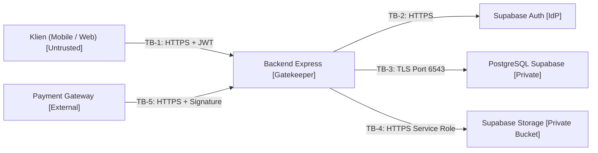

# Model Ancaman (`Security Threat Model — STRIDE`)

**Status:** `[RENCANA]` (analisis ancaman konseptual lintas 7 komponen; kontrol runtime bisnis belum diimplementasikan)  
**Metodologi:** **STRIDE** (*Spoofing, Tampering, Repudiation, Information Disclosure, Denial of Service, Elevation of Privilege*).

---

## 1. Diagram Trust Boundary Sistem

---

## 2. Analisis Ancaman STRIDE per Komponen

| ID | Komponen | Kategori STRIDE | Ancaman | Dampak | Kontrol | Status Kontrol | Sumber |
|---|---|---|---|---|---|---|---|
| **TM-01** | **Supabase Auth** | Spoofing | Token JWT palsu atau kedaluwarsa | Akses akun tidak sah | Verifikasi via `supabase.auth.getUser(token)` | `[ADA]` (`auth.middleware.ts`) | `authentication-and-authorization.md` |
| **TM-02** | **Supabase Auth** | Spoofing | Brute-force / kredensial curian | Pengambilalihan akun | Pesan error generik + rate limiting auth | `[RENCANA]` | `error-catalog.md` |
| **TM-03** | **Backend Express** | Tampering | Harga pesanan dimanipulasi klien | Kerugian finansial | Hitung `totalAmount` & `unitPrice` dari DB | `[RENCANA]` | `business-rules.md` |
| **TM-04** | **Backend Express** | Tampering | Bobot SAW dikirim/diubah klien | Peringkat rekomendasi bias | Tolak bobot klien; SAW backend-only | `[RENCANA]` (`ADR-0002` `[ADA]`) | `ADR-0002` |
| **TM-05** | **Backend Express** | Information Disclosure | `storagePath` terekspos di API publik | Kebocoran lokasi file privat | DTO publik mengecualikan `storagePath` | `[RENCANA]` | `security-guidelines.md` |
| **TM-06** | **Backend Express** | Information Disclosure | Stack trace & detail error DB bocor | Mempermudah eksploitasi | `errorHandler` sembunyikan stack trace | `[ADA]` (`error.middleware.ts`) | `error.middleware.ts` |
| **TM-07** | **Backend Express** | Information Disclosure | Pesan error membocorkan email terdaftar | User enumeration | Pesan error login generik | `[RENCANA]` | `error-catalog.md` |
| **TM-08** | **Backend Express** | Denial of Service | Request flood pada endpoint sensitif | Layanan lambat / down | `sensitiveEndpointLimiter` (`express-rate-limit`) | `[ADA]` file / `[RENCANA]` mount | `rate-limit.middleware.ts` |
| **TM-09** | **Backend Express** | Elevation of Privilege | `CUSTOMER` mengakses endpoint `/admin/*` | Akses fitur admin ilegal | `authorize('ADMIN')` di backend | `[ADA]` (`auth.middleware.ts`) | `app.ts` (`/admin/ping`) |
| **TM-10** | **Backend Express** | Elevation of Privilege | Pelanggan mengirim `role: "ADMIN"` saat sync/update | Eskalasi hak akses | Zod `.strict()` + tolak `role`/`isActive` | `[RENCANA]` | `FR-C02` |
| **TM-11** | **PostgreSQL Supabase** | Tampering | SQL Injection melalui parameter input | Manipulasi/pencurian data DB | Prisma ORM *parameterized queries* + Zod | `[ADA]` (Prisma & `validate.ts`) | `database-security.md` |
| **TM-12** | **PostgreSQL Supabase** | Information Disclosure | IDOR: pelanggan membaca order/akses user lain | Kebocoran data transaksi | Filter `userId = req.user.id` di semua endpoint | `[RENCANA]` | `security-guidelines.md` |
| **TM-13** | **PostgreSQL Supabase** | Repudiation | Penghapusan/perubahan catatan transaksi | Hilangnya jejak audit keuangan | `Transaction` immutable + `onDelete: Restrict` | `[ADA]` schema / `[RENCANA]` | `schema.prisma` |
| **TM-14** | **Supabase Storage** | Information Disclosure | Bucket PDF bersifat publik / URL permanen | Pembajakan e-book gratis | Bucket `ebooks-private` privat | `[ADA]` aturan / `[RENCANA]` prod | `AGENTS.md` |
| **TM-15** | **Supabase Storage** | Information Disclosure | Signed URL disebar & berlaku terlalu lama | Akses ilegal berkepanjangan | TTL pendek (`300` detik default) + cek `EbookAccess` | `[ADA]` helper / `[RENCANA]` endpoint | `supabase-storage.ts` |
| **TM-16** | **Supabase Storage** | Tampering | File PDF diganti pihak tidak berwenang | Konten rusak / malware | Upload hanya via admin terotorisasi | `[RENCANA]` | `FR-A04` |
| **TM-17** | **Payment Gateway** | Spoofing | Webhook palsu dari penyerang | Aktivasi akses e-book gratis | Verifikasi signature (`PAYMENT_GATEWAY_WEBHOOK_SECRET`) | `[RENCANA]` | `webhook-contract.md` |
| **TM-18** | **Payment Gateway** | Tampering | Nominal webhook dimanipulasi | Pelunasan kurang bayar | Cocokkan `amount == Payment.amount` | `[RENCANA]` | `webhook-contract.md` |
| **TM-19** | **Payment Gateway** | Repudiation | Webhook dikirim ulang berkali-kali | Transaksi & akses ganda | Idempotensi (`DUPLICATE_WEBHOOK`) + `@unique` | `[RENCANA]` | `webhook-contract.md` |
| **TM-20** | **Payment Gateway** | Denial of Service | Webhook flood | Beban DB tinggi | Rate limit + verifikasi signature cepat | `[RENCANA]` | `security-payment.md` |
| **TM-21** | **Klien (Mobile/Web)** | Information Disclosure | Token disimpan di storage tidak aman | Pencurian sesi pengguna | `flutter_secure_storage` (mobile) | `[RENCANA]` | `mobile/AGENTS.md` |
| **TM-22** | **Klien (Mobile/Web)** | Information Disclosure | Secret ditaruh di `VITE_*` / kode Flutter | Kebocoran `SERVICE_ROLE_KEY` | Larangan keras + audit pra-commit | `[ADA]` aturan | `AGENTS.md` |
| **TM-23** | **Klien (Mobile/Web)** | Tampering | Klien memodifikasi UI / hitung SAW lokal | Bypass menu / peringkat palsu | Otorisasi & SAW backend-only | `[ADA]` aturan | `AGENTS.md`, `ADR-0002` |
| **TM-24** | **SAW Service** | Tampering | Bobot tidak valid (`<=0` / total `!= 1.0`) | Peringkat SAW error / bias | Validasi bobot ketat (`SAW_CONFIGURATION_INVALID`) | `[RENCANA]` | `saw-backend-contract.md` |
| **TM-25** | **SAW Service** | Tampering | Pembagi nol menghasilkan `NaN`/`Infinity` | Crash / output korup | Guard pembagi nol di normalisasi SAW | `[RENCANA]` | `saw-edge-cases.md` |

---

## 3. Matriks Risiko Prioritas

| ID | Ancaman | Probabilitas | Dampak | Skor Risiko | Prioritas Mitigasi | Status |
|---|---|---|---|---|---|---|
| **TM-17** | Webhook palsu (tanpa signature) | Tinggi | Kritis | Kritis | **P1 (Wajib sebelum rilis)** | `[RENCANA]` |
| **TM-22** | Secret bocor di `VITE_*` / Flutter / Git | Sedang | Kritis | Kritis | **P1 (Wajib di setiap commit)** | `[ADA]` aturan |
| **TM-03** | Manipulasi harga checkout dari klien | Tinggi | Tinggi | Tinggi | **P1 (Wajib di Order Service)** | `[RENCANA]` |
| **TM-12** | IDOR pada order/payment/akses PDF | Tinggi | Tinggi | Tinggi | **P1 (Wajib di seluruh endpoint)** | `[RENCANA]` |
| **TM-08** | Request flood (tanpa rate limiter aktif) | Sedang | Tinggi | Tinggi | **P2 (Pasang `rate-limit.middleware.ts`)** | `[RENCANA]` |
| **TM-04** | Manipulasi bobot SAW oleh klien | Sedang | Sedang | Sedang | **P2 (Backend-only `ADR-0002`)** | `[RENCANA]` |
