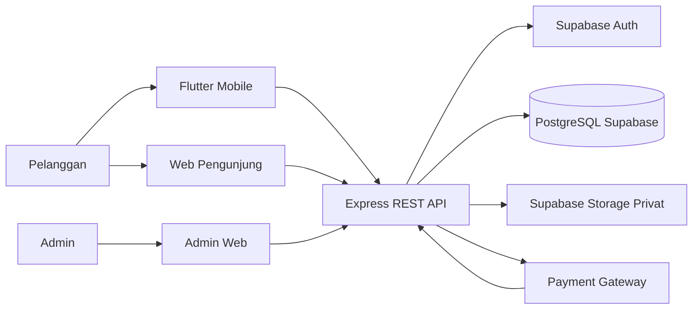

# Dokumentasi Proyek: Sistem Informasi E-Book dan SPK Berbasis Mobile (Metode SAW)

## A. Identitas Dokumen

- **Judul Proyek:** Sistem Informasi E-Commerce E-Book dan Sistem Pendukung Keputusan (SPK) Metode Simple Additive Weighting (SAW)
- **Status Proyek Keseluruhan:** `[RENCANA]` — fondasi monorepo, kerangka `backend/`, definisi `schema.prisma`, dan template klien sudah `[ADA]`; seluruh fitur bisnis, migrasi database, integrasi pembayaran, akses PDF privat, dan `SPK SAW` masih `[RENCANA]`.
- **Fungsi Dokumen:** Sumber kebenaran utama (*single source of truth*) dan indeks resmi status proyek.
- **Tanggal Pembaruan Terakhir:** 14 November 2026
- **Audiens Dokumen:** Dosen pembimbing/penilai akademik, pemilik proyek, tim pengembang (`backend`, `web`, `mobile`), QA, serta pihak nonteknis.

### Cara Membaca Status

| Label | Arti |
|---|---|
| `[ADA]` | Artefak, implementasi, atau pengujian telah tersedia dan dapat dibuktikan secara nyata di repository. |
| `[RENCANA]` | Belum diimplementasikan, masih dalam perancangan, atau masih membutuhkan keputusan final. |

---

## B. Ringkasan Eksekutif

- **Masalah yang Diselesaikan:** Pengelolaan katalog `e-book`, transaksi pembelian daring, perlindungan file PDF dari akses bebas, serta pemilihan rekomendasi `e-book` secara objektif dan konsisten.
- **Solusi yang Dibangun:** Sistem informasi e-commerce `e-book` berbasis arsitektur *Client–Server* terpusat dengan integrasi *payment gateway* nyata, **Supabase Auth**, penyimpanan PDF pada **Supabase Storage `bucket privat`**, serta mesin rekomendasi **SPK SAW** yang berjalan eksklusif di `backend/`.
- **Model Bisnis:** *Single-Seller B2C* (satu toko resmi menjual langsung ke pembeli; bukan *marketplace* multi-vendor, lihat [ADR-0001](./adr/0001-single-seller-b2c.md)).
- **Aktor Utama:** **Pelanggan** (*Customer*) dan **Admin**.
- **Platform Utama:** Aplikasi mobile Android (`mobile/ebook_store`), portal web pelanggan (`web/pengunjung-web`), dan aplikasi web administrasi (`web/admin-web`).
- **Peran Backend:** Menjadi pusat otorisasi (`JWT` + `RBAC`), validasi input (**Zod**), pengelolaan pesanan & *webhook* pembayaran idempoten, penerbitan `signed URL`, dan perhitungan `SPK SAW`.
- **Peran SAW:** Membantu **Pelanggan** memperoleh peringkat rekomendasi `e-book` berbasis kriteria terukur; perhitungan dikunci **hanya di `backend/`** ([ADR-0002](./adr/0002-backend-only-saw.md)).
- **Batasan Akses PDF:** File PDF disimpan di `bucket privat` dan hanya dapat dibaca di dalam aplikasi (*in-app PDF reader*) via `signed URL` sementara setelah `backend/` memvalidasi `EbookAccess` aktif.
- **Status Implementasi Umum:** Fondasi teknis `backend/` (`/api/v1/health`, `/api/v1/admin/ping`, middleware dasar, `schema.prisma`, dan 5 unit test Vitest) serta kerangka awal klien sudah `[ADA]`; seluruh modul bisnis masih `[RENCANA]`.

---

## C. Arsitektur Ringkas

**Penjelasan Prinsip Arsitektur:**
- Aplikasi klien (`Flutter Mobile`, `Web Pengunjung`, `Admin Web`) **tidak boleh** mengakses PostgreSQL atau `Supabase Storage Privat` secara langsung.
- `Express REST API` (`backend/`) menangani otorisasi peran, transaksi database atomik, perhitungan `SPK SAW`, dan penerbitan `signed URL` sementara.
- Storage file PDF bersifat **privat** (tidak ada unduhan publik bebas).
- *Payment gateway* hanya mengirimkan notifikasi status pembayaran ke `backend/` melalui *webhook* bertanda tangan yang tervalidasi.

---

## D. Status Implementasi Saat Ini

| Area | Status | Bukti atau Catatan | Dokumen Detail |
|---|---|---|---|
| **Fondasi Monorepo** | `[ADA]` | Struktur `backend/`, `web/`, `mobile/`, `docs/`, `.gitignore`, `AGENTS.md` | [`application-architecture.md`](./02-architecture/application-architecture.md) |
| **Backend Express** | `[ADA]` fondasi / `[RENCANA]` bisnis | `GET /api/v1/health`, `GET /api/v1/admin/ping`, env Zod, `error.middleware.ts` di `backend/src/` | [`api-overview.md`](./02-api/api-overview.md) |
| **Prisma & Schema Database** | `[ADA]` skema / `[RENCANA]` migrasi | `backend/prisma/schema.prisma` (8 model, 3 enum) valid `prisma validate`; `prisma/migrations/` belum ada | [`erd.md`](./01-design/erd.md) |
| **Autentikasi Supabase** | `[ADA]` keputusan & middleware dasar / `[RENCANA]` sinkronisasi DB | `auth.middleware.ts` memanggil `supabase.auth.getUser(token)`; sinkronisasi tabel `users` belum ada | [`authentication-and-authorization.md`](./02-api/authentication-and-authorization.md) |
| **Otorisasi Role (`RBAC`)** | `[ADA]` kerangka / `[RENCANA]` penuh | `authorize('ADMIN')` terpasang pada `/api/v1/admin/ping`; endpoint bisnis belum ada | [`authentication-and-authorization.md`](./02-api/authentication-and-authorization.md) |
| **Katalog & Kategori** | `[RENCANA]` | Belum ada router, service, maupun endpoint katalog/kategori | [`ebook-catalog.md`](./06-modules/ebook-catalog.md) |
| **Pembayaran** | `[RENCANA]` | Integrasi payment gateway nyata & *webhook* idempoten belum diimplementasikan | [`webhook-contract.md`](./02-api/webhook-contract.md) |
| **Storage PDF Privat** | `[ADA]` helper dasar / `[RENCANA]` endpoint | `backend/src/integrations/storage/supabase-storage.ts` tersedia; endpoint unggah & bucket privat belum teruji | [`ebook-access.md`](./06-modules/ebook-access.md) |
| **Akses Signed URL** | `[RENCANA]` | Endpoint `/api/v1/ebooks/{id}/access-url` dan cek `EbookAccess` belum ada | [`sequence-diagram.md`](./01-design/sequence-diagram.md) |
| **SPK SAW** | `[RENCANA]` | Fungsi SAW, validasi bobot, dan unit test SAW belum diimplementasikan | [`saw-method.md`](./03-saw/saw-method.md) |
| **Admin Web (`web/admin-web`)** | `[ADA]` template TS / `[RENCANA]` UI bisnis | Template Vite + React + TypeScript (`tsc --noEmit` & `lint` PASS); fitur admin belum dibuat | [`admin-dashboard.md`](./06-modules/admin-dashboard.md) |
| **Portal Pengunjung Web (`web/pengunjung-web`)** | `[ADA]` template & keputusan #1 / `[RENCANA]` UI bisnis | Template Vite + React (`lint` & `build` PASS); fitur pelanggan web belum dibuat | [`system-scope.md`](./01-project-overview/system-scope.md) |
| **Mobile Flutter (`mobile/ebook_store`)** | `[ADA]` template + paket / `[RENCANA]` fitur | `pubspec.yaml` memuat `flutter_riverpod`, `dio`, `flutter_secure_storage`; UI masih template | [`application-architecture.md`](./02-architecture/application-architecture.md) |
| **Dokumentasi API** | `[ADA]` rancangan OpenAPI 3.1 / `[RENCANA]` implementasi | `docs/02-api/` lengkap (OpenAPI 3.1, kontrak webhook, katalog error, keterlacakan) | [`api-spec.yaml`](./02-api/api-spec.yaml) |
| **Dokumentasi Desain** | `[ADA]` dokumen desain / `[RENCANA]` implementasi | `docs/01-design/` lengkap (Use Case, Activity, Sequence, Class, ERD, DFD, Component, Architecture) | [`design-traceability.md`](./01-design/design-traceability.md) |
| **Pengujian** | `[ADA]` tes fondasi / `[RENCANA]` tes bisnis | 2 file (5 tes) Vitest backend PASS; lint/build web PASS; `flutter analyze` & `flutter test` PASS | [`test-results.md`](./09-testing/test-results.md) |
| **Deployment** | `[RENCANA]` | Panduan konseptual tersedia; hosting backend menunggu Keputusan #10 | [`deployment.md`](./05-deployment/deployment.md) |
| **Audit Keamanan** | `[ADA]` aturan `.gitignore` / `[RENCANA]` audit runtime | Kontrol keamanan runtime belum dapat diverifikasi karena fitur bisnis masih `[RENCANA]` | [`security-overview.md`](./07-security/security-overview.md) |

---

## E. Indeks Dokumentasi Terstruktur

1. **Memahami Proyek:**
   - [`project-overview.md`](./01-project-overview/project-overview.md) — Latar belakang, tujuan, aktor, dan status aktual proyek (`[RENCANA]` / `[ADA]` fondasi).
   - [`project-plan.md`](./00-project/project-plan.md) — Peran tim 3 orang, tahapan kerja, milestone, dan mitigasi risiko (`[RENCANA]`).
   - [`stakeholder-analysis.md`](./01-project-overview/stakeholder-analysis.md) — Analisis pemangku kepentingan dan matriks komunikasi (`[ADA]` / `[RENCANA]`).
   - [`glossary.md`](./01-project-overview/glossary.md) — Kamus istilah resmi proyek (`[ADA]`).
2. **Memahami Kebutuhan & Ruang Lingkup:**
   - [`business-requirements.md`](./01-project-overview/business-requirements.md) — Kebutuhan bisnis terklasifikasi `BR-*` (`[RENCANA]`).
   - [`requirements.md`](./00-project/requirements.md) — Spesifikasi kebutuhan fungsional `FR-*` & non-fungsional `NFR-*` (`[RENCANA]`).
   - [`system-scope.md`](./01-project-overview/system-scope.md) — Batasan *in-scope*, *out-of-scope*, asumsi, dan kriteria penerimaan (`[ADA]` batasan / `[RENCANA]` fitur).
   - [`success-metrics.md`](./01-project-overview/success-metrics.md) & [`overview-traceability.md`](./01-project-overview/overview-traceability.md) — Indikator keberhasilan & keterlacakan bisnis (`[RENCANA]`).
3. **Memahami Desain Sistem (`01-design/`):**
   - [`use-case-diagram.md`](./01-design/use-case-diagram.md) & [`use-cases.md`](./01-design/use-cases.md) — Pemodelan aktor dan spesifikasi use case (`[RENCANA]`).
   - [`activity-diagram.md`](./01-design/activity-diagram.md), [`sequence-diagram.md`](./01-design/sequence-diagram.md), & [`dfd.md`](./01-design/dfd.md) — Alur proses, interaksi komponen, dan arus data (`[RENCANA]`).
   - [`class-diagram.md`](./01-design/class-diagram.md), [`component-diagram.md`](./01-design/component-diagram.md), [`data-flow.md`](./01-design/data-flow.md), [`design-traceability.md`](./01-design/design-traceability.md), & [`design-assumptions-and-gaps.md`](./01-design/design-assumptions-and-gaps.md) (`[ADA]` sebagian skema / `[RENCANA]` fitur).
4. **Memahami Arsitektur:**
   - [`architecture.md`](./01-design/architecture.md), [`system-architecture.md`](./02-architecture/system-architecture.md), [`application-architecture.md`](./02-architecture/application-architecture.md), & [`technology-stack.md`](./02-architecture/technology-stack.md) (`[ADA]` kerangka / `[RENCANA]` integrasi).
5. **Memahami Database:**
   - [`erd.md`](./01-design/erd.md) — Acuan ERD terbaru berbasis `schema.prisma` (`[ADA]` definisi model / `[RENCANA]` migrasi).
   - [`database-design.md`](./04-database/database-design.md), [`data-dictionary.md`](./04-database/data-dictionary.md), & [`04-database/erd.md`](./04-database/erd.md) — Rancangan awal (`[RENCANA]`, memiliki perbedaan penamaan tabel lama yang dicatat di `design-assumptions-and-gaps.md`).
6. **Memahami API:**
   - [`api-spec.yaml`](./02-api/api-spec.yaml), [`api-overview.md`](./02-api/api-overview.md), [`authentication-and-authorization.md`](./02-api/authentication-and-authorization.md), [`api-conventions.md`](./02-api/api-conventions.md), [`error-catalog.md`](./02-api/error-catalog.md), [`webhook-contract.md`](./02-api/webhook-contract.md), & [`api-traceability.md`](./02-api/api-traceability.md) (`[ADA]` `/health` & `/admin/ping` / `[RENCANA]` 27 path bisnis).
   - [`05-api/api-overview.md`](./05-api/api-overview.md) & [`05-api/api-endpoints.md`](./05-api/api-endpoints.md) — Rancangan API tahap awal (`[RENCANA]`).
7. **Memahami Proses Bisnis:**
   - [`customer-workflow.md`](./03-business-process/customer-workflow.md), [`admin-workflow.md`](./03-business-process/admin-workflow.md), & [`transaction-workflow.md`](./03-business-process/transaction-workflow.md) (`[RENCANA]`).
8. **Memahami SAW:**
   - [`saw-method.md`](./03-saw/saw-method.md) & [`perhitungan-manual.md`](./03-saw/perhitungan-manual.md) (`[RENCANA]` — kerangka metode & dataset manual).
9. **Memahami Modul Aplikasi (`06-modules/`):**
   - [`authentication.md`](./06-modules/authentication.md), [`ebook-catalog.md`](./06-modules/ebook-catalog.md), [`order-management.md`](./06-modules/order-management.md), [`payment-management.md`](./06-modules/payment-management.md), [`ebook-access.md`](./06-modules/ebook-access.md), & [`admin-dashboard.md`](./06-modules/admin-dashboard.md) (`[RENCANA]`).
10. **Menjalankan Proyek (`08-development/`):**
    - [`installation.md`](./08-development/installation.md), [`development-guide.md`](./08-development/development-guide.md), [`environment-configuration.md`](./08-development/environment-configuration.md), & [`coding-conventions.md`](./08-development/coding-conventions.md) (`[ADA]` panduan setup).
11. **Menguji Proyek (`09-testing/` & `04-testing/`):**
    - [`testing-strategy.md`](./09-testing/testing-strategy.md), [`test-cases.md`](./09-testing/test-cases.md), [`test-results.md`](./09-testing/test-results.md) (`[ADA]` hasil cek fondasi), serta [`04-testing/test-report.md`](./04-testing/test-report.md).
12. **Melakukan Audit Keamanan (`07-security/`):**
    - [`security-overview.md`](./07-security/security-overview.md) & [`security-guidelines.md`](./07-security/security-guidelines.md) (`[RENCANA]` kontrol runtime / `[ADA]` pedoman).
13. **Melakukan Deployment & Pemeliharaan:**
    - [`deployment.md`](./05-deployment/deployment.md), [`maintenance-guide.md`](./10-maintenance/maintenance-guide.md), & [`troubleshooting.md`](./10-maintenance/troubleshooting.md) (`[RENCANA]` / panduan operasional).
14. **Memahami Keputusan Arsitektur:**
    - [`0001-single-seller-b2c.md`](./adr/0001-single-seller-b2c.md), [`0002-backend-only-saw.md`](./adr/0002-backend-only-saw.md), [`0003-admin-web-sebelum-mobile.md`](./adr/0003-admin-web-sebelum-mobile.md), & [`keputusan-terbuka.md`](./00-project/keputusan-terbuka.md).

---

## F. Roadmap Pengembangan (Urutan Terkunci)

Mengacu pada [ADR-0003](./adr/0003-admin-web-sebelum-mobile.md) dan [`project-plan.md`](./00-project/project-plan.md):

| Fase | Tujuan | Output Utama | Ketergantungan | Kriteria Selesai | Status |
|---|---|---|---|---|---|
| **Fase 0 — Fondasi** | Menyiapkan struktur monorepo, skema awal, dan kerangka aplikasi. | Express + Zod + `schema.prisma`, 5 unit test, template Vite & Flutter. | — | `typecheck`, `lint`, `build`, `prisma:validate`, dan tes dasar PASS. | `[ADA]` |
| **Fase 1 — Backend** | Membangun seluruh REST API, migrasi DB, integrasi Supabase/Gateway, dan `SPK SAW`. | Migrasi Prisma, endpoint auth/katalog/order/webhook/`signed URL`/SAW/admin. | Penguncian keputusan terbuka #5–#7, #9, #11. | Seluruh unit & integration test backend PASS + uji konektivitas DB berhasil. | `[RENCANA]` |
| **Fase 2 — Admin Web** | Menyediakan antarmuka operasional **Admin** bergaya Neo-Brutalism. | `web/admin-web` terhubung penuh ke API backend nyata. | Fase 1 selesai & teruji. | Admin dapat CRUD katalog/PDF & pantau transaksi; `lint` & `build` PASS. | `[RENCANA]` |
| **Fase 3 — Mobile & Web Pengunjung** | Menyediakan aplikasi **Pelanggan** di Android (`ebook_store`) dan web (`pengunjung-web`). | Autentikasi, katalog, rekomendasi SAW, checkout, bayar, *in-app PDF reader*. | Fase 1 & Fase 2 (data katalog nyata) siap. | Alur *end-to-end* beli hingga baca PDF lulus; `flutter analyze` & `test` PASS. | `[RENCANA]` |
| **Fase 4 — Pengujian Terpadu, Keamanan & Deployment** | Memverifikasi kualitas, keamanan, dan kesiapan rilis sistem. | Laporan uji `test-cases.md`, audit secret/RBAC/PDF privat, konfigurasi deploy. | Fase 1–3 selesai + Keputusan #10. | Nol kebocoran secret, seluruh skenario `test-cases.md` lulus. | `[RENCANA]` |

---

## G. Aturan Kritis Proyek (`[ADA]` pada `AGENTS.md`)

1. **SAW hanya di backend:** Klien dilarang menghitung skor akhir SAW atau mengirim bobot mentah yang dipercaya server.
2. **Otorisasi di backend:** Token `JWT` dan `UserRole` diverifikasi di `backend/`; menyembunyikan menu di UI hanya kosmetik.
3. **Bucket PDF privat & `signed URL` sementara:** File PDF dilarang diletakkan di bucket publik; akses hanya via `signed URL` TTL singkat setelah validasi `EbookAccess`.
4. **Tidak ada secret pada repository:** Dilarang commit `.env` atau menaruh secret di variabel `VITE_*` maupun kode Flutter.
5. **Data simulasi wajib berlabel:** Setiap data placeholder wajib diberi label `"DATA SIMULASI"`.
6. **Status dokumentasi konsisten & jujur:** Fitur tidak boleh diklaim `[ADA]` sebelum implementasi dan pengujiannya benar-benar dijalankan.
7. **Urutan pengerjaan terkunci:** `Backend -> Admin Web -> Mobile`.

---

## H. Keputusan Terbuka dan Risiko

Ringkasan keputusan yang masih `[RENCANA]` (rincian lengkap tersedia di [`keputusan-terbuka.md`](./00-project/keputusan-terbuka.md)):

| ID | Topik | Dampak Utama | Status | Dokumen Detail |
|---|---|---|---|---|
| **#5** | Pengubahan bobot SAW oleh pelanggan | Menentukan apakah API rekomendasi menerima pilihan preset bobot atau terkunci oleh Admin. | `[RENCANA]` | [`keputusan-terbuka.md`](./00-project/keputusan-terbuka.md) |
| **#6 & #7** | Ulasan, rating, & e-book tanpa rating | Menentukan penambahan model `Review` di Prisma dan aturan normalisasi `ratingAvg = 0`. | `[RENCANA]` | [`keputusan-terbuka.md`](./00-project/keputusan-terbuka.md) |
| **#8** | Identitas & logo final aplikasi | Memengaruhi penamaan tampilan UI pada `admin-web`, `pengunjung-web`, dan `ebook_store`. | `[RENCANA]` | [`keputusan-terbuka.md`](./00-project/keputusan-terbuka.md) |
| **#9** | Konflik 4 vs 5 kriteria SAW | **Kritis:** Menentukan kriteria final, bobot, perhitungan manual, dan unit test backend. | `[RENCANA]` | [`keputusan-terbuka.md`](./00-project/keputusan-terbuka.md) |
| **#10** | Platform hosting backend | Memengaruhi manajemen koneksi Prisma/PostgreSQL dan stabilitas *webhook*. | `[RENCANA]` | [`keputusan-terbuka.md`](./00-project/keputusan-terbuka.md) |
| **#11** | Penyimpanan riwayat rekomendasi SAW | Menentukan perlu tidaknya tabel snapshot historis SAW di `schema.prisma`. | `[RENCANA]` | [`keputusan-terbuka.md`](./00-project/keputusan-terbuka.md) |
